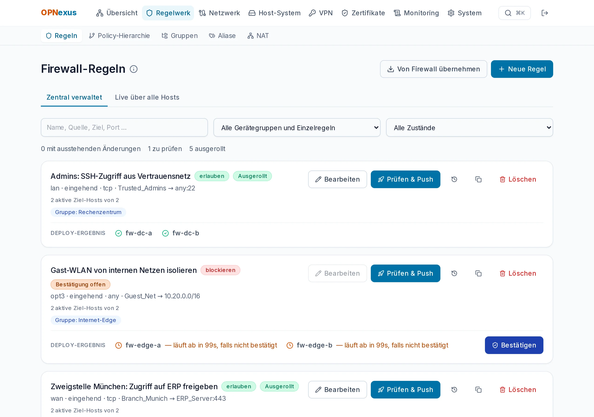

# OPNexus

**Alle OPNsense-Firewalls. Eine Konsole.**
Zentrale Verwaltung mehrerer [OPNsense](https://opnsense.org)-Firewalls: Regeln, Aliase, NAT, VPN, Zertifikate, Logs und Updates — per OPNsense-API ausgerollt, mit Vorschau, Bestätigung und automatischem Rollback.

[Website](https://opnexus.dev/) · [Changelog](CHANGELOG.md) · [Handbuch](docs/HANDBUCH.md) · [English](README.md)



> **Stand:** `1.23.10` ist die aktuelle stabile Version. Entwickelt und getestet wurde gegen echte OPNsense-Instanzen; eine frische Installation aus dem Release-Bundle sowie Updates und Rollbacks sind durchgängig geprüft. Ecken und Kanten bitte melden.

## Funktionen

- **Flotte & Hochverfügbarkeit** — Live-Status aller Hosts, CARP-Rollen nebeneinander, Ereignis-Historie, Alarm bei Split-Brain oder fehlendem MASTER, Wartungsmodus mit optionalem Auto-Revert-Timer.
- **Regeln, Aliase & NAT** — zentral gepflegt, gezielt auf Hosts oder Gerätegruppen ausgerollt; Port-Forward, 1:1- und Outbound-NAT mit Drift-Erkennung zwischen Cluster-Knoten.
- **Sichere Änderungen** — jede Änderung läuft *Prüfen → Ausrollen → Bestätigen*; bleibt die Bestätigung im Zeitfenster aus, rollt OPNexus zurück.
- **Hierarchische Policies** — Pre-/Post-Rulebases mit Vererbung über Gruppenbäume.
- **VPN** — IPsec-Site-to-Site, OpenVPN und WireGuard, einmal definiert und ausgerollt.
- **Netzwerk** — Schnittstellen, VLANs, virtuelle IPs, Gateways, Routen, LAGG/Bridge/GRE, DNS und DHCP je Firewall, dazu Tunables, Cron, Syslog, Snapshots und Diagnose (Ping, Traceroute, Port-Prüfung, DNS), ein Abgleich der Cluster-Knoten, mit Diff-Vorschau, Backup vor jeder Änderung und Schutz davor, die eigene Verbindung zu kappen; von Hand angelegte Regeln lassen sich übernehmen.
- **Zertifikate** — Trust-Store für alle Firewalls und Ausstellung per ACME / Let's Encrypt.
- **Logs & Audit** — zentrale Log-Suche mit Korrelation, Dashboards und lückenloser Deploy-Verlauf.
- **Update-Center** — Firmware-Updates für die Flotte, mit Blick auf HA-Reihenfolge und Wartungsmodus.
- **Einrichtungsassistent** — geführter Erststart nach der Installation: eigenes Passwort, Zwei-Faktor und die erste Firewall verbinden.
- **Selbst-Update** — OPNexus aktualisiert sich auf Wunsch aus der eigenen Oberfläche, mit Fortschritt und automatischem Rollback (optional).
- **Automatisierung** — persönliche API-Tokens (Lesen / Ausrollen / Admin), Prometheus-Metriken, ein nur lesender MCP-Endpunkt für KI-Assistenten und ein OpenAPI-Schema.
- **Sicherheitslage** — ein Wert von 0 bis 100 je Firewall aus Härtungs- und Regel-Hygiene-Prüfungen (offene WAN-Regeln, schwaches SSH/SNMP, verdeckte Regeln, alte Backups …), nur lesend.
- **Backups & Wiederherstellung** — geplante Konfigurationssicherungen mit Aufbewahrung, verschlüsselte Offsite-Kopie auf S3-kompatiblen Speicher, Änderungsansicht zwischen Sicherungen und eine vollständige verschlüsselte Sicherung von OPNexus selbst (`opnexus backup --full`).
- **Single Sign-on** — Anmeldung über deinen Identitätsanbieter (OIDC); die Rolle kommt bei jeder Anmeldung aus dessen Gruppen.
- **Zugang** — HTTPS mit gepinnten Firewall-Zertifikaten, optionale Zwei-Faktor-Anmeldung, Rollen (Admin / Operator / Nur-Lesen), Tastaturbedienung, Dark Mode, Oberfläche auf Deutsch und Englisch.

Alle Screenshots zeigen fiktive Beispieldaten.

## Ratgeber

- [OPNsense-Firewalls zentral verwalten](https://opnexus.dev/opnsense-zentral-verwalten/) – wann sich zentrale Verwaltung lohnt und wie sie funktioniert
- [OPNsense-HA-Cluster mit CARP verwalten](https://opnexus.dev/opnsense-ha-cluster-carp/) – Rollen, Alarme, geordnete Updates, Abgleich beider Knoten
- [OPNsense-Regeln sicher ausrollen](https://opnexus.dev/opnsense-regeln-sicher-ausrollen/) – Vorschau, Bestätigungsfenster und automatischer Rollback
- [Das Kommandozeilen-Werkzeug `opnexus`](https://opnexus.dev/docs/cli/) – Installation aktualisieren, zurückrollen und sichern

## Schnellstart

Voraussetzung: Docker mit Compose-Plugin.

```bash
git clone https://git.opnexus.dev/opnexus/opnexus.git
cd opnexus
cp .env.example .env        # POSTGRES_PASSWORD (und ADMIN_PASSWORD) setzen
docker compose up -d --build
```

Die Oberfläche läuft dann unter `http://localhost:3100`. Ohne `ADMIN_PASSWORD` wird beim ersten Start ein zufälliges Admin-Passwort erzeugt und **einmalig** im Backend-Log ausgegeben. Verloren oder nie gesehen? Dieses Kommando setzt ein neues Zufallspasswort und zeigt es an (im Repo-Checkout `scripts/opnexus`, im Release-Bundle `./opnexus`):

```bash
scripts/opnexus password
```

Nach der ersten Anmeldung öffnet sich von selbst ein kurzer **Einrichtungsassistent**: eigenes Passwort setzen, optional Zwei-Faktor-Anmeldung einschalten, die erste Firewall verbinden (samt Anleitung für den API-Key in OPNsense). Er lässt sich überspringen und jederzeit unter System › Einrichtung wieder öffnen.

Für den Zugriff von anderen Rechnern und den Produktivbetrieb mit TLS (mitgelieferter Caddy-Proxy) siehe das [Handbuch](docs/HANDBUCH.md#zugriff-aus-dem-netz-und-tls).

**Fertige Images** (amd64) liegen in der Registry dieses Gitea. In der `.env`:

```bash
OPNEXUS_IMAGE_REPO=git.opnexus.dev/opnexus
OPNEXUS_VERSION=1.23.10
```

```bash
docker compose pull && docker compose up -d --no-build
```

Aktualisiert wird danach mit `scripts/opnexus update` / `rollback` (erst ziehen, vor Migrationen ein Datenbank-Backup, automatisches Zurückrollen, wenn die Dienste nicht gesund werden).

## Datenschutz

OPNexus wird selbst betrieben und hat keine Telemetrie. Es verbindet sich nur mit deinen Firewalls und mit Benachrichtigungszielen, die du selbst einrichtest. Der optionale Hinweis auf neue Versionen (Schalter unter Einstellungen › OPNexus aktualisieren, oder `UPDATE_CHECK_URL` in der `.env`) ist **aus**, solange du ihn nicht einschaltest; eingeschaltet geht höchstens alle 12 Stunden ein einfaches `GET` mit dem User-Agent `OPNexus/<Version>` hinaus — ohne Instanz- oder Nutzerdaten.

## Lizenz

OPNexus ist **quelloffen einsehbar (source-available)** unter der [PolyForm Shield License 1.0.0](LICENSE) — es ist *keine* Open-Source-Software im Sinne der OSI. Du darfst den Code herunterladen, lesen, verändern und nutzen, auch in einem Unternehmen für die eigenen Firewalls. Nicht erlaubt ist, damit ein konkurrierendes Produkt anzubieten (etwa Weiterverkauf oder Betrieb als gehosteter Dienst). Maßgeblich ist der Lizenztext.

## Sicherheit

Sicherheitslücken bitte vertraulich an **security@opnexus.dev** melden, siehe [SECURITY.md](SECURITY.md).

---

OPNexus ist ein unabhängiges Projekt und steht in keiner Verbindung zu Deciso B.V. oder dem OPNsense®-Projekt. OPNsense® ist eine Marke von Deciso B.V.
