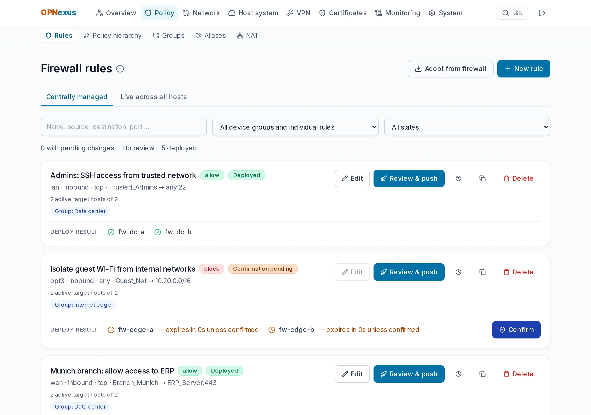
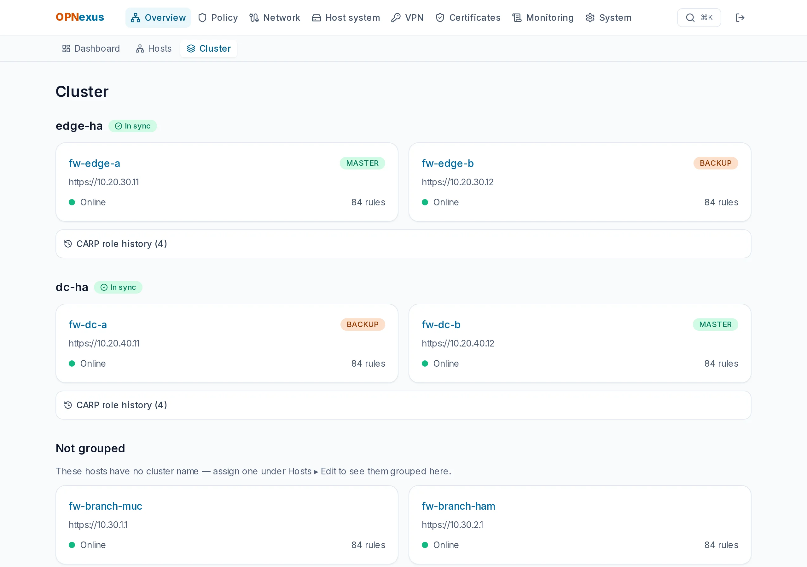

# OPNexus

**All your OPNsense firewalls. One console.**
Central management for multiple [OPNsense](https://opnsense.org) firewalls: rules, aliases, NAT, VPN, certificates, logs and updates — rolled out through the OPNsense API with preview, confirmation and automatic rollback.

[Website](https://opnexus.dev) · [Changelog](CHANGELOG.md) · [Handbook (German)](docs/HANDBUCH.md) · [Deutsch](README.de.md)



> **Status:** `1.27.0` is the current stable release. It has been developed and tested against real OPNsense instances; a clean install from the release bundle, updates and rollbacks have been verified end to end. Please report rough edges.

## What it does

- **Fleet & high availability** — live status of all hosts, CARP roles side by side, event history, alerts for split-brain or a missing MASTER, maintenance mode with an optional auto-revert timer.
- **Rules, aliases & NAT** — maintained centrally, rolled out to single hosts or device groups; port forward, 1:1 and outbound NAT with drift detection between cluster nodes.
- **Safe changes** — every change goes *preview → deploy → confirm*; without your confirmation inside the time window OPNexus rolls it back.
- **Hierarchical policies** — pre/post rulebases with inheritance across group trees.
- **VPN** — IPsec site-to-site, OpenVPN and WireGuard, defined once and rolled out.
- **Network** — interfaces, VLANs, virtual IPs, gateways, routes, LAGG/bridge/GRE, DNS and DHCP per firewall, plus tunables, cron, syslog, snapshots and diagnostics (ping, traceroute, port check, DNS), a comparison of cluster nodes, with a diff preview, a backup before every change and a guard against cutting your own connection; rules, aliases and NAT rules created by hand on a firewall can be adopted.
- **Certificates** — trust store for all firewalls and ACME / Let's Encrypt issuance.
- **Alerts** — gateway/WAN outage (down, packet loss, latency), disk/memory/swap/CPU thresholds and stopped services, debounced over several measurements so spikes and flapping links stay quiet; delivered by email, webhook, ntfy, Gotify, Telegram, Microsoft Teams or Matrix, all switchable per event.
- **Firewall interface through OPNexus** — open a firewall's own web interface in a separate browser tab through OPNexus, even behind NAT; admins only, one-time ticket, isolated origin, time limits and audit (off by default).
- **Logs & audit** — central log search with correlation, dashboards and a complete deploy audit trail.
- **Update center & rollouts** — firmware updates for the fleet, aware of HA order and maintenance mode; rollouts in waves (canary → pilot → prod) with recurring maintenance windows, a health gate between the waves and an automatic stop on anything unusual.
- **Setup assistant** — a guided first run after installation: your own password, two-factor, and connecting the first firewall.
- **Self-update** — OPNexus can update itself from its web interface, with progress and automatic rollback (opt-in).
- **Automation** — personal API tokens (read / deploy / admin), Prometheus metrics, a read-only MCP endpoint for AI assistants and an OpenAPI schema.
- **Security posture** — a 0–100 score per firewall from hardening and rule-hygiene checks (open WAN rules, weak SSH/SNMP, shadowed rules, stale backups …), read-only.
- **Rule analysis** — "Which rule matches?" for a source, destination, protocol and port: the deciding rule per firewall (or fleet/group) with an honest confidence (sure / probable / unknown) and a rule-by-rule trace, read-only.
- **Backups & recovery** — scheduled config backups with retention, an encrypted offsite copy to S3-compatible storage, a redacted change view between backups, and a full encrypted backup/restore of OPNexus itself (`opnexus backup --full`).
- **Single sign-on** — sign in with your identity provider (OIDC); roles come from its groups at every login.
- **Access** — HTTPS with pinned firewall certificates, optional two-factor sign-in, roles (admin / operator / read-only), keyboard operation, dark mode, German and English UI.



All screenshots show fictitious sample data.

## Guides

- [Manage OPNsense firewalls centrally](https://opnexus.dev/en/manage-opnsense-centrally/) – when central management pays off and how it works
- [Manage OPNsense HA clusters with CARP](https://opnexus.dev/en/opnsense-ha-cluster-carp/) – roles, alerts, ordered updates, comparing both nodes
- [Roll out OPNsense rules safely](https://opnexus.dev/en/roll-out-opnsense-rules-safely/) – preview, confirmation window and automatic rollback
- [The `opnexus` command-line tool](https://opnexus.dev/en/docs/cli/) – update, roll back and back up an installation

## Quick start

Requires Docker with the Compose plugin.

```bash
git clone https://git.opnexus.dev/opnexus/opnexus.git
cd opnexus
cp .env.example .env        # set POSTGRES_PASSWORD (and ADMIN_PASSWORD)
docker compose up -d --build
```

The UI is then available at `http://localhost:3100`. Without `ADMIN_PASSWORD` a random admin password is generated on first start and printed **once** in the backend log. Lost it, or never saw it? This sets a new random one and prints it (use `scripts/opnexus` in a repo checkout, `./opnexus` in the release bundle):

```bash
scripts/opnexus password
```

After the first sign-in a short **setup assistant** opens on its own: set your own password, optionally enable two-factor sign-in, connect your first firewall (including how to create the API key in OPNsense). You can skip it and reopen it any time under System › Setup.

For access from other machines and for production use with TLS (bundled Caddy proxy), see the [handbook](docs/HANDBUCH.md#zugriff-aus-dem-netz-und-tls) (German).

**Prebuilt images** (amd64 and arm64) are published to this Gitea's registry. In `.env`:

```bash
OPNEXUS_IMAGE_REPO=git.opnexus.dev/opnexus
OPNEXUS_VERSION=1.27.0
```

```bash
docker compose pull && docker compose up -d --no-build
```

`scripts/opnexus update` / `rollback` then update the installation (pull first, database backup before migrations, automatic rollback if the services do not become healthy).

**Updating from the web interface** is available as an opt-in: set `COMPOSE_PROFILES=updater` in `.env` and an administrator can update (and roll back) under *Settings › Update OPNexus*. It runs as a separate small container that is the only one with Docker access — see the [handbook](docs/HANDBUCH.md#update-aus-dem-webinterface-optional) (German) for the security model.

## Privacy

OPNexus is self-hosted and has no telemetry. It only connects to your firewalls and to notification targets you configure yourself. The optional new-version notice (switch under Settings › Update OPNexus, or `UPDATE_CHECK_URL` in the `.env`) is **off** unless you turn it on; when on, it makes one plain `GET` at most every 12 hours with the user agent `OPNexus/<version>` — no instance or user data.

## License

OPNexus is **source-available** under the [PolyForm Shield License 1.0.0](LICENSE) — it is *not* open source in the OSI sense. You may download, read, modify and use it, including inside a company for its own firewalls. You may not use it to provide a product that competes with OPNexus (for example reselling it or offering it as a hosted service). The license text is authoritative.

## Security

Please report vulnerabilities privately to **security@opnexus.dev**, see [SECURITY.md](SECURITY.md).

---

OPNexus is an independent project and is not affiliated with Deciso B.V. or the OPNsense® project. OPNsense® is a trademark of Deciso B.V.
