> **Handbuch.** Ausführliche Feature- und Betriebsdokumentation (Deutsch), chronologisch gewachsen.
> Kurzüberblick und Schnellstart: [README](../README.md). Verweise auf `docs/verification*` und
> `docs/HANDOFF-*` meinen interne Verifikationsnachweise, die nicht veröffentlicht werden.

# OPNexus

Zentrale Verwaltung mehrerer OPNsense-Firewalls: Fleet-/HA-Status (CARP
MASTER/BACKUP), zentral gepflegte Firewall-Regeln (Push per API statt
OPNsense-eigenem HA-Config-Sync), Firewall-Logs.

Eigenständiges Projekt unter `/opt/opnexus/` — komplett
getrennt vom bestehenden InfraPanel (eigenes Docker-Compose-Projekt
`opnexus`, eigenes Netzwerk, eigene Ports, kein Traefik).

**Auf einen Blick:** Fleet-Dashboard mit offenen Aktionen, Sicherheits-
Warnungen und Aktivitäts-Feed · zentrale Firewall-Regeln, Aliase und NAT mit
Preview→Deploy→Confirm-Workflow und automatischem Rollback-Fenster ·
hierarchische Pre-/Post-Policies mit Vererbung · CARP/HA inkl.
Ereignis-Historie, Split-Brain-Alarm und optionalem Auto-Revert-Timer ·
IPsec-, OpenVPN- und WireGuard-VPN-Management · Zertifikats-Trust-Store und
ACME/Let's-Encrypt-Ausstellung · zentrale Log-Suche mit Korrelation und
Dashboards · lückenloser Deploy-Audit-Verlauf · Fleet-Update-Center inkl.
Major-Upgrades und CARP-Wartungsmodus · Rollen (Admin/Nur-Lese), Dark Mode
und ein eigenes Versionsschema mit Codenamen (siehe
[CHANGELOG.md](../CHANGELOG.md)).

Alle Screenshots unten sind mit fiktiven, in der Anwendung selbst
erzeugten Beispieldaten aufgenommen (kein Bezug zur echten Produktivflotte)
— Details und Verifikationsnachweise zu jedem Feature stehen in den
chronologischen Abschnitten weiter unten in diesem Dokument.

## Lizenz

OPNexus steht unter der **PolyForm Shield License 1.0.0** (siehe
[LICENSE](../LICENSE)). Das ist eine *source-available*-Lizenz, **keine**
Open-Source-Lizenz im Sinne der OSI:

- **Erlaubt:** kostenlos herunterladen, Quellcode ansehen, für eigene Zwecke
  anpassen und einsetzen — auch geschäftlich, z. B. in einer Firma für die
  eigenen Firewalls.
- **Nicht erlaubt:** OPNexus oder Ableitungen als Produkt oder Dienst
  anzubieten oder weiterzuverkaufen, das mit OPNexus konkurriert (auch nicht
  kostenlos).
- Der Lizenzgeber (Julian Boldt) ist an diese Einschränkung nicht gebunden und
  darf OPNexus selbst vertreiben und verkaufen.

Frühere Stände, die bereits unter der AGPL-3.0 veröffentlicht wurden, bleiben
für alle, die sie erhalten haben, unter dieser Lizenz. Diese Zusammenfassung
ersetzt nicht den Lizenztext.

```
Required Notice: Copyright 2026 Julian Boldt (https://opnexus.dev)
```

## Features

### Dashboard

Fleet-Startseite (`/dashboard`, seit 2026-09-14 das Ziel von `/` und des
Post-Login-Redirects): offene Aktionen (ausstehende Bestätigungen/Fehler
über Regeln, NAT, Policy-Hierarchie und laufende CARP-Wartungsfenster),
Fleet-/CARP-Gesundheit, Sicherheits- und Ablauf-Warnungen (Zertifikate,
Regel-/NAT-Drift, verfügbare Updates) sowie ein Aktivitäts-Feed der letzten
Audit-Ereignisse.

### Fleet-Übersicht & Hochverfügbarkeit

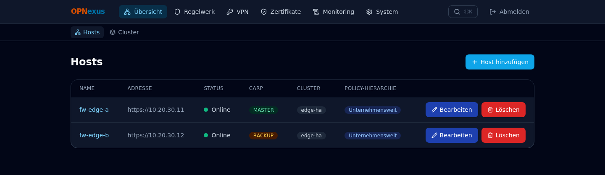

Zentrale Liste aller verwalteten OPNsense-Hosts mit Live-Status, CARP-Rolle,
Cluster- und Policy-Hierarchie-Zugehörigkeit.

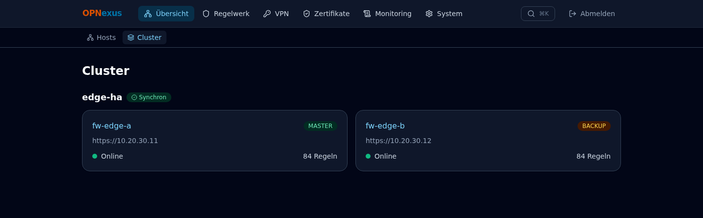

HA-Paare werden automatisch anhand des Cluster-Namens gruppiert; zeigt
MASTER/BACKUP-Rollen nebeneinander, markiert Regel- und NAT-Drift zwischen
den Knoten, führt eine einsehbare CARP-Ereignis-Historie pro Cluster und
alarmiert bei Split-Brain oder fehlendem MASTER. Der CARP-Wartungsmodus
kann optional mit einem Auto-Revert-Timer (15/30/60 Minuten oder dauerhaft)
versehen werden.

### Firewall-Regelwerk

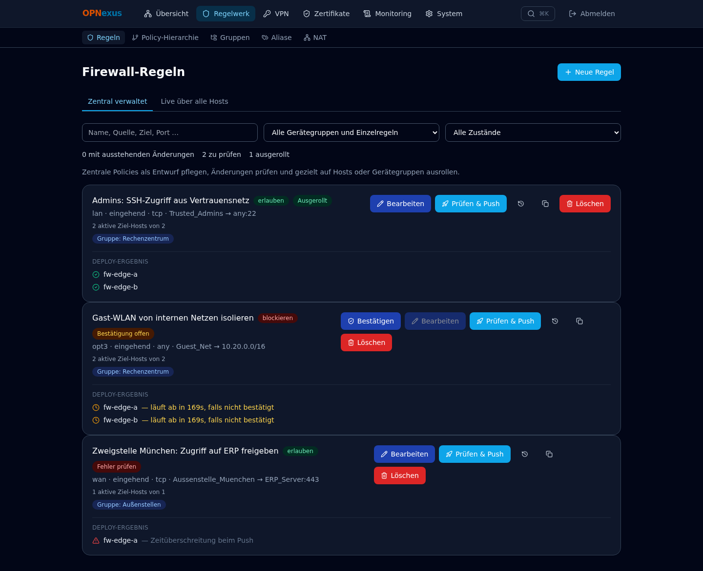

Zentral gepflegte Firewall-Regeln, gezielt auf Hosts oder Gerätegruppen
ausgerollt — mit Preview→Deploy→Confirm-Flow, Änderungs-/Deploy-Status pro
Ziel-Host und automatischem Rollback-Fenster bei ausbleibender Bestätigung.

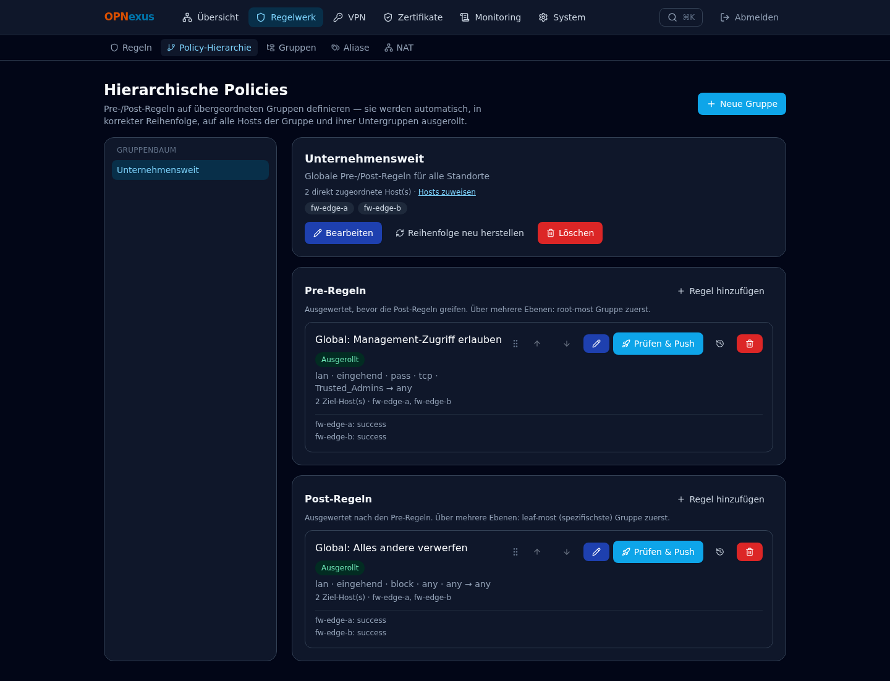

Pre-/Post-Rulebases mit Vererbung über Gruppenbäume: eine auf einer
übergeordneten Gruppe gepflegte Regel rollt automatisch, in korrekter
Reihenfolge, auf alle zugehörigen Hosts aus.

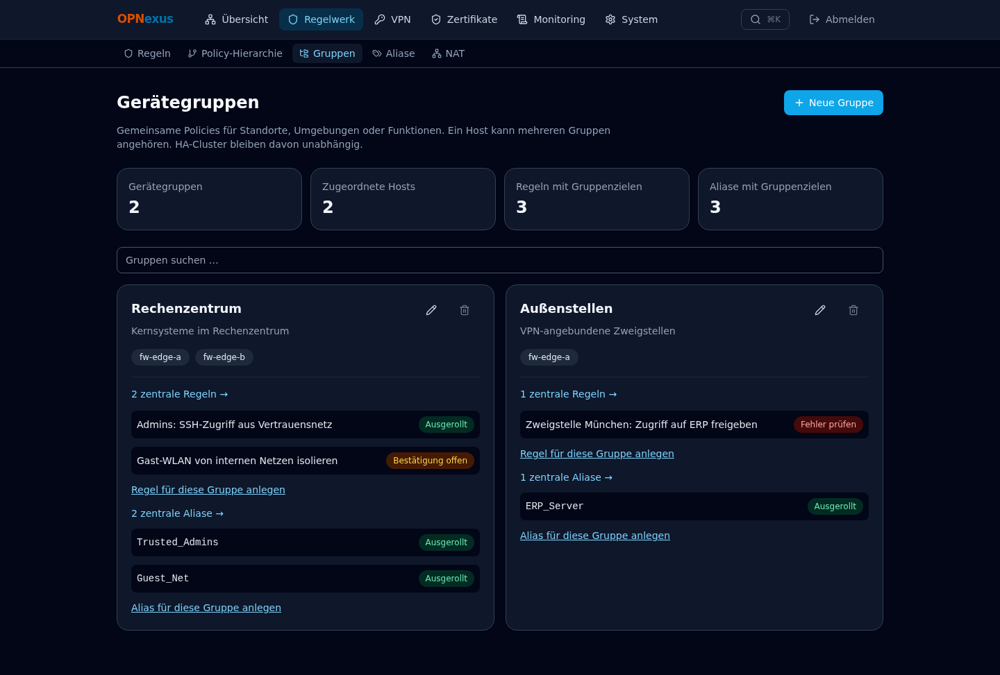

Gerätegruppen bündeln Hosts für gezieltes Deployment von Regeln, Aliasen
und NAT — ein Ziel, viele Hosts.

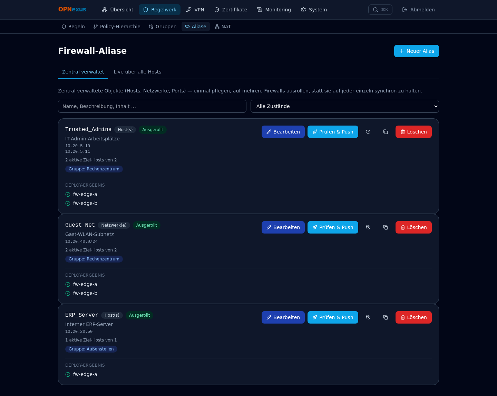

Netzwerk-Objekte (Host/Netz/Port/Gruppe/MAC/ASN) zentral gepflegt, gleicher
Deploy-Workflow und gleiche Rollback-Absicherung wie Firewall-Regeln.

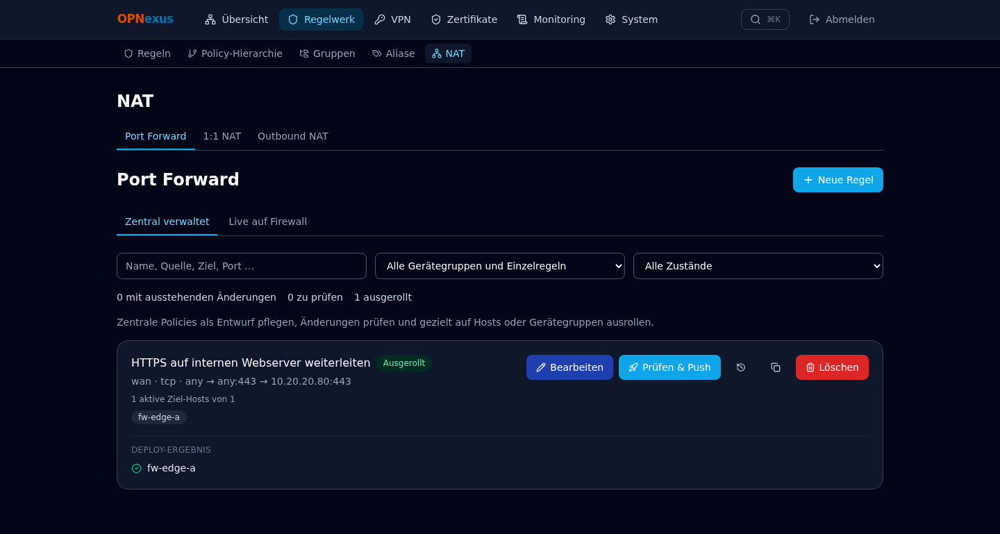

Port Forward, 1:1 NAT und Outbound NAT zentral verwaltet, inklusive
Live-Ansicht der tatsächlich auf der Firewall aktiven Regeln.

### VPN-Management

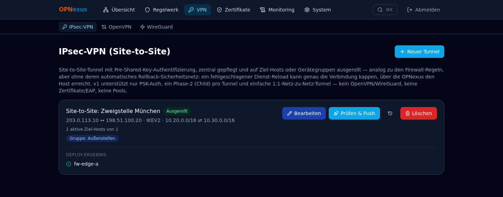

Site-to-Site-Tunnel mit Pre-Shared-Key-Authentifizierung, zentral gepflegt
und auf Ziel-Hosts oder Gerätegruppen ausgerollt.

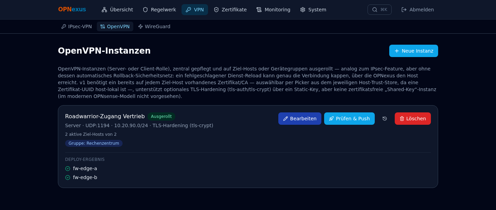

Server- und Client-Instanzen inklusive optionalem TLS-Auth/TLS-Crypt-
Hardening, mit host-lokalem Zertifikat-/CA-Picker pro Ziel-Host.

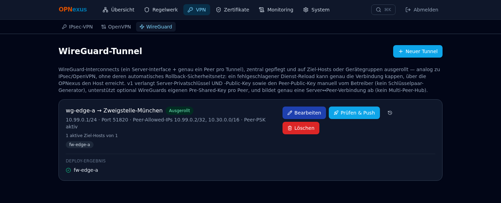

Server+Peer-Tunnel inklusive optionalem Peer-Pre-Shared-Key; OPNexus bildet
OPNsense's denormalisierte Server↔Peer-Verknüpfung korrekt nach.

### Zertifikatsverwaltung

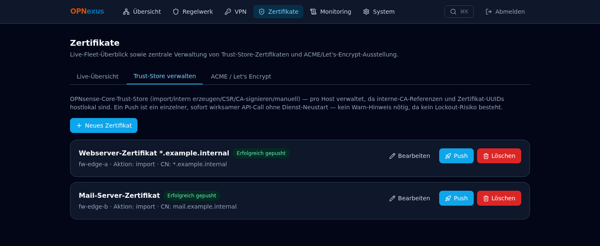

Live-Fleet-Überblick sowie zentrale Verwaltung von Trust-Store-Zertifikaten
und ACME/Let's-Encrypt-Ausstellung, mit Warngate vor jedem Kontakt zu einer
echten Zertifizierungsstelle.

### Monitoring

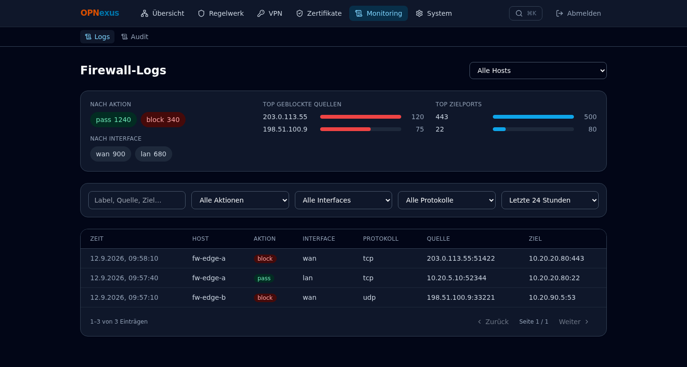

OPNexus ingestiert Firewall-Logs selbst statt sie nur live anzuzeigen:
durchsuchbar, filterbar, mit Dashboards für Top-Quellen und -Zielports.

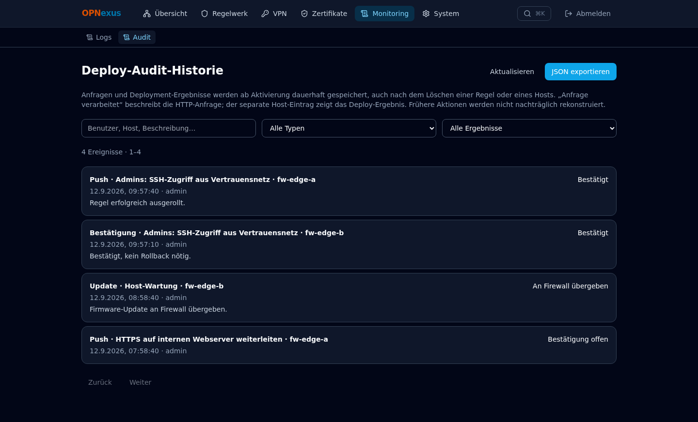

Lückenloser, dauerhaft gespeicherter Audit-Verlauf jeder Anfrage und jedes
Deployment-Ergebnisses — bleibt auch nach dem Löschen einer Regel oder
eines Hosts erhalten, mit JSON-Export.

### Update Center


Fleet-weite Ansicht über den abgesicherten Host-Wartungspfad: automatische
Update-Suche, stabile Updates und Major-Upgrades mit eigenem Warngate,
Neustart, sowie ein geführter CARP-Ablauf für HA-Updates ohne
Verkehrsunterbrechung auf dem falschen Knoten.

---

## Barrierefreiheit (2026-10-04)

Version 1.8.0 „Harris“. Ziel: OPNexus per Tastatur und mit Screenreader
vollständig bedienbar, Texte in beiden Themes gut lesbar (WCAG 2.2 AA).
Grundlage war ein automatischer axe-core-Lauf über alle 18 Seiten in Hell,
Dunkel und Mobil (54 Läufe), der zuerst 192 Kontrast- und 20 Struktur-Treffer
fand.

- **Kontrast.** Die Nebentext-Grautöne `slate-400`/`slate-500` sind im
  Hellmodus dunkler (jetzt ≥ 4,5:1 auf Weiß, Slate-50 und Slate-100), im
  Dunkelmodus heller. Links nutzen `sky-700`. Der aktive Hauptmenüpunkt im
  Dunkelmodus (`bg-brand-50`, hell auf hell, Kontrast 1,99) hat jetzt einen
  dunklen Hintergrund.
- **Tastatur.** Globaler `:focus-visible`-Ring (nur bei Tastaturbedienung,
  in beiden Themes ausreichend kontrastreich); „Zum Inhalt springen“ als
  erstes Tab-Ziel; `<main>` ist Sprungziel; scrollbare Tabellenkarten sind per
  Tab erreichbar. Dialoge (Fokusfalle, Esc, Fokus zurück an den Auslöser) und
  Tabs (Pfeiltasten) waren bereits korrekt und wurden mitgeprüft.
- **Screenreader.** Seitentitel wechseln pro Seite („Regeln · OPNexus“, per
  gerendertem `<title>` in `AuthGate`, weil der statische Metadata-Titel sonst
  zurückspringt). Jede Seite hat genau eine `h1` (Login und Über-Seite
  fehlte sie); Karten in Regeln/Aliase/Logs nutzen `h2` statt `h3` direkt unter
  `h1`. Menü: `aria-current`, Icon-Links mit `aria-label`, Icons
  `aria-hidden`, Unternavigation als eigene Landmarke. Leere Tabellenköpfe
  tragen einen nur für Screenreader sichtbaren Text („Aktionen“). Der
  Host-Status (`StatusDot`) war fest deutsch und folgt jetzt der Sprache.
- **Prüfen.** `scripts/verify_a11y.mjs` wiederholt den axe-Lauf (nur lesend:
  schreibende Anfragen werden im Browser lokal beantwortet, das Theme wird nur
  in der Antwort überschrieben). Aufruf siehe Skriptkopf; Exit-Code ≠ 0 bei
  Verstößen.

**Verifikation:** axe-core (WCAG 2.0/2.1/2.2 A + AA, Best Practices) auf allen
18 Seiten, Hell/Dunkel bei 1440 px und Hell bei 375 px: 0 Verstöße. Zusätzlich
von Hand im Browser: erster Tab = Sprunglink, Enter springt zum Inhalt,
Seitentitel wechseln, Dialog hält den Fokus nach 30 Tab-Drücken, Esc schließt
und gibt den Fokus zurück, Command-Palette ohne Verstöße; keine
Konsolenfehler. `tsc --noEmit` und `check_i18n.py` sauber. Nicht abgedeckt:
Test mit einem echten Screenreader (NVDA/VoiceOver) und Zustände, die erst nach
Schreibaktionen sichtbar werden (Review-Dialoge nach Push).

## Sichere Übertragung: HTTPS-Proxy, Zertifikats-Pinning, Zwei-Faktor (2026-10-04)

Version 1.7.0 „Goshawk“. Ziel: Passwort, Session und Firewall-Zugangsdaten
laufen nie unverschlüsselt oder unauthentisiert über das Netz — auch in einem
Netz ohne DNS, in dem OPNexus und die Firewalls nur per IP angesprochen werden.

**Architektur.** Ein mitgelieferter Caddy-Proxy (`proxy/Caddyfile`, Service
`proxy`) ist der einzige Dienst, der im Netz lauscht (Ports 80/443). Backend
und Frontend sind nur noch an `127.0.0.1` gebunden. Der Browser spricht die API
unter demselben Host an (`/api`), daher funktionieren IP und Namen gleich und es
gibt kein CORS zwischen Ursprüngen.

**Zertifikate ohne DNS.** Caddy stellt Zertifikate aus einer eigenen internen
CA aus — auch für reine IP-Adressen. Die Root-CA lädst du einmal unter
`https://<ip>/opnexus-ca.crt` herunter und importierst sie in Browser/System
(Firefox: Einstellungen → Zertifikate → Zertifizierungsstellen → Importieren;
Windows/macOS: Zertifikat als vertrauenswürdige Stammzertifizierungsstelle
installieren). Bis dahin zeigt der Browser eine Warnung, die Verbindung ist
trotzdem verschlüsselt.

**Root-CA vor dem Import prüfen.** Die Verschlüsselung allein beweist nicht,
dass die zuerst heruntergeladene Datei echt ist — wer auf dem Weg dazwischen
sitzt, könnte eine eigene CA unterschieben. Vergleiche vor dem Import den
Fingerabdruck, den du auf dem OPNexus-Server selbst ermittelst, mit dem der
heruntergeladenen Datei:

```
# auf dem Server
docker compose exec -T proxy cat /data/caddy/pki/authorities/local/root.crt \
  | openssl x509 -noout -fingerprint -sha256
# auf dem Client, für die heruntergeladene Datei
openssl x509 -in opnexus-root-ca.crt -noout -fingerprint -sha256
```

Nur bei identischem SHA-256-Fingerabdruck importieren (oder die CA stattdessen
über eure Unternehmens-/MDM-Verteilung ausrollen).

**Weitere Adressen (IP *und* Name).** In `.env`:

```
OPNEXUS_SITES=10.0.0.5, opnexus.lan     # alle Adressen, unter denen OPNexus erreichbar sein soll
OPNEXUS_DEFAULT_SNI=10.0.0.5            # die primäre (Browser senden bei reiner IP keinen Namen)
FRONTEND_ORIGIN=https://10.0.0.5,https://opnexus.lan
COOKIE_SECURE=true
TRUST_PROXY_HEADERS=true
BIND_ADDRESS=127.0.0.1
```

Danach `docker compose up -d`. Ein Name ohne DNS braucht auf dem Client einen
Hosts-Datei-Eintrag. **Backup-Hinweis:** Der Schlüssel der CA liegt im Volume
`caddy_data`. Geht es verloren, entsteht eine neue CA und alle Clients müssen sie
erneut importieren.

**Firewall-Verbindungen: Zertifikat festsetzen (Pinning).** Firewalls haben meist
ein selbstsigniertes Zertifikat, dessen Name nicht zur genutzten Adresse passt.
Statt die Prüfung abzuschalten, setzt OPNexus pro Host das Zertifikat fest: Hosts
→ Bearbeiten → „Zertifikat abrufen“ zeigt den SHA-256-Fingerprint; nach dem
Vergleich mit OPNsense (System → Vertrauen → Zertifikate) bestätigen. Danach
vertraut OPNexus *ausschließlich* diesem Zertifikat, bevor Zugangsdaten gesendet
werden — unabhängig davon, ob der Host per IP oder Name angesprochen wird
(`tls_pin_service.py`). Erneuert die Firewall ihr Zertifikat, meldet der Host
„Zertifikat passt nicht zum festgesetzten“; dann erneut abrufen und bestätigen.
Beide produktiven Firewalls wurden am 2026-10-04 festgesetzt; sie präsentieren
dasselbe Zertifikat (HA-Sync), gültig bis 2027-07-18. Das Festsetzen ist
„Trust on first use“ — der Fingerprint-Vergleich ist der Schritt, der es absichert.

**Zwei-Faktor-Anmeldung (optional, pro Benutzer).** Einstellungen →
Zwei-Faktor-Anmeldung: QR-Code scannen, Code bestätigen, 10 einmalige
Wiederherstellungscodes sichern. TOTP nach RFC 6238 ohne Zusatzbibliothek; das
Geheimnis liegt als Datei (0600) im Volume `totp_secrets`, nicht in der
Datenbank; ein einmal akzeptierter Code kann nicht wiederverwendet werden; falsche
Codes zählen für die Login-Sperre. Das Passwort wird beim Einrichten erneut
verlangt. Ein Admin kann das 2FA anderer Benutzer zurücksetzen (Benutzerliste);
für den letzten Admin gibt es auf dem Server:
`docker compose exec backend python -m app.reset_2fa <benutzername>`.

**Weitere Härtung.**
- `Secure`-/`HttpOnly`-/`SameSite=Lax`-Cookie; zusätzlich lehnt das Backend jede
  schreibende Anfrage ab, deren `Origin`/`Referer` weder derselbe Host noch in
  `FRONTEND_ORIGIN` gelistet ist (`security_middleware.py`).
- Header über den Proxy: HSTS, `Content-Security-Policy` (nur eigener Ursprung;
  `'unsafe-inline'` für Next.js-Hydration und React-Styles ist die bekannte
  Einschränkung), `X-Frame-Options: DENY`, `nosniff`, `Referrer-Policy`,
  `Permissions-Policy`, COOP/CORP; `Server`/`X-Powered-By` entfernt. API-Antworten
  sind `Cache-Control: no-store`.
- Login-Sperre nutzt über den Proxy die echte Client-IP (`TRUST_PROXY_HEADERS`).
- Abhängigkeiten: `pip-audit` meldet keine bekannten Lücken. `npm audit` meldet
  (Stand 2026-10-07) noch Funde nur in Build-Werkzeugen (`braces`,
  `postcss-selector-parser` über Tailwind 3/ESLint; für `braces` existiert keine
  gepatchte Version), die nicht im Laufzeit-Image liegen. Der Stand ändert sich
  täglich — vor einem Release neu prüfen (`npm audit`, `pip-audit`).
- Sicherheitsüberprüfung 2026-10-07: umgesetzte Korrekturen siehe Changelog (1.11.0).

**Bekannte Grenzen.** Kein IP-Allowlisting, keine Passkeys/WebAuthn; die
Session-Lebensdauer beträgt weiter 30 Tage. Das Zertifikat der Firewall wird
beim Festsetzen einmalig ohne Vorab-Vertrauen abgerufen.

**Verifikation:** 402 Backend-Tests (inkl. echtem lokalem TLS-Server für Pinning
per IP und per Name, Origin-Prüfung, 2FA-Ablauf); Browser-Ende-zu-Ende über
`https://<ip>` und über einen Namen ohne DNS (`--host-resolver-rules`): Login,
2FA-Einrichtung, falscher Code, Recovery-Code, Cookie `Secure`/`HttpOnly`;
mit der CA verifizierte TLS-Verbindung per IP; Ports 3100/8100 von außen
geschlossen; beide Firewalls nach dem Festsetzen online.

## Bedienbarkeit: Hinweise als Tooltips, ruhigere Listen, Log-Speicherlimit (2026-10-04)

Version 1.6.0 „Peregrine“. Ziel: weniger Text auf dem Bildschirm, klarere
Aktionen, dieselben Sicherheitsschranken.

- **Tooltips statt Textblöcken.** Neue Komponente `components/ui/Tooltip.tsx`
  (`Tooltip`, `InfoTip`): erscheint bei Hover, Tastaturfokus und Tippen, schließt
  mit Esc, wird nie von Karten oder Dialogen abgeschnitten und funktioniert auch
  auf deaktivierten Buttons. Seitenintros sind ein Info-Icon am Titel;
  `FieldGroup` hat ein `hint`-Feld.
- **Update Center.** Die Sperrgrund-Kästen sind weg: Warum „Update vorbereiten“
  gesperrt ist, steht im Tooltip des Buttons (mit Schloss-Symbol, per Tab
  erreichbar). Erfolgsmeldungen erscheinen als Toast. Die Bestätigung
  (Hostname eintippen + Häkchen) bleibt unverändert, ist aber kürzer.
- **Dialoge.** CARP-Umschaltung zeigt die Rollen als `MASTER → BACKUP` statt
  eines Textblocks; Host-Wartung, Restore-Wizard (jetzt ein Schritt, Warnung
  bleibt sichtbar) und Review-Dialoge folgen demselben Muster. Dialoge halten
  den Tastaturfokus und geben ihn beim Schließen zurück.
- **Listen.** Pro Zeile eine Hauptaktion („Prüfen & Push“), Bearbeiten als
  Outline-Button, Löschen dezent in Rot, Verlauf/Duplizieren als Icon mit
  Tooltip; Deploy-Ergebnisse stehen in einer Zeile.
- **Host-Detail.** Live-Regeln und Live-Aliase sind einklappbar (mit Anzahl);
  die Seite ist von ca. 10.900 px auf ca. 2.300 px geschrumpft.
- **Log-Speicherlimit.** Einstellungen → Log-Erfassung: „Max. Speicher (GB)“
  (Standard 10, 0 = unbegrenzt). Ist es erreicht, löscht OPNexus die ältesten
  Einträge (`log_ingest_service.enforce_size_limit`, im bestehenden
  Prune-Zyklus alle 20 Polls). Die Größe ist eine Schätzung aus der
  Tabellengröße, skaliert mit dem Anteil lebender Zeilen, weil Postgres Platz
  nach DELETE nicht ans Dateisystem zurückgibt, sondern wiederverwendet. Neue
  Spalte `log_settings.max_size_gb` (via `schema_patches.py`); `GET
  /api/logs/settings` liefert zusätzlich `used_bytes`, `entries`, `oldest_at`.
  Die Zahl in den Einstellungen („gespeichert“) zählt die ganze Tabelle, die
  Zahl auf der Logs-Seite („Treffern“) nur den aktuellen Filter.
- **UI-Korrekturen.** Karten in Listen haben wieder Abstand (`space-y` wirkt
  nicht über `fieldset.contents`, daher `flex flex-col gap-*`); `Input`/`Select`
  behalten ihre Standardstyles auch mit eigener `className`; alle Buttons sind
  gleich hoch; Zahlen in den Logs haben Tausendertrennung; das Dashboard zeigt
  lesbare Aktionsnamen.

**Verifikation:** Backend-Tests 383 bestanden (inkl. neuer Tests für
`enforce_size_limit` und die Einstellungen); Browserprüfung bei 1440 px und
375 px auf 16 Seiten ohne Konsolenfehler und ohne horizontalen Überlauf, mit
GET-only-Routing (jede schreibende Anfrage lokal abgefangen, keine
Firewall-Änderung).

## Mehrsprachigkeit (Deutsch/Englisch)

**Mehrsprachigkeit vollständig shipped 2026-09-19 (v1.5.0 „Osprey“).**
Deutsch bleibt Standard und Fallback; Englisch kann pro Benutzer unter
`/settings` gewählt werden. Die Auswahl wird sofort in `localStorage`
(`opnexus-language`) angewendet, in `user_preferences.language` persistiert,
zwischen Tabs synchronisiert und vor der React-Hydration auf `<html lang>`
gesetzt. Ein Reload oder eine neue Anmeldung übernimmt anschließend den
DB-Wert. Die Lösung verwendet bewusst keine URL-Locale und keine zusätzliche
i18n-Abhängigkeit, sondern den kleinen `LanguageProvider` und die DE/EN-Kataloge
unter `frontend/lib/i18n/` (`de.json`/`en.json`, ca. 1.400 Schlüssel).

- **Oberfläche:** alle Seiten und Komponenten laufen über `t("bereich.schlüssel")`
  (Platzhalter als `{name}`). Datums- und Zeitangaben folgen der Sprache
  (`de-DE`/`en-GB`, über `useLanguage().locale`). Gemeinsame Bausteine
  (Regel-/NAT-/Alias-Karten, Review-Dialoge, Wartungsdialoge) teilen sich ihre
  Schlüssel in `rules.*`, `review.*`, `maint.*`, `fields.*`.
- **API-Fehler** bleiben sprachneutral: `detail: {code, params}`, 118 Codes, beide
  Kataloge decken alle ab (`errors.<CODE>`). Neu seit dieser Version: die letzten
  rohen `HTTPException`s in `services/` sowie die Middleware-Antworten
  (401 `NICHT_AUTHENTIFIZIERT`, 403 `READ_ONLY_ACCESS`) liefern ebenfalls Codes.
- **Deutsche Fließtexte in Erfolgsantworten** (Vorschau-Warnungen, Wartungs- und
  Deploy-Meldungen, Revisionsnotizen, Blocker-Listen, Pydantic-Validierungstexte)
  erzeugt das Backend weiterhin auf Deutsch. Der Client übersetzt bekannte Texte
  mit `translateServerText()` anhand der Tabelle in
  `frontend/lib/i18n/serverMessages.ts` (ganze Sätze, Muster mit Platzhaltern,
  zusammengesetzte Strings). Unbekannte Texte erscheinen unverändert; wer im
  Backend einen neuen deutschen Satz einführt, ergänzt dort den englischen Text.
- **Bewusst nicht übersetzt:** Server-Logs, ausgehende Benachrichtigungen
  (Webhook/E-Mail), Antworttexte der OPNsense-Firewalls selbst, Namen aus
  Firewall-Daten (Aliase, Regelbeschreibungen) und die deutschen Suchbegriffe der
  Befehlspalette (sie bleiben zusätzlich zu den englischen Seitentiteln nutzbar).
- **Prüfwerkzeuge:** `python3 scripts/check_i18n.py` (Katalog-Parität,
  Platzhalter, Abdeckung aller `ErrorCode`s, referenzierte Schlüssel) und
  `scripts/verify_i18n.mjs` (Browser: Umschalten über die Einstellungen, alle
  lesenden Seiten samt „Neu“-Dialogen auf deutsche Restwörter prüfen, 375 px auf
  horizontalen Überlauf; schreibende Requests werden abgefangen; `/updates` wird
  ausgelassen, weil das Öffnen dort Update-Suchen auf den Firewalls startet).
  Das Skript braucht `OPNEXUS_TEST_PASSWORD` und als `OPNEXUS_BASE_URL` den in
  `FRONTEND_ORIGIN` konfigurierten Origin (sonst blockiert die CORS-Freigabe die
  Anmeldung).

**Verifiziert 2026-09-19:** DE→EN→DE mit DB-Persistenz und Reload; 17 Seiten und
alle „Neu“-Dialoge im Englischen ohne deutsche Restwörter (Treffer nur aus
Firewall-Daten); englischer Fehlertext bei unbekanntem Host; Update Center inkl.
Blocker-Meldungen, Update-/Major-/CARP-Dialogen im Englischen über die
gemockten Fixtures; 375 px ohne horizontalen Überlauf (dabei einen bestehenden
Überlauf im Dashboard behoben: Grid-Karten ohne `min-w-0`); keine Browser-
Konsolenfehler. Backend-Suite 378 Tests grün, `tsc --noEmit` und
`next build` sauber. Die Spalte `user_preferences.language` entsteht über den
append-only Schema-Patch.

---

## Zweite Härtungsrunde: Fehlerinfo-Leckage, Healthchecks, DB-Backup, Log-Retention (2026-09-17)

Fortsetzung der Härtung unten, ausgelöst durch das Live-Rollout dieser
Härtung selbst — mehrere Punkte wurden erst beim tatsächlichen Deployment
gegen die echte Produktivinstanz sichtbar, nicht am Schreibtisch:

- **Keine rohen OPNsense-Fehlertexte mehr in 502-Antworten**: `str(exc)`
  enthielt die komplette Roh-Antwort der Ziel-Firewall (inkl. interner
  Details) und ging 1:1 an jeden angemeldeten Nutzer (auch `read_only`)
  raus. Neuer `_upstream_error()`-Helper loggt das volle Detail
  serverseitig (jetzt dank der Logging-Härtung unten auch sichtbar) und
  gibt nur noch eine generische Meldung an den Client.
- **Healthchecks für Backend/Frontend ergänzt** (bisher nur Postgres) —
  dabei einen echten Bug gefunden: Docker setzt automatisch
  `HOSTNAME=<container-id>`, und Next.js' Standalone-Server bindet sich
  standardmäßig genau daran, nicht an `0.0.0.0` — der Frontend-Container
  lauschte dadurch nur auf seiner eigenen Container-IP, nie auf
  `127.0.0.1`. Harmlos für den veröffentlichten Port (Docker-NAT geht
  direkt auf die Container-IP), aber jeder containerinterne Check auf
  `localhost` schlug fehl. Behoben per explizitem `HOSTNAME=0.0.0.0`.
- **Nächtliches Backup der eigenen OPNexus-Datenbank** (neuer
  `postgres-backup`-Service) plus Fix für Postgres' zu kleines
  `/dev/shm` — siehe eigener Abschnitt "Backup & Restore" unten für
  Details, Restore-Prozedur und warum `firewall_log_entries` bewusst
  ausgeschlossen ist.
- **Log-Erfassungs-Einstellungen (Intervall/Aufbewahrung) jetzt sicht-
  und editierbar** über eine neue Einstellungen-Sektion + `GET`/`PUT
  /api/logs/settings` — vorher gab es dafür überhaupt keine UI/API, nur
  direktes Editieren der DB-Zeile. Default-Aufbewahrung von 30 auf 7 Tage
  gesenkt.
- **Realer Vorfall, der den letzten Punkt motiviert hat**: beim Testen
  des neuen Backup-Service fiel auf, dass `firewall_log_entries` bei den
  zwei echten, mäßig ausgelasteten Firewalls in nur 9 Tagen auf ~8,7 Mio.
  Zeilen / ~9,7GB angewachsen war (30-Tage-Default, keine Möglichkeit,
  das vorher zu sehen oder zu ändern) — zusammen mit den Rebuilds dieser
  Session zweimal kurz zu einem vollen Datenträger und dadurch zu einer
  kurzen Postgres-Crash-Loop geführt. Mit demselben sicheren
  `docker image/builder prune` wie beim 2026-09-12-Audit behoben, dazu
  Retention auf dieser Instanz sofort über die App-eigene Logik auf 7
  Tage reduziert und 2,1 Mio. alte Zeilen bereinigt. Keine Datenverluste,
  beide echten Hosts während des gesamten Vorgangs erreichbar (außer den
  kurzen Postgres-Unterbrechungen selbst).
- **Diese VM ist für die reale Log-Last knapp bemessen** (42GB Disk,
  reihenweise Docker-Image-Rebuilds plus jetzt auch DB-Wachstum) — auch
  nach allen Fixes hier bewegt sich der freie Speicher im niedrigen
  einstelligen GB-Bereich. Für den öffentlichen Release kein Code-Thema
  mehr, aber für den laufenden Betrieb dieser Instanz eine offene
  Kapazitätsfrage (mehr Disk zuteilen, oder Retention/Poll-Intervall noch
  weiter senken).

375 Backend-Tests grün (4 neu für die Log-Einstellungen), `tsc --noEmit`
und `next build` sauber.

---

## Sicherheits- und Stabilitäts-Härtung vor dem öffentlichen Release (2026-09-17)

Vollständiges Security-/Stabilitäts-Audit (zwei parallele Reviews) mit Blick
auf den geplanten öffentlichen Release — der Kern war bereits solide
(Argon2id-Passwort-Hashing, saubere httpOnly/SameSite-Session-Cookies, keine
SQL-/Shell-Injection, keine XSS-Lücken, robuste Background-Loops), aber
mehrere Standardeinstellungen waren nur für die eigene, vertrauenswürdige
Dev-VM sinnvoll und wären für fremde Selfhoster riskant:

- **CORS gehärtet**: Default akzeptierte zuvor jede Origin auf Port 3100
  (`^https?://[^/]+:3100$`), kombiniert mit `allow_credentials=True` — in
  Kombination ein potenzielles Session-Hijacking-Einfallstor. Default
  matcht jetzt nur noch `localhost`/`127.0.0.1`; jedes andere Deployment
  muss `FRONTEND_ORIGIN` exakt setzen (neue Env-Variable).
- **`POSTGRES_PASSWORD` ohne unsicheren Fallback**: der bisherige Default
  (identisch zum Benutzernamen) stand als Klartext im
  öffentlichen Repo — `docker compose` verweigert jetzt den Start ohne
  explizit gesetztes Passwort.
- **Ports standardmäßig nur auf `127.0.0.1`** statt `0.0.0.0` — verhindert,
  dass ein frisches `docker compose up` auf einer Maschine mit
  Netzwerk-/Internet-Interface eine unauthentifizierte
  Firewall-Management-Oberfläche exponiert. Steuerbar über die neue
  `BIND_ADDRESS`-Variable in `.env` (z.B. `0.0.0.0` für LAN-weiten Zugriff
  ohne Reverse-Proxy), ohne `docker-compose.yml` anfassen zu müssen.
- **TLS/Reverse-Proxy-Weg dokumentiert** (siehe "Zugriff von außerhalb
  dieser VM / Produktivbetrieb mit TLS" im Setup-Abschnitt) — empfohlener
  Produktivpfad ist ein TLS-terminierender Proxy (Caddy-Beispiel) plus
  `FRONTEND_ORIGIN`+`COOKIE_SECURE=true`, statt die Ports direkt zu öffnen.
- **Backend-Logging aktiviert**: `logging.basicConfig()` fehlte komplett,
  wodurch sämtliche `logger.info()`-Aufrufe der 5 Background-Loops (CARP-
  Rollenwechsel, Log-Ingest-Zähler, Sweep-Ergebnisse) spurlos verworfen
  wurden — `docker compose logs backend` zeigte nach Stunden Laufzeit nur
  uvicorns eigene Zugriffslogs. Zusätzlich Log-Rotation (`max-size: 10m`,
  `max-file: 3`) für alle drei Container, gegen unbegrenztes Log-Wachstum.
- **Automatischer Schema-Patch-Mechanismus** (`app/schema_patches.py`):
  löst das strukturelle Problem hinter dem "Schema-Änderungen ohne
  Migrationstool"-Abschnitt unten dauerhaft — jede historische manuelle
  `ALTER TABLE ... ADD COLUMN IF NOT EXISTS`-Anweisung läuft jetzt bei
  jedem Start automatisch (idempotent), statt eine manuelle DBA-Aktion zu
  verlangen. Verifiziert durch simulierten Alt-Stand (Spalte künstlich
  gelöscht, Neustart stellt sie wieder her). Schließt insbesondere die
  zuvor offene Migration auf der zweiten echten Instanz (`10.0.0.34`).
- **Reproduzierbare Builds**: `frontend/package-lock.json` committet
  (Dockerfile nutzt jetzt `npm ci` statt `npm install`), Backend-
  Abhängigkeiten in `requirements.txt` exakt statt mit `>=`-Untergrenzen
  gepinnt.

Alle Änderungen einzeln committet, 371 Backend-Tests grün, gegen die
laufende Produktiv-Instanz (dieser Host, `10.0.0.34`) live ausgerollt
und verifiziert (Erreichbarkeit, CORS-Preflight mit der konfigurierten
Origin, Schema-Spalten vorhanden, beide echten Hosts `fw-primary`/
`fw-secondary` weiterhin korrekt in der DB). Während der Arbeit lief die
Root-Disk durch die Rebuilds kurz auf 100% voll, was den Postgres-
Container in eine kurze Crash-Loop schickte — mit demselben sicheren
`docker image prune`/`docker builder prune`-Cleanup wie beim Audit vom
2026-09-12 behoben, keine Datenverluste (siehe dortigen Handbuch-Abschnitt).

**Bewusst nicht in diesem Batch:** unauthentifizierte `/docs`/`/redoc`,
in-memory-only Login-Throttle (kein Problem für den Normalfall, aber nicht
Multi-Replica-fähig), rohe Fehlermeldungen in einigen 502-Antworten an
`read_only`-Nutzer, fehlende Resource-Limits/Healthchecks für
Backend/Frontend in `docker-compose.yml`, kein automatisches Backup der
eigenen OPNexus-Postgres-Datenbank — alles als "nice-to-have" eingestuft,
nicht release-blockierend.

---

## Direct-View-Link, Dienst-Steuerung, Resource-Monitoring, geplante Wartung (2026-09-17)

Vier Lücken gegenüber DynFi Manager (dem einzigen echten Software-
Wettbewerber in der Nische "zentrales OPNsense-Fleet-Management", deren
öffentliche Feature-Seiten für diesen Vergleich geprüft wurden) geschlossen.
Multi-Tenancy/MSP-Betrieb ist dabei bewusst **kein** Ziel — Zielgruppe sind
Privatleute/kleine Unternehmen mit eigener Firewall, nicht Dienstleister mit
mehreren Kunden.

**Direct-View-Link.** Ein-Klick-Button "In OPNsense öffnen" (neue Spalte in
der Host-Liste, neuer Button in der Host-Detailansicht) öffnet `host.base_url`
in einem neuen Tab — reiner Navigationslink, kein neuer Endpunkt, kein API-Call.

**Generische Dienst-Steuerung.** Neue Sektion "Dienste" auf der Host-
Detailseite: Liste aller von OPNsense gemeldeten Dienste (`Core\Api\
ServiceController::searchAction`) mit Running-Badge, Start-/Stopp-/Neustart-
Buttons je Zeile hinter einem generischen Warnhinweis (keine kuratierte
Allowlist — alle Dienste sind grundsätzlich steuerbar). Neuer Router
`routers/services.py`, nutzt denselben `ensure_no_maintenance()`-Lock wie
jeder andere Schreibpfad. **Nur das Auflisten (`search`) wurde live gegen
fw-primary/fw-secondary verifiziert** (Read-only GET) — Start/Stopp/Neustart
bleiben mock-only, bis explizit freigegeben.

**Resource-Monitoring.** Neue Sektion "Systemauslastung (24h)" mit drei
kompakten Zeitverlaufs-Charts (CPU-Last, Speicher-%, Platten-%) je Host,
als eigene, minimale Inline-SVG-Komponente (`components/ui/Sparkline.tsx`,
keine neue Chart-Bibliothek) mit Hover-Crosshair+Tooltip. Neue Tabelle
`host_resource_samples`, vierter Hintergrund-Poll-Loop
(`_resource_poll_loop`, fester 60s-Intervall, keine eigene Einstellungs-UI
für v1) sampelt `systemResources`/`systemTime`/`systemDisk`/
`getInterfaceStatistics` je aktivem Host, mit Retention-Pruning nach 30
Tagen. **Live gegen fw-primary/fw-secondary verifiziert** — der Loop läuft
bereits produktiv und hat reale Messwerte aufgezeichnet.

**Geplante Wartung (einmalig).** Neuer Abschnitt in der Host-Wartung:
Neustart/Update/Major-Upgrade auf einen zukünftigen Zeitpunkt statt sofort
legen, mit Pflicht-Bestätigung ("läuft unbeaufsichtigt"). Bewusst **kein**
Recurring/Cron-Schema — ein Zeitpunkt pro Eintrag. Neue Tabelle
`scheduled_maintenance`, fünfter Poll-Loop
(`_scheduled_maintenance_poll_loop`, 60s) prüft beim Zünden **erneut**
`ensure_no_maintenance()` und dieselben Blockierungsgründe wie ein manuell
ausgeführtes Update (z. B. fehlendes frisches Backup) — eine blockierte
Aktion wird als `failed` markiert, nicht automatisch wiederholt. Feuert über
dieselbe `HostOperation`/Action-Dispatch-Logik wie `maintenance.py`s
`execute()`, keine doppelte Implementierung. **v1-Scope-Entscheidung:** ein
blockierter/fehlgeschlagener Zündversuch wird geloggt und im Status der
geplanten Wartung sichtbar, aber (noch) nicht an das bestehende Webhook-/
E-Mail-Alerting angebunden — das ist auf persistente `NotificationProblem`-
Zeilen mit eigenen Einstellungen zugeschnitten, eine neue Problem-Art dafür
wäre ein größerer Schnitt als dieses Feature selbst. Das End-zu-Ende-
Verhalten (Anlegen → Liste → Abbrechen) wurde live gegen fw-primary
verifiziert (Zeitpunkt 1 Jahr in der Zukunft, danach abgebrochen — zu keinem
Zeitpunkt ein echter OPNsense-Call, da eine geplante Wartung vor dem
Zünden nur eine OPNexus-eigene Datenbankzeile ist).

371 Backend-Tests grün (14 neu für diese vier Features), Browser-verifiziert
bei 1440px/375px in Dunkelmodus gegen die echten Produktions-Hosts, keine
Konsolenfehler.

---

## Versionierung: Semantic Versioning mit Codenamen (2026-09-17)

OPNexus hatte bisher nur eine manuell gepflegte, datumsbasierte
Versionsstring (`2026.09.09`, nur auf der Login-Seite sichtbar) ohne
erkennbare Bedeutung zwischen den Zahlen. Ersetzt durch ein richtiges
Schema:

- **Semantic Versioning** (`MAJOR.MINOR.PATCH`) plus **Codename pro
  MINOR-/MAJOR-Version** — Raubvögel, alphabetisch aufsteigend über die
  Releases hinweg (Vorbild: Ubuntus alliterierende Tier-Codenamen, ohne den
  Buchstaben-Zwang). Ein PATCH-Release behält den Codenamen seiner
  MINOR-Version. Vollständig dokumentiert in der neuen
  [`CHANGELOG.md`](../CHANGELOG.md), die ab jetzt parallel zu den
  Feature-Abschnitten hier im Handbuch die kurze Versions-/Namens-Übersicht
  führt (Das Handbuch bleibt die ausführliche Feature-Doku mit
  Verifikationsnachweisen).
- **Erstes versioniertes Release: `1.0.0` "Falcon"** — markiert den
  aktuellen, bereits sehr ausgereiften Stand (siehe CHANGELOG.md für die
  Begründung, warum `1.0.0` und nicht `0.x`).
- **Versionsanzeige erweitert.** Bisher nur auf der Login-Seite; jetzt
  zusätzlich im Footer jeder eingeloggten Seite (`AuthGate.tsx`, verlinkt
  zu `/about`), auf `/about` selbst (bisher nur Fleet-Status/OPNsense-
  Versionen der verwalteten Hosts, nie die eigene App-Version) und in den
  Einstellungen unter einem neuen "Über OPNexus"-Abschnitt. Quelle bleibt
  weiterhin `frontend/lib/version.ts` (`APP_VERSION`/`APP_CODENAME`,
  jetzt mit Codenamen-Konstante); neu ist `backend/app/version.py` mit
  denselben Werten, das FastAPI's eigenes `version=`-Feld setzt (sichtbar
  in `/docs`/`/openapi.json`). Beide Konstanten sind unabhängig
  voneinander von Hand gepflegt (kein Build-Schritt verbindet sie, wie
  auch sonst nirgends im Projekt) — künftig bei jedem Release-Bump beide
  gemeinsam ändern.
- **Nebenfund beim Anfassen der Login-Seite behoben:** `router.push`
  nach erfolgreichem Login zeigte noch auf `/hosts`, obwohl `/` (und damit
  die eigentliche Startseiten-Erwartung) seit dem Dashboard-Release
  (2026-09-14, siehe unten) auf `/dashboard` zeigt — frisch eingeloggte
  Nutzer landeten also nicht auf der neuen Startseite. Jetzt konsistent
  `/dashboard`.

Keine Backend-Schema-Änderung. Verifiziert: `tsc --noEmit`/`next build`
sauber, volle Backend-Suite weiterhin grün (357), Backend-`/openapi.json`
zeigt `version: "1.0.0"`. Browser-verifiziert (Playwright, Session direkt
per `auth_service.create_session` gemäß der Projekt-Konvention für
passwortlose Testsessions, danach wieder gelöscht — löscht dabei auch
jede andere gerade offene Sitzung, ein erwarteter Seiteneffekt, kein
Datenverlust): `/about`, `/settings` und `/dashboard` zeigen
„Falcon“ im Footer bzw. den jeweiligen Abschnitten, null Konsolenfehler.

## CARP/HA vertiefen: Ereignis-Historie, Split-Brain-Alarm, NAT-Drift, Auto-Revert (2026-09-15)

Auf Wunsch nach einem offenen Feature-Brainstorm ("was können wir noch
hinzufügen") aus drei angebotenen Kategorien zwei gewählt: CARP/HA
vertiefen und bekannte UX-Lücken schließen (eine dritte, komplett neue
Feature-Kategorie wurde für diese Runde bewusst zurückgestellt).

- **CARP-Ereignis-Historie.** Neue Tabelle `carp_events` (komplett neu,
  kein manuelles `ALTER TABLE` nötig) plus `carp_event_service.
  detect_and_record`, eingehängt in den bestehenden
  `_notification_poll_loop` (`main.py`) — ein zusätzlicher
  `get_vip_status`-Aufruf pro Zyklus, bewusst getrennt vom bestehenden
  `notification_checks.check_host_offline`-Aufruf, um dessen bereits
  getesteten Code nicht anzufassen. Kein "letzter bekannter
  Zustand"-Feld nötig: neue Events werden gegen die jeweils letzte
  `carp_events`-Zeile pro Host verglichen. Neuer Endpunkt `GET
  /api/cluster/carp-events?cluster_name=` (`routers/cluster.py`, der
  erste Router dieses Namens im Projekt). Frontend: einklappbarer
  Verlaufs-Abschnitt pro Cluster auf `/cluster`.
- **Split-Brain-/Kein-Master-Alarm**, vollständig über die bestehende
  Benachrichtigungs-Infrastruktur (kein neuer Zustell-/Dedup-Code): neue
  `notification_checks.check_carp_health`, neuer `ProblemType`
  `carp_split_brain`, neue Spalte `NotificationSettings.
  carp_health_enabled` — **brauchte den manuellen-`ALTER TABLE`-Workaround**
  (siehe "Schema-Änderungen" oben; auf dieser Dev-VM bereits ausgeführt,
  auf `10.0.0.34` noch ausstehend).
- **NAT-Drift-Erkennung**, Erweiterung des bestehenden Regel-/Alias-Drift-
  Musters auf alle drei NAT-Typen (Port Forward, 1:1, Outbound). Neuer
  `nat_drift_service.py`, neue Komponente `LiveNatDrift.tsx` (4. Tab
  "Live-Drift" auf `/nat`), neuer `ProblemType` `nat_drift` + Spalte
  `NotificationSettings.nat_drift_enabled` (zweite manuelle-`ALTER
  TABLE`-Spalte). Feldnamen vorab gegen den OPNsense-Core-Quellcode
  verifiziert (`DNatController.php`/`OneToOneController.php`/
  `SourceNatController.php`), nicht geraten: Port Forwards
  Such-Zeilen-Felder sind `descr` + gepunktete `source.network`/
  `destination.network`-Keys — anders als OneToOne/Outbound-NATs flache
  `description`/`source_net`/`destination_net`, und wieder anders als
  Port Forwards eigenes *Schreib*-Payload-Format (dort echte
  `source`/`destination`-Objekte statt gepunkteter Keys).
- **CARP-Wartungsmodus-Auto-Revert-Timer** — der riskanteste Teil, da er
  einen echten Produktions-Schreibpfad erweitert
  (`opnsense_client.toggle_carp_maintenance`). Neue Tabelle
  `carp_maintenance_windows` (komplett neu) + `carp_maintenance_window_
  service.py`: optionale Dauer (15/30/60 Minuten oder dauerhaft) am
  bestehenden CARP-Umschalt-UI (`CarpSwitchControl.tsx`), ein Sweep im
  bestehenden 10-Sekunden-`_deploy_revert_sweep_loop` (`main.py`). Anders
  als die bewusste Kein-Auto-Revert-Haltung der VPN-Trilogie (ein
  VPN-`reconfigure` kann den für die Reparatur nötigen Pfad selbst kappen)
  ist ein CARP-Rollenwechsel gefahrlos automatisch rückgängig zu machen —
  der Sweep überspringt das menschliche Bestätigen-Gate bewusst, weil der
  Mensch mit der Dauer-Auswahl bereits zugestimmt hat. Neuer `ProblemType`
  `carp_auto_revert_failed` + Spalte `NotificationSettings.
  carp_auto_revert_failed_enabled` (dritte manuelle-`ALTER TABLE`-Spalte
  dieser Runde). Das Dashboards "Offene Aktionen" zeigt jetzt auch aktive
  Wartungsfenster (informativ, mit Auto-Revert-Zeitpunkt) und
  fehlgeschlagene an. **Von der Testsuite gefundener echter Bug, nicht
  durch Inspektion:** die erste Fassung schrieb ein rohes Python-
  `datetime`-Objekt in `HostOperation.snapshot` (eine reine JSON-Spalte
  mit Stdlib-`json.dumps`, anders als FastAPIs eigene Response-
  Serialisierung) — behoben durch `.isoformat()` auf `auto_revert_at` vor
  dem Einfügen.
- **Toast-Abdeckungs-Lücke geschlossen** (schließt eine offen dokumentierte
  Lücke aus dem UI/UX-Umbau vom 2026-09-14 unten): alle 9 Deploy-Review-
  Overlays (`RuleReview`, `PortForwardReview`, `OneToOneReview`,
  `OutboundNatReview`, `AliasReview`, `PolicyHierarchyRuleReview`,
  `IpsecTunnelReview`, `OpenVpnInstanceReview`, `WireguardTunnelReview`)
  zeigen jetzt einen Erfolgs-Toast beim Push (zusätzlich zu, nicht statt
  ihrem bisherigen Host-Status-Text). Alle 4 VPN-/Zertifikats-Seiten
  (`ipsec`, `openvpn`, `wireguard`, `certificates`) haben jetzt
  vollständige Erstellen/Bearbeiten/Löschen/Push/Registrieren/
  Signieren-Toast-Abdeckung — vorher null.

**Bewusst nicht in dieser Runde gebaut** (im Plan so festgehalten, kein
Versehen): Aliase-/NAT-Hierarchie in der Policy-Hierarchie, Restore Stufe 2
(`revertBackup`) — beide als eigene, mit früheren Features vergleichbar
große Features zurückgestellt.

**Verifikation:** 351→357 Backend-Tests (19 neu, alle respx-gemockt), volle
Suite durchgehend grün. `tsc --noEmit`/`next build` bei jedem Schritt
sauber. **Echte Browser-Verifikation gegen die reale Flotte** (fw-primary/
fw-secondary, nicht gemockt) nach Neubau beider Container und Anwendung
der drei manuellen `ALTER TABLE`-Befehle auf dieser Dev-VM-Datenbank —
bestätigt per Screenshot bei 1440px (Dark Mode) und 375px (kein
horizontales Overflow auf allen drei neuen/geänderten Seiten): der
CARP-Poll-Loop erfasste sofort und korrekt die erste `carp_events`-Zeile
beider echten Hosts, NAT-Live-Drift zeigte korrekte reale Zahlen (1
Port-Forward-Regel, 0 1:1, 0 Outbound, keine falsch-positiven Treffer),
alle neuen Einstellungs-Schalter rendern und sind standardmäßig aktiviert.
Null Konsolenfehler. **Kein Schreibzugriff auf `10.0.0.2`/`.3` für den
CARP-Auto-Revert-Pfad** — A4s eigentlicher `toggle_carp_maintenance`-Sweep-
Aufruf ist nur über respx-/zustandsbehaftete Mock-Tests verifiziert; ein
erster echter Test des Auto-Revert-Sweeps gegen Produktion bräuchte ein
eigenes, explizites Go-ahead, dieselbe Disziplin wie bei jedem anderen
schreibfähigen Feature.

**Noch offen:** dieselben drei `ALTER TABLE notification_settings ADD
COLUMN`-Befehle (`carp_health_enabled`, `nat_drift_enabled`,
`carp_auto_revert_failed_enabled`, alle `BOOLEAN DEFAULT true NOT NULL`)
müssen noch auf der zweiten echten Instanz (`10.0.0.34`) ausgeführt
werden, bevor deren Benachrichtigungs-Einstellungsseite lädt — dieselbe
ausstehende Migration wie die bereits bekannte `admin_users.role`-Lücke.

## Fleet-Dashboard, neue UI-Bausteine und Konsistenz-Pass (2026-09-14)

Auf Wunsch, das Frontend auf "perfektes UI/UX" zu analysieren und zu
verbessern. Die App war funktional bereits sehr ausgereift, die
Oberfläche aber als "solide Admin-Tabellen" statt poliert eingeschätzt
worden — kein echtes Dashboard, Dark Mode als brüchige ~100-zeilige
Klassennamen-Override-Tabelle, nur 7 UI-Primitives für ~20 Seiten,
nicht-semantische Button-Varianten, kein Toast-/Feedback-System, ad-hoc
Empty-States. In vier Phasen umgesetzt:

- **Phase 0 — Design-Fundament.** `slate` ist jetzt CSS-Variablen-
  gestützt statt eine statische Palette: `tailwind.config.ts` definiert
  `colors.slate.*` über `rgb(var(--slate-N) / <alpha-value>)`,
  `globals.css` setzt die 11 `--slate-N`-Variablen unter `:root` (hell)
  und spiegelt 10 davon unter `[data-theme="dark"]` (dieselben
  Schatten-Umkehr-Paare wie die alte Tabelle). Das ersetzt ~60 Zeilen der
  alten `[data-theme="dark"] .bg-slate-100 {...}`-Tabelle **und behebt
  den Opacity-Modifier-Dark-Mode-Bug dauerhaft für slate**
  (`bg-slate-100/50` komponiert jetzt korrekt) — ohne eine einzige
  JSX-Änderung über alle ~20 Seiten hinweg. Die Akzentfarben (sky/blue/
  emerald/…) bleiben bewusst bei der alten kontextabhängigen
  Override-Tabelle, da deren Dark-Mode-Zielfarbe je nach CSS-Eigenschaft
  variiert (kein reiner Paletten-Ersatz möglich). Neue semantische
  `--tone-*`-Variablen (neutral/info/success/warning/danger/accent) für
  die neuen `Badge`/`Toast`-Komponenten. Neue Primitives in
  `components/ui/`: `Badge.tsx`, `Tabs.tsx` (mit echter `role="tab"`/
  Pfeiltasten-Navigation), `Table.tsx`, `EmptyState.tsx`, `Toast.tsx` (+
  `ToastProvider`/`useToast()`, in `app/layout.tsx` eingehängt). `Button`s
  `edit`-Variante zu `secondary` umbenannt (war ein fest codiertes
  `bg-blue-800` ohne semantischen Namen). Ein Dark-Mode-Regressions-Fund
  vom Nutzer selbst korrigiert: `.bg-white`/`select option` nutzten
  versehentlich die (bewusst invertierende) `--slate-900`-Variable statt
  eines festen Werts — für eine Karte, die *immer* hell/dunkel bleiben
  soll (nicht themenabhängig invertiert), jetzt hart auf `rgb(15 23 42)`
  gesetzt.
- **Phase 1 — Dashboard.** Neue Seite `/dashboard`, jetzt Ziel von `/`
  und des Post-Login-Redirects (ersetzt `/hosts`), erster Eintrag in
  Navs "Übersicht"-Gruppe. Deckt alle vier gewünschten Aspekte ab:
  Fleet-/CARP-Gesundheit (Host-Liste mit Live-Status/CARP-Rolle/Cluster),
  offene Aktionen (neuer `GET /api/dashboard`, `routers/dashboard.py`,
  reiner DB-Read ohne Live-OPNsense-Aufrufe — aggregiert Pending/Error/
  Revert-Failed über alle 5 deploybaren Entitätstypen plus feststeckende
  `HostOperation`-Zeilen), Sicherheits-/Ablauf-Warnungen (bewusst keine
  Logik dupliziert — nutzt das bereits bestehende `GET /api/notifications/
  problems` direkt statt eine zweite Erkennung zu bauen) sowie Aktivität
  (letzte 15 Audit-Events). Ein echter Fund beim ersten Laden gegen die
  reale Flotte: 28 einzeln gerenderte, fast identische Drift-Zeilen
  flurteten das Panel — client-seitig zu einer Zeile pro Cluster
  gruppiert, die Rohzahl bleibt trotzdem in der Stat-Kachel sichtbar. 3
  neue Backend-Tests, volle Suite (338) grün.
- **Phase 2 — Konsistenz-Pass.** Alle handgerollten Badges (`WorkflowBadge`,
  `CertStatusBadge`, mehrere Inline-Pills in `rules`/`logs`/
  `certificates`/`updates`) auf `<Badge tone=...>` migriert; alle
  handgerollten `TabButton`-Implementierungen (6 Dateien) auf `<Tabs>`
  mit echter Pfeiltasten-Navigation; alle ad-hoc "Noch keine X
  angelegt"-Meldungen auf `<EmptyState>` (mit bewusst dokumentierten
  Ausnahmen, wo eine Icon-Box das Layout gesprengt hätte, z.B.
  Tabellen-Leerzeilen und die kompakte Policy-Hierarchie-Sidebar).
- **Toast-Feedback.** Nur bei erfolgreichen Mutationen (`toast.show(...,
  "success")`) — Fehler bleiben bewusst als persistenter `<p
  role="alert">` neben der Aktion, da das für etwas, das der Nutzer
  wirklich lesen und beheben muss, das bessere Muster ist als ein nach
  5s verschwindender Toast. Vollständige Erstellen/Bearbeiten/Löschen-
  Abdeckung auf `hosts`/`users`; nur-Löschen auf `groups` (bewusst kein
  Toast für dessen Speichern-Pfad, der bereits einen besseren
  bespoken Erfolgs-Banner mit Deep-Link hat); Bestätigen+Löschen auf
  `rules`/`aliases`/den drei NAT-Panels. **Explizit noch nicht
  abgedeckt in dieser Phase, als bekannte Lücke dokumentiert:** die
  eigentliche "Prüfen & Push"-Deploy-Aktion in den `*Review.tsx`-Overlays
  sowie alle VPN-/Zertifikats-Seiten — geschlossen am 2026-09-15 (siehe
  "CARP/HA vertiefen" oben).

Verifiziert bei jedem Schritt: `tsc --noEmit`/`next build` sauber,
Playwright bei 1440px/375px in Hell und Dunkel gegen den echten Container
mit echten fw-primary/fw-secondary-Daten, null Konsolenfehler. Kein README-
Eintrag/Screenshot wurde ursprünglich ergänzt (bewusst zurückgestellt, um
im Scope der UI/UX-Arbeit selbst zu bleiben) — dieser Abschnitt holt das
jetzt nach.

## Login-Infos: Version, Sicherheits-Historie, Dark-Mode-Audit (2026-09-09)

Drei kleine, zusammenhängende Ergänzungen auf Nutzerwunsch ("beim Login
Infos und sowas"):

- **Versions-/Herstellerzeile auf der Login-Seite** (`app/login/page.tsx`):
  `OPNexus {APP_VERSION} · Eigenentwicklung von {APP_MAINTAINER}` aus
  `lib/version.ts` — eine manuell gepflegte, datumsbasierte Version
  (kein Build-Tooling/Git-Hash-Pipeline, bewusst einfach gehalten,
  analog zu den bereits datierten README-Abschnitten); wird bei
  künftigen nennenswerten Änderungen mit hochgezogen.
- **Sicherheits-Banner nach dem Login** (`components/LoginInfoBanner.tsx`):
  zeigt einmalig nach einer erfolgreichen Anmeldung Zeitpunkt+IP der
  *vorherigen* Anmeldung, die Anzahl fehlgeschlagener Versuche seit
  dieser letzten Anmeldung (amber-Warnfarbe statt neutral, wenn > 0) und
  bis wann die neue Sitzung gültig ist. Backend: `AdminUser` bekommt eine
  neue Spalte `last_login_ip` (String, manuelle `ALTER TABLE` gegen die
  echte DB nötig und bereits ausgeführt — siehe Schema-Änderungs-Konvention
  weiter unten); `auth_service.authenticate()` merkt sich den *alten*
  Wert von `last_login_at`/`last_login_ip` als transientes (nicht
  persistiertes) Attribut auf dem zurückgegebenen User-Objekt, bevor
  beide auf den aktuellen Login überschrieben werden. Fehlversuche seit
  dem letzten erfolgreichen Login zählt ein neuer In-Memory-Zähler in
  `_LoginThrottle` (`_failures_since_success`, pro Prozess, wie der Rest
  des Throttles — überlebt also keinen Backend-Neustart, ist aber ein
  reiner Info-Hinweis und keine Sicherheitskontrolle). `POST
  /api/auth/login` liefert die neuen Felder
  (`previous_login_at`/`previous_login_ip`/
  `failed_attempts_since_last_login`/`session_expires_at`) nur einmal in
  der Login-Response; das Frontend legt sie kurz in `sessionStorage` ab
  (Key aus `lib/loginInfo.ts`) und liest+löscht sie einmalig, damit das
  Banner nicht bei jedem Seitenaufruf erneut erscheint. 278 Backend-Tests
  weiterhin grün (respx-gemockt wie üblich, `admin_users` bleibt vom
  Tabellen-Reset zwischen Tests ausgenommen). Browser-verifiziert:
  Banner erscheint nach Login, bleibt nach Reload weg, zeigt beim
  zweiten Login IP+Zeitpunkt des ersten, Warnvariante nach zwei
  Fehlversuchen korrekt amber, X schließt es.
- **Dark-Mode-Audit** (Anlass: die Ecken/Kanten-Rückmeldung zur Nav/Command-Palette
  vom selben Tag): gezielt nach dem gefundenen Bug-Muster gesucht (Tailwind-
  Opacity-Modifier-Klassen wie `bg-x/NN`, die vom klassennamen-basierten
  Dark-Mode-Override in `globals.css` nicht erfasst werden). Zwei weitere
  Fundstellen behoben: `LiveRulesDrift.tsx`s Drift-Zeilen-Highlight
  (`bg-amber-50/60` → `bg-amber-50`) und `components/ui/Modal.tsx` — dessen
  Karte hatte wie die Command Palette vorher gar keinen Rand, nur
  `shadow-xl`, was im Dark Mode (Karte fast gleich dunkel wie der Backdrop)
  nicht mehr als Abgrenzung reicht; jetzt `border border-slate-200` ergänzt
  (jeder Confirm-Dialog im Projekt nutzt `Modal.tsx`, Fix wirkt also
  projektweit). Vollständiger Grep nach `(bg|text|border|ring)-<farbe>/<zahl>`
  über `app/`+`components/` bestätigt: keine weiteren Fundstellen offen.

## OpenVPN: Zertifikat-/CA-Picker pro Ziel-Host (2026-09-09)

Schließt eine der beiden verbliebenen Lücken der Funktions-Roadmap. Bisher musste
`cert_ref`/`ca_ref` als eine einzelne, von Hand eingetippte UUID gepflegt
werden — dabei ist eine Zertifikat-UUID host-lokal, und OpenVPN-Instanzen
unterstützen echtes Multi-Host-Targeting: der alte Code schickte dieselbe
UUID an jeden Ziel-Host, was für jeden Host außer bestenfalls einem defekt
gewesen wäre (ein realer, nicht nur hypothetischer Bug, durch Code-Lesen
bestätigt, bevor mit dem Picker begonnen wurde).

- **Datenmodell:** `cert_ref`/`ca_ref` (einzelner String) → `cert_refs`/
  `ca_refs` (`{host_id: uuid}`-Maps, JSON-Spalten). `openvpn_instances`
  hatte null echte Zeilen, daher direktes `ALTER TABLE ... DROP COLUMN
  cert_ref, DROP COLUMN ca_ref, ADD COLUMN cert_refs JSON ..., ADD COLUMN
  ca_refs JSON ...` gegen die echte DB, kein Datenverlust.
- **Neuer Lesepfad:** `GET /api/hosts/{id}/cas` (Pendant zu `/certificates`),
  gegen OPNsense-Kernquelle verifiziert vor dem Bauen (`Trust/Api/
  CaController.php` → `trust/ca/search`, `Trust/Ca.xml` für die Feldnamen)
  statt einer Vermutung — beide direkt von github.com/opnsense/core master
  abgerufen.
- **Deploy-Pfad wird wirklich pro Host:** `build_payloads(instance, host_id)`
  löst Zertifikat/CA jetzt pro Host auf; fehlt einem Ziel-Host die Auswahl,
  wird **fail closed** abgebrochen (`MissingCertError`, kein Config-Write,
  kein Reconfigure-Aufruf) statt eine leere/falsche UUID zu senden.
  `preview()` bekommt dafür einen eigenen Aktions-Wert `missing_cert`.
- **Frontend:** `openvpn/page.tsx`s Formular löst die tatsächlichen
  Ziel-Hosts (direkte Auswahl + Gerätegruppen-Mitglieder) live auf und zeigt
  je Host ein eigenes Zertifikat-/CA-Dropdown aus dessen echtem Trust-Store
  (`GET .../certificates` + `.../cas`), mit Leerzustand, falls ein Host
  (noch) keins hat.
- **Nebenbei gefundener und behobener Bug** (unabhängig vom Picker): das
  Anlegen einer neuen Instanz über die UI schickte immer
  `tls_key_material: ""` statt es wegzulassen, was das Backend-Schema
  (`min_length=1`) ablehnte — der Bearbeiten-Pfad hatte dafür schon einen
  Workaround, der Anlegen-Pfad nicht. Jetzt beide gleich behandelt.
- 4 neue Backend-Tests (Multi-Host-Deploy schickt pro Host ein eigenes
  Zertifikat/CA — vorher nicht einmal ausdrückbar; fehlende Auswahl bricht
  ohne jeden Aufruf ab; Vorschau zeigt den neuen Aktionswert; `/cas`-Endpunkt),
  volle Suite (294) grün. Browser-verifiziert direkt gegen beide echten Hosts
  (sicher, weil rein lesend + lokaler Formularstand bis zu einem expliziten
  Push, der während der Verifikation nie ausgelöst wurde) bei 1440px/375px/
  Dark Mode — dabei ein reales Ergebnis sichtbar gemacht: beide echten Hosts
  haben aktuell keine CA im Trust-Store registriert (nur das Standard-WebGUI-
  Zertifikat), korrekt als Leerzustand statt als Fehler angezeigt. Test-Daten
  nach der Verifikation wieder gelöscht.

## Restore, Stufe 1: Vorschau + manuelle Übergabe (2026-09-09)

Setzt `docs/restore-plan.md` (8. September) in seiner ersten Ausbaustufe um:
eine lokal gespeicherte OPNsense-Konfigurationssicherung (`backup_store.py`,
bereits vorhandenes "Backups"-Panel) prüfen, sicher als Vorschau anzeigen und
den Wechsel auf das OPNsense-Webinterface dokumentiert übergeben — **OPNexus
führt an keiner Stelle einen Schreibzugriff auf die Firewall aus.** Stufe 2
(`revertBackup` als echter API-Aufruf) ist bewusst nicht Teil dieser Änderung.

- **Backend:** neue Tabelle `restore_operations` (`models/restore_operation.py`,
  nach dem Vorbild von `HostOperation`, keine FK auf `opnsense_hosts`, brandneu
  also ohne manuelles `ALTER TABLE`). Neuer Service `restore_service.py` parst
  die XML mit `defusedxml.ElementTree` (neue Abhängigkeit, kein XML-Parser war
  vorher im Projekt vorhanden) — Root-Element muss `opnsense` sein, 32-MiB-
  Obergrenze vor dem Parsen, jedes Blattelement mit einem
  passwort-/schlüssel-artigen Tag-Namen wird per `sha256:<hex>` ersetzt statt
  je roh gespeichert oder zurückgegeben zu werden (gleiches Muster wie die
  Secret-Redaktion in `ipsec_deploy_service.py` nach dem Fund vom Vortag).
  Neuer Router `routers/restore.py` unter `/hosts/{id}/restore` mit
  `preview` → `handoff` → `confirm`/`cancel`, 1:1 nach dem Vorschau/Ausführen/
  Bestätigen-Muster von `maintenance.py` (Fingerprint-Prüfung, Typ-den-
  Hostnamen-Bestätigung, Ablaufzeit). `preview` löst zusätzlich best-effort
  eine frische Sicherheitssicherung aus (derselbe Aufruf, den der bestehende
  „Jetzt sichern“-Button schon macht) — schlägt das fehl, wird nur gewarnt,
  nicht abgebrochen. **Cross-Feature-Sperre:** `ensure_no_maintenance()` und
  `inspect_host()`s Blocked-Liste in `host_maintenance_service.py` (die
  bereits von allen 9 Regel-/Alias-/NAT-/VPN-/Zertifikats-Deploy-Pfaden sowie
  Reboot/Update genutzten Prüfpunkte) wurden um eine Prüfung auf offene
  Restore-Vorgänge (`status=="handed_off"`) erweitert — eine einzige
  Änderung an einer Datei sperrt automatisch alle bestehenden Schreibpfade,
  ohne die 9 einzelnen Deploy-Services anzufassen.
- **Frontend:** `RestoreWizard.tsx` (gleiches Modal/„armed“-Zwei-Schritt-Muster
  wie `IpsecTunnelReview.tsx`, deutliche Warnung vor der Übergabe), neuer
  „Wiederherstellen“-Button je Backup-Zeile in der Host-Detailseite, neue
  „Restore-Historie“-Tabelle darunter.
- **Bewusst nicht gebaut:** Stufe 2 (`revertBackup`), Durchsuchen/Herunterladen
  geräteseitiger Revisionen (`backups/this`) — Stufe 1 sieht nur bereits
  lokal gespeicherte Sicherungen vor —, automatisches Markieren von Regel-/
  Alias-/NAT-Zeilen als "abzugleichen" nach einem Restore (nur ein statischer
  Hinweistext bei der Bestätigung).
- 12 neue Backend-Tests (Happy Path, überlange/falsches-Wurzelelement/XXE-
  Datei abgelehnt, Fingerprint-Mismatch blockiert Übergabe, Sperre blockiert
  echten Regel-Deploy und Reboot-Vorschau während `handed_off` und gibt nach
  `confirm` wieder frei), volle Suite (290) grün. Browser-verifiziert bei
  1440px/375px/Dark Mode **direkt gegen den echten Host `fw-primary`** — sicher,
  weil Stufe 1 außer dem bereits etablierten, lesenden `download_backup`-Aufruf
  (identisch zum „Jetzt sichern“-Button) keinerlei OPNsense-Aufruf macht;
  Vorschau zeigt reale Backup-Metadaten (u.a. einen echten, informativen Fund:
  der Hostname in der Sicherung ist noch der OPNsense-Standardwert, nicht
  „fw-primary“ — als Warnung sichtbar gemacht, nicht verschluckt), 17 geheime
  Felder redaktiert, Übergabe/Bestätigen/Abbrechen durchgeklickt, danach
  bewusst wieder auf „Abgebrochen“ gesetzt statt bestätigt, damit kein echter
  Host in gesperrtem Zustand zurückbleibt.

## Command Palette: Schnellsuche per Strg/⌘+K (2026-09-09)

Fast-Follow zur Nav-Umstrukturierung (siehe unten): eine globale
Command-Palette (`components/CommandPalette.tsx`), erreichbar per
Strg/⌘+K oder über den Such-Button in der Kopfzeile. Durchsucht zwei
Quellen — alle 14 Nav-Ziele (aus `navGroups`, jetzt aus `Nav.tsx`
exportiert statt privat, um Doppelpflege zu vermeiden) mit Gruppen-Label
als Kontext-Hinweis, sowie alle Hosts (`GET /api/hosts`, live bei jedem
Öffnen geladen) mit Adresse als Hinweis, Ziel `/hosts/{id}`. Volltext-
Filter per Substring (Label + Hinweis, case-insensitive), Pfeiltasten
zum Navigieren, Enter zum Sprung, Escape zum Schließen, Klick auf
Backdrop schließt ebenfalls. Reine Navigations-Suche v1 — keine Suche
*innerhalb* von Entitäten (z. B. "welche Regel matcht Port 443"); das
wäre ein separates, deutlich größeres Vorhaben mit eigenen Backend-
Suchendpunkten pro Entität, bewusst nicht Teil dieser Iteration.
Browser-verifiziert bei 1440px/375px (eingeloggt): Öffnen per Button und
per Tastenkürzel, Filtern auf Nav-Ziel und auf Host, Sprung per Enter zu
beiden Zieltypen bestätigt (URL-Wechsel geprüft), Leerzustand bei
Treffer-losem Suchbegriff, Escape schließt, kein Overflow auf Mobile.
`npx tsc --noEmit` sauber.

**Dark-Mode-Nachbesserung (gleicher Tag):** Nutzer-Feedback anhand eines
Screenshots zeigte zwei Stellen ohne saubere Abgrenzung im Dark Mode.
Ursache beide Male dieselbe: das Dark-Mode-Override-Schema in
`globals.css` matcht exakte Tailwind-Klassennamen (z. B. `.bg-slate-50`)
— eine Opacity-Modifier-Klasse wie `bg-slate-50/60` erzeugt aber intern
einen anderen Klassennamen (`.bg-slate-50\/60`) und wird vom Override
nicht erfasst, bleibt also im Dark Mode bei der hellen Originalfarbe.
Betraf die Subnav-Leiste in `Nav.tsx` (`bg-slate-50/60` → auf reines
`bg-slate-50` ohne Opacity gewechselt, dadurch vom bestehenden
`.bg-slate-50`-Override erfasst) und die Command-Palette-Karte in
`CommandPalette.tsx` (hatte gar keinen Rand, nur `shadow-xl` — im Dark
Mode ist die Karte fast gleich dunkel wie der Backdrop, wodurch der
Schatten allein nicht mehr als Abgrenzung ausreicht; `border
border-slate-200` ergänzt, per bestehendem Override im Dark Mode
`border-slate-700`). Browser-verifiziert im Dark Mode bei 1440px:
Subnav-Leiste jetzt durchgängig dunkel ohne hellen Streifen,
Command-Palette mit sichtbarem Rand klar vom Hintergrund abgegrenzt.

## Navigation: gruppierte Top-Tabs + Subnav (2026-09-09)

Die Hauptnavigation (`components/Nav.tsx`) war mit 14 flachen Links (Hosts,
Cluster, Gruppen, Regeln, Policy-Hierarchie, Aliase, NAT, IPsec-VPN, OpenVPN,
WireGuard, Zertifikate, Audit, Logs, Einstellungen) in einer Zeile überladen
— Folge des schnellen Feature-Wachstums (VPN-Trilogie, Zertifikate,
Policy-Hierarchie, Log-Suche kamen alle in wenigen Tagen dazu). Umgebaut zu
einer zweistufigen Struktur nach dem Vorbild zentraler
Firewall-Management-Konsolen: eine schlanke Kopfzeile mit 6 Gruppen-Tabs
(Übersicht, Regelwerk, VPN, Zertifikate, Monitoring, System), darunter eine
zweite, schmale Subnav-Leiste mit den Unterpunkten der jeweils aktiven
Gruppe. Ein-Punkt-Gruppen (Zertifikate → nur `/certificates`, System → nur
`/settings`) navigieren direkt und zeigen keine Subnav-Zeile. Aktive Gruppe
wird über Pfad-Präfix-Matching der Kind-Routen ermittelt (kein eigener
Router-State). Reine Frontend-/Struktur-Änderung, keine neuen Routen, keine
Backend-Änderung. Browser-verifiziert bei 1440px und 375px (eingeloggt,
echte Session): alle 6 Gruppen-Tabs und deren Subnav-Items einzeln
angeklickt, Active-State-Highlighting auf beiden Ebenen korrekt, Ein-Punkt-Gruppen
ohne Subnav-Zeile bestätigt, keine Konsolenfehler durch die Nav selbst,
kein horizontaler Overflow. `npx tsc --noEmit` sauber.

## Zertifikatsverwaltung: Trust-Store + ACME/Let's Encrypt (2026-09-09)

Baut die bisher rein lesende Zertifikatsansicht (`GET /api/hosts/{id}/certificates`,
Seite `/certificates`) zu echter zentraler Verwaltung aus — Trust-Store-CRUD
(OPNsense-Core, kein Plugin) plus ACME/Let's-Encrypt-Ausstellung (Plugin
`os-acme-client`), in einem Durchgang. Beide neuen Entitäten
(`ManagedCertificate`, `AcmeAccount`/`AcmeCertificateRequest`) sind
**bewusst pro Host modelliert** (ein einfaches `host_id`-Feld, **keine**
`DeviceGroup`/`effective_hosts`-Mehrfachziel-Auswahl wie bei
Regeln/IPsec/OpenVPN/WireGuard) — Trust-Store-`caref` und ACME-`account`-/
`validationMethod`-UUIDs sind hostlokal und über mehrere Hosts nicht
portabel, ein Mehrfach-Host-Push würde eine ganze Klasse von
UUID-Mismatch-Bugs erzeugen.

**Wichtiger Unterschied zu den VPN-Features: kein Lockout-Risiko für den
Trust-Store-Teil.** Bestätigt über GitHub-Issue `opnsense/core#9399`: es
existiert nachweislich **keine** API, um das WebGUI-Zertifikat der
Firewall umzubiegen — OPNexus kann diesen Kanal also auch nicht
versehentlich kappen. Trust-Store-Schreibaktionen lösen laut
Modell-Definition **keinen Service-Restart** aus (`reissue` z. B.
explizit "does not restart services"), ein Push ist ein einzelner,
sofort wirksamer `add`/`set`-API-Call. Deshalb: **kein** zweistufiges
Warn-Gate im Frontend für `ManagedCertificate`, anders als bei den
VPN-Features — dieses Risikoprofil existiert hier schlicht nicht.

**Das neue Risiko liegt stattdessen bei ACME:** die separaten Aktionen
`register` (Account) und `sign` (Zertifikat) sind **echte Aufrufe gegen
die externe Zertifizierungsstelle** (Let's Encrypt o. ä.) über das echte
Internet — mit deren bekannten Rate-Limits (z. B. Ausstellungen pro
Domain und Woche), nicht mit Verbindungsabbruch-Risiko. Beide sind daher
**hinter demselben zweistufigen Warn-Gate versteckt** wie IPsec/OpenVPN/
WireGuards Push (`AcmeActionConfirm.tsx`, mechanisch identisches
"warnung verstanden → explizit bestätigen"-Muster), aber mit **anderem
Warntext**: Kontaktiert die echte Zertifizierungsstelle über das
Internet, zählt gegen deren Rate-Limits, Empfehlung `letsencrypt_test`/
Staging-CA für Tests zu verwenden. Anlegen/Ändern/Push von Account und
Zertifikatsanfrage selbst sind reine lokale Konfigurationsänderungen ohne
Außenkontakt und daher NICHT gewarnt — nur `register`/`sign`.

**`register` ist blockierend** (`acme.sh --registeraccount`, idempotent
bei bereits registriertem Account, aber jedes Mal ein echter
Außenkontakt). **`sign` läuft asynchron** (configd forkt einen Daemon und
kehrt sofort zurück) — der Trigger-Aufruf ist **keine Erfolgsmeldung**,
nur eine Bestätigung, dass die Ausstellung angestoßen wurde
(`sign_status` wird `"triggered"`, nie `"success"`). Das tatsächliche
Ergebnis ist nur über einen separaten Poll (`GET
/acmeclient/certificates/get/{uuid}` → `statusCode`/`statusLastUpdate`/
`lastUpdate`) sichtbar — Button "Status" in der UI, `POST
/api/acme/certificates/{id}/poll` im Backend.

**Response-Form-Falle, dritte eigene Variante nach IPsec/OpenVPN:**
`register`/`sign` antworten **weder** mit IPsecs `{"status":"ok"}`
**noch** mit OpenVPN/WireGuards `{"result":"ok"}`, sondern mit
`{"result":"failed"}` bei Vorprüfungsfehler oder `{"response": "<roher
configd-Text>"}` bei akzeptiertem Trigger — ein eigener Parser
(`opnsense_client._acme_action_result()`) wertet das aus, `_mutation_result`
passt hier nicht (durch einen eigenen Regressionstest abgesichert, siehe
unten).

**`renewInterval`-Semantik-Falle** (explizit dokumentiert, da real
verwirrend): das Feld zählt **Tage seit der letzten Ausstellung**, NICHT
Tage vor Ablauf — sowohl im Formular-Label (`AcmeCertificateForm.tsx`) als
auch im Modell-Docstring (`AcmeCertificateRequest`) explizit so benannt.

**UUID-Injektion für `AcmeCertificateRequest.account`** — beim Push wird
die pro-Host-UUID des verlinkten `AcmeAccount` frisch eingefügt, exakt das
Prinzip, das `ipsec_deploy_service.py` für sein eigenes `connection`-Feld
dokumentiert (inkl. derselben Stolperfalle: die injizierte UUID darf nie
in das für No-Op-Redeploy-Vergleich gespeicherte `last_payload`
einfließen). Ein eigener Regressionstest (`test_push_certificate_request_
repushes_after_account_switch`) sperrt das exakte Szenario ein: Wechsel
des verlinkten Accounts allein (alle anderen Felder unverändert) muss
trotzdem einen echten Re-Push mit der neuen Account-UUID auslösen.

**Geheimnisse nie in Postgres** — weder der private Schlüssel
(`ManagedCertificate`, nur bei `action=import`) noch der External-
Account-Binding-HMAC (`AcmeAccount.eab_hmac`) landen jemals in der
Datenbank, beide nur auf Platte, eine Datei pro Entity-ID, `chmod 600`
(`cert_key_store.py`/`acme_secret_store.py`, neue Docker-Volumes
`cert_key_secrets`/`acme_secrets`). **Anders als beim bereits bekannten
Muster von IPsec/OpenVPN/WireGuard** (deren PSK/Static-Key/Private-Key
bewusst *auch* im `last_payload`-JSON landen, für den No-Op-Vergleich) —
hier landen die Geheimnisse **nirgends** in Postgres, auch nicht im
`last_payload`: ein Boolean-Platzhalter (`private_key_set`/
`eab_hmac_set`) steht im Vergleichs-Payload stellvertretend dafür, damit
eine reine Schlüsseländerung trotzdem als echte Änderung erkannt wird.

**Löschen eines verwendeten Zertifikats** wird von OPNsense selbst
verhindert (`checkAndThrowValueInUse()` in `CertController::delAction()`)
— OPNexus prüft das nicht selbst vorab, sondern reicht OPNsenses eigene
Fehlermeldung 1:1 durch.

**Verifizierte Fakten** (gegen `opnsense/core` und `opnsense/plugins`
master, 2026-09-09, direkt per `raw.githubusercontent.com` abgerufen —
volle Zitate in `opnsense_client.py`s "Trust-Store"/"ACME"-Abschnitten und
den Modul-Docstrings von `managed_certificate_service.py`/`acme_service.py`):

- `Trust/Cert.xml`: Beschreibungsfeld heißt auf der Leitung `descr`, NICHT
  `description`. Klartext-Eingabefelder sind `crt_payload`/`csr_payload`/
  `prv_payload` — `CertController::setBaseHook()` base64-kodiert diese
  serverseitig in `crt`/`csr`/`prv`. `private_key_location` (Default
  `"firewall"`) wird von OPNexus nie gesendet — dadurch generiert und
  speichert OPNsense den privaten Schlüssel für `internal`/`reissue`
  komplett selbst; OPNexus muss nur für `action=import` überhaupt
  Schlüsselmaterial verwalten.
- `CertController`: `addAction`/`setAction`/`delAction`/`getAction`
  (Body-Key `cert`), Standard-`{"result":"saved","uuid":...}`-Form über
  `_mutation_result` — Trust-Store hat **keine** asynchrone/externe
  Antwortform, anders als ACME.
- `AcmeClient.xml`: `ca`-Enum letsencrypt/letsencrypt_test/zerossl/
  buypass/buypass_test/google/google_test/sslcom/custom. `keyLength`-Werte
  sind **präfixiert** (`key_4096`, nicht `4096`) — eine reale
  Feld-Form-Falle, die ein ungeprüftes `"4096"` still verworfen hätte.
  `altNames` ist ein `CSVListField` (kommagetrennt, keine Unterliste).
- `AccountsController`/`CertificatesController`: Bearbeiten heißt
  `updateAction`, **nicht** `setAction` (explizit anders als Trust-Store
  und alle VPN-Features geprüft, nicht durch Analogie angenommen).
  `registerAction`/`signAction` mit der oben beschriebenen
  `{"result":"failed"}`/`{"response":"..."}`-Form.

**Manueller Schema-Schritt: keiner nötig.** Alle 3 neuen Tabellen
(`managed_certificates`, `acme_accounts`, `acme_certificate_requests`)
sind brandneu — `Base.metadata.create_all()` legt sie beim ersten Start
automatisch an.

Neue Endpunkte:

| Methode | Pfad | Zweck |
|---|---|---|
| GET / POST | `/api/certificates/managed` | Trust-Store-Zertifikate auflisten / anlegen |
| PUT | `/api/certificates/managed/{id}` | Entwurf speichern; `private_key` optional (nur `action=import`) |
| POST | `/api/certificates/managed/{id}/push` | Einzelner add/set-Call, sofort wirksam, kein Warn-Gate |
| DELETE | `/api/certificates/managed/{id}` | Löschen; OPNsenses "in use"-Fehler wird 1:1 durchgereicht |
| GET / POST | `/api/acme/accounts` | ACME-Accounts auflisten / anlegen |
| PUT | `/api/acme/accounts/{id}` | Entwurf speichern; `eab_hmac` optional |
| POST | `/api/acme/accounts/{id}/push` | Lokaler Config-Write, kein Warn-Gate |
| POST | `/api/acme/accounts/{id}/register` | **Echter Außenkontakt** — im Frontend zweistufig gewarnt |
| DELETE | `/api/acme/accounts/{id}` | Löschen; blockiert, solange eine Zertifikatsanfrage noch referenziert |
| GET / POST | `/api/acme/certificates` | ACME-Zertifikatsanfragen auflisten / anlegen |
| PUT | `/api/acme/certificates/{id}` | Entwurf speichern |
| POST | `/api/acme/certificates/{id}/push` | Lokaler Config-Write inkl. Account-UUID-Injektion, kein Warn-Gate |
| POST | `/api/acme/certificates/{id}/sign` | **Echter, asynchroner Außenkontakt** — zweistufig gewarnt, Ergebnis nur per Poll |
| POST | `/api/acme/certificates/{id}/poll` | `statusCode`/`statusLastUpdate`/`lastUpdate` von OPNsense nachladen |
| DELETE | `/api/acme/certificates/{id}` | Löschen |

**Bewusst nicht in v1 enthalten** (aus dem Plan übernommen): kein
Mehrfach-Host-Push (hostlokale UUIDs, siehe oben); keine
DNS-Provider-/Validierungsverwaltung (`validations.validation`) —
Betreiber konfiguriert das selbst in OPNsense, OPNexus referenziert nur
per manuell eingetragener UUID (`validation_ref`); kein eigener
Renewal-Scheduler — OPNsenses eigenes Cron/`autoRenewal` bleibt die
Quelle der Wahrheit, OPNexus zeigt nur an und bietet den manuellen
Sofort-Trigger; keine `restartActions`-Verwaltung (Post-Issuance-Hooks
wie HAProxy/Synology).

**Validierung:** 22 neue Backend-Tests (Trust-Store: Anlegen, Pflichtfeld-
Validierung je Aktion, privater Schlüssel nur bei `action=import`
erlaubt, Push, No-Op-Redeploy, Löschen vor erstem Push ohne Firewall-
Aufruf, Löschen eines in Verwendung befindlichen Zertifikats reicht
OPNsenses Fehlermeldung durch; ACME: Account anlegen, `custom`-CA
verlangt URL, Push inkl. leerem `eab_hmac`-Default, **Regressionstest für
die `{"result":"failed"}`/`{"response":"..."}`-Antwortform** (sowohl
Erfolgs- als auch Fehlerfall), Registrieren verlangt vorherigen Push,
Löschen eines noch referenzierten Accounts blockiert, Zertifikatsanfrage
verlangt zum Host passenden Account, **UUID-Injektions-Regressionstest**
inkl. No-Op- und Account-Wechsel-Szenario, `sign` markiert nie
fälschlich `"success"`, Poll aktualisiert die Remote-Statusfelder), plus
die vollständige bestehende Suite weiterhin grün (277 Tests insgesamt,
vorher 255). Browser-Verifikation (Chromium/Playwright) bei 1440px und
375px auf `/certificates` — **vollständig im Browser gemockter
`/api/**`-Schreibpfad** (auch `push`/`register`/`sign`, die einzigen
Aktionen in diesem Projekt, die potenziell eine echte externe CA
erreichen könnten): keine Konsolenfehler, kein horizontaler
Seitenüberlauf, das zweistufige Warn-Gate für `register`/`sign` wurde
exakt wie spezifiziert durchlaufen (Warnung sichtbar → "Warnung
verstanden" löst noch **keinen** API-Call aus → erst der explizite
Bestätigen-Klick tut das), `sign_status` bleibt nach dem Trigger explizit
`"triggered"`, nie `"success"` — siehe `docs/verification/certificates-*`.
**Kein Schreib-, Registrier- oder Ausstellungs-Aufruf gegen
`10.0.0.2`/`.3`, irgendeinen anderen Host oder eine echte externe
Zertifizierungsstelle** fand im Rahmen dieser Implementierung statt.

## IPsec-VPN-Management: Site-to-Site, Pre-Shared-Key (2026-09-09)

Erste Schreib-Feature-Kategorie mit einem strukturell neuen Risiko
gegenüber Firewall-Regeln/NAT/Aliasen (siehe Sicherheitsabschnitt unten) —
deshalb bewusst zuletzt auf der Funktions-Roadmap umgesetzt, nach
dem rein lesenden Log-Feature. v1-Scope: nur **PSK-Authentifizierung**
(kein Zertifikat/EAP), **ein Phase-2 (Child) pro Tunnel**, einfache
1:1-Netz-zu-Netz-Tunnel (keine Pools, keine Wildcard-Traffic-Selektoren).
Kein OpenVPN, kein WireGuard (beide technisch machbar, siehe Recherche —
späterer Fast-Follow mit demselben konservativen Apply-Muster).

**Sicherheitsrisiko strukturell anders als bei Firewall-Regeln (bewusste,
mit dem Nutzer abgestimmte Entscheidung, konservativ ohne Auto-Rollback):**
Ein `reconfigure` des IPsec-Dienstes kann genau die Verbindung kappen,
über die OPNexus den Host erreicht — und der übliche Auto-Revert-
Mechanismus (siehe "Deploy-Sperrschutz" unten) kann dann selbst nicht mehr
greifen, weil der Host nicht mehr erreichbar ist. Anders als ein
Regel-Fehler (Grenzfall) ist das bei VPN ein Kernszenario (Fleet-
Management über Site-to-Site-Tunnel). Bei den beiden echten Hosts
(`10.0.0.2`/`.3`) ist das laut Topologie-Doku aktuell kein akutes
Risiko (direkt über Management-IPs erreichbar, nicht über einen von
OPNexus verwalteten Tunnel) — die konservative Lösung gilt trotzdem
generell, nicht nur für den aktuellen Fleet-Zustand:

- **Deliberat einfacheres Status-Modell** als bei Regeln: nur `draft`
  (noch nie gepusht — abgeleitet aus dem Fehlen eines Deployment-Datensatzes,
  nicht persistiert), `success`, `error`. **Kein** `pending`, **kein**
  `revert_deadline`, **kein** Bestätigen-Endpunkt, **kein**
  Hintergrund-Sweep/Auto-Revert — `services/ipsec_deploy_service.py`
  dokumentiert diese Abweichung ausführlich in seinem Modul-Docstring.
- Ein Push schreibt nacheinander Connection → Local → Remote → Child →
  Pre-Shared-Key; schlägt ein Schritt fehl, bleibt der bereits
  geschriebene Teil-Stand **unverändert stehen** (kein Rollback-Mechanismus
  existiert dafür), und das Deployment landet direkt auf `error` mit
  Klartext-Fehlermeldung. Danach folgt **separat** der `reconfigure`-Call;
  scheitert nur dieser, lautet die Meldung exakt „Konfiguration wurde
  geschrieben, Dienst-Reload aber nicht bestätigt — Erreichbarkeit manuell
  prüfen" statt einer generischen Exception-Meldung, weil beide
  Fehlerarten unterschiedliche manuelle Reaktionen erfordern.
- **UI-Warnung vor jedem Apply:** Vor jedem Push zeigt die
  Prüfen-&-Push-Ansicht (`IpsecTunnelReview.tsx`) einen auffälligen,
  nicht-beiläufigen Warnhinweis („Kein automatischer Rollback: falls
  dieser Host nur über den VPN-Tunnel erreichbar ist, den du gerade
  änderst, kann OPNexus die Verbindung nach einem Fehler NICHT
  automatisch wiederherstellen.") und verlangt ein explizites
  zweistufiges Bestätigen ("Warnung verstanden — Push vorbereiten" → "Ja,
  jetzt ausrollen") statt eines einfachen Toasts oder direkten Buttons.
- **Komposit-Entität `IpsecTunnel`** verbirgt 5 verlinkte OPNsense-Objekte
  (Swanctl `Connection`/`Local`/`Remote`/`Child` + separates Modell
  `OPNsense\IPsec\IPsec`s `preSharedKeys.preSharedKey`) hinter einem
  Formular, das ein Admin tatsächlich als "eine Site-to-Site-VPN-
  Verbindung" denkt.
- **Targeting exakt wie bei Regeln** (`DeviceGroup` + direkte
  Host-Ziele, `policy_service.effective_hosts` direkt wiederverwendet,
  keine Neuerfindung) — der Hauptanwendungsfall ist ein identischer
  Tunnel auf beiden HA-Cluster-Mitgliedern.
- **Der Pre-Shared-Key selbst landet nie in der Datenbank** — wie das
  OPNsense-API-Secret pro Host (`opnsense_secret_store.py`) liegt er nur
  auf Platte, eine Datei pro Tunnel-ID, `chmod 600`
  (`services/ipsec_psk_store.py`, neues Docker-Volume
  `ipsec_psk_secrets`). Die DB hält nur `pre_shared_key_set`. Beim
  Bearbeiten kann das Feld leer gelassen werden, um den bestehenden Key
  zu behalten (Muster wie bei `NotificationSettings`' SMTP-Passwort/
  Webhook-Signing-Secret).
- **Löschen/Undeploy:** normale explizite Aktion wie beim Regel-Löschen,
  nicht durch irgendeinen Lockout gesperrt (es gibt hier keinen). Löscht
  in Abhängigkeitsreihenfolge Child → Local → Remote → Connection (die
  `ModelRelationField`-Beziehung zurück zur Connection-UUID), danach den
  Pre-Shared-Key (eigenständiges Modell, nur über String-Gleichheit
  `ident`/`remote_ident` ↔ Local/Remote-`id` verknüpft, keine
  UUID-Referenz), danach `reconfigure`.
- Keine Interface-/Alias-Konsistenzchecks über mehrere Hosts (bei
  VPN-Endpunkten nicht einschlägig, anders als bei Regeln).

**Verifizierte Fakten (gegen OPNsense-Core-Quellcode + Modell-XML
geprüft, 2026-09-08/09, siehe ausführliche Zitate im Modul-Docstring von
`ipsec_deploy_service.py` und im Kommentarblock in `opnsense_client.py`):**

- `Swanctl.xml`: `Connections.Connection` (Felder u. a. `enabled`,
  `proposals`, `version`, `local_addrs`/`remote_addrs`, `description`),
  `locals.local`/`remotes.remote` (**separate** Top-Level-Arrays mit
  `connection`-`ModelRelationField` zurück zur Connection-UUID, **nicht**
  unter der Connection verschachtelt — Feldnamen `enabled`, `connection`,
  `auth`, `id`, `description`), `children.child` (ebenfalls eigenes Array
  mit `connection`-Relationsfeld — `esp_proposals`, `local_ts`/
  `remote_ts`, `description`).
- `IPsecProposalField` (`proposals`/`esp_proposals`) direkt im
  Feldtyp-Quellcode verifiziert: eine `BaseListField` (kommagetrennt bei
  mehreren Werten) mit Cipher-Suite-Strings wie
  `aes256-sha256-modp2048` **oder** dem Literal `default` — Letzteres ist
  OPNsenses eigener Modell-Default für beide Felder und der Wert, den
  diese App verwendet, sofern nicht explizit geändert. **Nicht** gegen
  eine echte `getConnection`-API-Antwort verifiziert, nur gegen Modell-
  und Feldtyp-Quellcode — als konservativste, quellcode-belegte Wahl
  dokumentiert.
- `IPsec.xml`: `preSharedKeys.preSharedKey` (separates Modell
  `OPNsense\IPsec\IPsec`, **nicht** Teil von Swanctl) — Felder `ident`,
  `remote_ident`, `keyType` (Default `PSK`), `Key` (großes K),
  `description`. Verknüpfung zur Connection läuft **nicht** über eine
  UUID, sondern über String-Gleichheit `ident`/`remote_ident` ↔ der
  jeweiligen Local-/Remote-Identität (`id`-Feld) — bestätigt in
  `ConnectionsController::delConnectionAction()`/`connectionFilter()`.
- Endpunkt-Pfad-Konvention (`/api/{modul}/{controller}/{aktion}`) direkt
  gegen `Router.php::parsePath()` verifiziert, nicht nur per Analogie
  angenommen: jedes URL-Segment durchläuft
  `str_replace('_', '', ucwords($segment, '_'))`, wodurch sowohl
  camelCase- als auch snake_case-Segmente ohne internen Unterstrich auf
  denselben PHP-Klassen-/Methodennamen abbilden (Erklärung, warum die
  bestehende `DNatController`-Zuordnung `d_nat` funktioniert). Genaue
  Methodennamen (`addConnectionAction`, `addLocalAction`, `addChildAction`,
  `PreSharedKeysController::addItemAction`,
  `ServiceController::reconfigureAction`, …) direkt aus den PHP-Dateien
  gelesen, nicht geraten.

**Manueller Schema-Schritt: keiner nötig.** Alle 5 neuen Tabellen
(`ipsec_tunnels`, `ipsec_tunnel_targets`, `ipsec_tunnel_groups`,
`ipsec_tunnel_deployments`, `ipsec_tunnel_revisions`) sind brandneu —
`Base.metadata.create_all()` legt sie beim ersten Start mit diesem Code
automatisch an, keine Spaltenänderung an einer bestehenden Tabelle nötig
(anders als beim `cluster_name`-/Policy-Hierarchie-Präzedenzfall).

Neue Endpunkte:

| Methode | Pfad | Zweck |
|---|---|---|
| GET / POST | `/api/ipsec/tunnels` | Tunnel auflisten / anlegen |
| PUT | `/api/ipsec/tunnels/{id}` | Entwurf mit `expected_updated_at` speichern; `pre_shared_key` optional (leer = unverändert) |
| GET | `/api/ipsec/tunnels/{id}/preview` | Vorschau/Vorschau-Token, inkl. Rollback-Warnung |
| POST | `/api/ipsec/tunnels/{id}/deploy` | Push (Config-Schreiben + `reconfigure` in einem Aufruf — die Warn-Gate liegt im Frontend, nicht als zweiter Backend-Call) |
| DELETE | `/api/ipsec/tunnels/{id}` | Tunnel von allen Ziel-Hosts entfernen und löschen |
| GET | `/api/ipsec/tunnels/{id}/revisions` | Versionshistorie (Pre-Shared-Key selbst nie enthalten, nur `pre_shared_key_set`) |
| POST | `/api/ipsec/tunnels/{id}/deployments/{host_id}/remove` | Frühere Zielkopie entfernen |

**Bewusst nicht in v1 enthalten:** Zertifikats-/EAP-Authentifizierung
(nur PSK), Multi-Child-Support, Pools/Wildcard-Traffic-Selektoren,
OpenVPN/WireGuard, Pending-/Bestätigen-/Auto-Revert-Fenster (siehe oben).

**Validierung:** 11 neue Backend-Tests (Anlegen, Pflicht-PSK beim
Anlegen, PSK beim Bearbeiten weglassbar, Vorschau inkl. Rollback-Warnung,
Deploy ohne Ziele abgelehnt, Deploy-Erfolg inkl. aller 5 UUIDs, fehlender
Config-Schritt landet als `error` ohne Rollback der bereits geschriebenen
Teile, fehlgeschlagenes `reconfigure` nach erfolgreichem Config-Schreiben
mit der exakten spezifizierten Meldung, No-Op-Redeploy überspringt
OPNsense komplett, Löschen räumt Child/Local/Remote/Connection/PSK in der
richtigen Reihenfolge ab), plus die vollständige bestehende Suite
weiterhin grün (222 Tests insgesamt). Browser-Verifikation (Chromium/
Playwright) bei 1440px und 375px auf `/ipsec` — anders als bei bisherigen
Features **mit vollständig im Browser gemocktem Backend** für den
gesamten `/api/ipsec/tunnels`-Schreibpfad (nicht nur host-lose Testdaten),
da dieses Feature laut eigener Risikoanalyse gefährlicher live zu testen
ist als Firewall-Regeln: keine Konsolenfehler, kein horizontaler
Seitenüberlauf, das zweistufige Warn-Gate wurde exakt wie spezifiziert
durchlaufen (Warnung sichtbar → "Push vorbereiten" löst noch **keinen**
API-Call aus → erst "Ja, jetzt ausrollen" tut das) — siehe
`docs/verification/ipsec-*`. **Kein Schreib- oder Reconfigure-Aufruf
gegen `10.0.0.2`/`.3` oder irgendeinen anderen Host** fand im Rahmen
dieser Implementierung statt.

## OpenVPN-Instanz-Verwaltung (2026-09-09)

Fast-Follow zu IPsec, gleiches konservatives Apply-Muster (Config
schreiben → separates `reconfigure`, kein Auto-Rollback). Anders als
IPsec (5 verlinkte OPNsense-Objekte) ist OPNsenses moderne
"Instance"-Model (24.1+, `OpenVPN.xml`) größtenteils ein flaches Objekt —
**außer** dem optionalen TLS-Hardening-Key (`tls-auth`/`tls-crypt`), der
ein eigenständiges Objekt (`StaticKeys.StaticKey`) ist, per UUID vom
Instance referenziert. Diese Entität ist daher näher an einem
2-Objekt-Komposit (StaticKey optional zuerst, Instance referenziert
danach) als am perfekt flachen `FirewallRule`-Vorbild — dokumentiert
ausführlich im Modul-Docstring von `openvpn_deploy_service.py`.

**Wichtiger Scope-Fund beim Quellcode-Abgleich, der den ursprünglich
angenommenen Fallback verändert hat:** Die Recherche vor Feature-Beginn
ging davon aus, dass — falls Zertifikats-Integration zu aufwendig wäre —
ein reiner "Static-Key"-Auth-Modus (ohne Zertifikate) als v1-Fallback
diente, analog zu IPsecs PSK-only-Entscheidung. Der direkte Abgleich
gegen `OpenVPN.xml` zeigt: dieser Fallback existiert im modernen
Instance-Modell **nicht** — `role` hat nur die Werte `client`/`server`,
das alte (vor-24.1) zertifikatsfreie `p2p_shared_key`-Modus wurde bei der
Modell-Vereinheitlichung nicht übernommen. Jede Instance braucht also
unabhängig von der Rolle ein funktionierendes TLS-Handshake (`cert` +
`ca`, beides `ModelRelationField`s in OPNsenses eigenen Zertifikatsspeicher)
um tatsächlich Traffic zu transportieren; der `tls_key` (Static-Key) ist
nur eine **zusätzliche** Härtung des Kontrollkanals **oben drauf**, kein
Ersatz für Zertifikate.

**Tatsächliche v1-Entscheidung:** `cert_ref`/`ca_ref` sind reine, von
OPNexus **nicht validierte** Strings — die OPNsense-seitige UUID eines
bereits auf dem Ziel-Host vorhandenen Zertifikats/CA, die der Betreiber
selbst nachschlägt (z. B. über die bestehende, rein lesende
`GET /api/hosts/{id}/certificates`-Ansicht) und ins Formular einträgt —
exakt dasselbe Vertrauensmodell, das IPsec schon für
`local_address`/`remote_address` verwendet (OPNexus validiert nichts
gegen den Host, OPNsenses eigene API ist die Quelle der Wahrheit und
lehnt einen falschen Wert mit einer konkreten Fehlermeldung ab). Das
vermeidet die wirklich "tiefe Integration" dieses Problems — ein
host-übergreifender Zertifikats-Picker, der für einen Multi-Host-Push
passende UUIDs je Zielhost bräuchte (plausibel lösbar für ein HA-Paar,
dessen Konfigurations-XML per CARP-Sync identisch gehalten wird, aber
unverifiziert und ein eigenständiger Scope-Posten) — während trotzdem
eine tatsächlich funktionsfähige Instance entsteht, **sofern** der
Betreiber gültige, auf dem Host existierende UUIDs einträgt. Das
TLS-Hardening (Static-Key) wird dagegen vollständig End-to-End verwaltet
(dieselbe Fähigkeit, die OPNexus für IPsecs PSK schon hat) — die nächste
verfügbare Analogie zu "nur PSK", aber kein vollwertiger Ersatz dafür.
Zertifikats-Picker/-Verwaltung bleibt explizit einem späteren Schritt
vorbehalten, genau wie IPsec Zertifikate/EAP verschoben hat.

**Gleiches deliberat einfaches Status-Modell wie IPsec** (nur `draft`/
`success`/`error`, kein `pending`/Auto-Revert — dieselbe Begründung: ein
OpenVPN-`reconfigure` kann genau den Verwaltungsweg kappen, den OPNexus
für einen Auto-Revert bräuchte) und **dasselbe zweistufige UI-Warn-Gate**
(`OpenVpnInstanceReview.tsx`, wortgleiche Warnung mit "OpenVPN-Tunnel"
statt "VPN-Tunnel").

Deploy-Reihenfolge: StaticKey (nur falls `tls_key_enabled`) zuerst, dann
Instance (referenziert die StaticKey-UUID über `tls_key`). Wird
`tls_key_enabled` nachträglich deaktiviert, wird der verwaiste StaticKey
beim nächsten Push explizit gelöscht und `tls_key` explizit auf `""`
gesetzt (nur das Weglassen eines Felds reicht bei
`ApiMutableModelControllerBase::setBase()` nicht, um eine bereits
gesetzte Relation zu löschen — dieselbe Erkenntnis, die IPsec schon für
sein `local_wire`/`remote_wire`/`child_wire`-Overlay-Muster dokumentiert).
Undeploy löscht in umgekehrter Reihenfolge (Instance vor StaticKey).

**Verifizierte Fakten (direkt gegen `raw.githubusercontent.com/opnsense/
core/master/...` abgeglichen, 2026-09-09 — Rohdateien direkt
heruntergeladen statt nur eine KI-Zusammenfassung zu vertrauen, um
Detailfehler bei Feldnamen/Response-Shape auszuschließen):**

- `OpenVPN.xml` (Mount `//OPNsense/OpenVPN`) → `Instances.Instance`:
  `vpnid` (kein `<Default>` — wird nie gesendet, OPNsenses eigene UI
  fragt auch nie danach; **nicht unabhängig verifiziert**, ob/wie
  `VPNIdField` automatisch einen vergibt, explizit als offener Punkt
  markiert statt geraten), `enabled`, `dev_type`/`topology` (Defaults
  `tun`/`subnet`, nie gesendet), `proto` (v1 nur `udp`/`tcp`), `port`,
  `local`, `remote`, `role` (**nur** `client`/`server` — siehe
  Scope-Fund oben), `server`, `cert`/`ca`
  (`ModelRelationField` → `Trust\Cert`), `tls_key`
  (`ModelRelationField` → dasselbe Modells `StaticKeys.StaticKey`),
  `description`.
- `OpenVPN.xml` → `StaticKeys.StaticKey` (separates Top-Level-Array):
  `mode` (`auth`/`crypt`/`crypt-v2`, Default `crypt`), `key`
  (Pflichtfeld, auf den Base64-artigen OpenVPN-Static-Key-Zeichensatz
  maskiert), `description` (Pflichtfeld).
- `InstancesController.php` (`class InstancesController extends
  ApiMutableModelControllerBase`, `internalModelName = 'instance'`):
  `searchAction`/`getAction`/`addAction`/`setAction`/`delAction`/
  `toggleAction` (Instance) sowie `searchStaticKeyAction`/
  `getStaticKeyAction`/`addStaticKeyAction`/`setStaticKeyAction`/
  `delStaticKeyAction` (StaticKey, `internalModelName 'statickey'`) —
  Methodennamen direkt aus dem Controller-Quellcode gelesen.
  `genKeyAction` (Server-seitige Schlüsselgenerierung) existiert, wird
  von OPNexus aber bewusst **nicht** aufgerufen — der Betreiber liefert
  das Schlüsselmaterial selbst, dieselbe Philosophie wie beim
  IPsec-PSK.
- `ServiceController.php`: `reconfigureAction()` — Methodenkörper direkt
  gelesen: `(new Backend())->configdRun('openvpn configure');
  $this->runInterfaceRegistration(); return ['result' => 'ok'];`. **Wichtig:**
  Antwortschlüssel ist `result`, **nicht** `status` wie bei IPsecs
  `reconfigureAction` (`{"status": "ok"}`) — explizit geprüft statt als
  symmetrisch angenommen (eigener Regressionstest:
  `test_reconfigure_checks_result_key_explicitly`). Auch in dieser
  Controller-Klasse vorhanden, aber ungenutzt: `startServiceAction`/
  `stopServiceAction`/`restartServiceAction` (Instanz-genaues
  Start/Stop/Restart) — diese App nutzt wie bei IPsec ausschließlich das
  globale `reconfigureAction` als einzigen Apply-Schritt.

**Manueller Schema-Schritt: keiner nötig.** Alle 5 neuen Tabellen
(`openvpn_instances`, `openvpn_instance_targets`,
`openvpn_instance_groups`, `openvpn_instance_deployments`,
`openvpn_instance_revisions`) sind brandneu —
`Base.metadata.create_all()` legt sie beim ersten Start automatisch an.

Neue Endpunkte:

| Methode | Pfad | Zweck |
|---|---|---|
| GET / POST | `/api/openvpn/instances` | Instanzen auflisten / anlegen |
| PUT | `/api/openvpn/instances/{id}` | Entwurf mit `expected_updated_at` speichern; `tls_key_material` optional (leer = unverändert) |
| GET | `/api/openvpn/instances/{id}/preview` | Vorschau/Vorschau-Token, inkl. Rollback-Warnung |
| POST | `/api/openvpn/instances/{id}/deploy` | Push (Config-Schreiben + `reconfigure` in einem Aufruf) |
| DELETE | `/api/openvpn/instances/{id}` | Instanz von allen Ziel-Hosts entfernen und löschen |
| GET | `/api/openvpn/instances/{id}/revisions` | Versionshistorie (Schlüsselmaterial nie enthalten, nur `tls_key_material_set`) |
| POST | `/api/openvpn/instances/{id}/deployments/{host_id}/remove` | Frühere Zielkopie entfernen |

**Bewusst nicht in v1 enthalten:** Zertifikats-Picker/-Verwaltung (nur
manuell eingetragene UUIDs), zertifikatsfreie "Shared-Key"-Instanz (im
modernen OPNsense-Modell nicht vorgesehen, siehe oben), `crypt-v2`-Modus
(Server-/Client-Schlüsselhälfte-Unterscheidung, deferred), IPv4/IPv6-
gepinnte Protokoll-Varianten (`udp4`/`tcp6`/…), Authentifizierungsserver
(`authmode`/RADIUS/LDAP), Multi-Remote-Client-Konfiguration, Pending-/
Bestätigen-/Auto-Revert-Fenster (siehe oben).

**Validierung:** 17 neue Backend-Tests (Anlegen, Rollen-Validierung
Server↔`server_network`/Client↔`remote`, Vorschau inkl.
Rollback-Warnung, Deploy ohne Ziele abgelehnt, Deploy blockiert wenn
TLS-Hardening aktiviert aber kein Schlüsselmaterial hinterlegt,
Deploy-Erfolg inkl. Instance-UUID, StaticKey-vor-Instance-Reihenfolge,
fehlender Config-Schritt landet als `error` ohne Rollback,
fehlgeschlagenes `reconfigure` mit der exakten spezifizierten Meldung,
expliziter `result`-vs-`status`-Regressionstest, No-Op-Redeploy
überspringt OPNsense komplett, Deaktivieren von TLS-Hardening löscht den
verwaisten StaticKey, Löschen räumt Instance vor StaticKey ab, PUT kann
Schlüsselmaterial unverändert lassen), plus die vollständige bestehende
Suite weiterhin grün (239 Tests insgesamt, 222 Baseline + 17 neu).
Browser-Verifikation (Chromium/Playwright) bei 1440px und 375px auf
`/openvpn` — wie bei IPsec **mit vollständig im Browser gemocktem
Backend** für den gesamten `/api/openvpn/instances`-Schreibpfad: keine
Konsolenfehler, kein horizontaler Seitenüberlauf, das zweistufige
Warn-Gate wurde exakt wie spezifiziert durchlaufen (ein
Mutationszähler im Mock bestätigt: "Push vorbereiten" löst **keinen**
API-Call aus, erst "Ja, jetzt ausrollen" tut das) — siehe
`docs/verification/openvpn-*`. **Kein Schreib- oder Reconfigure-Aufruf
gegen `10.0.0.2`/`.3` oder irgendeinen anderen Host** fand im Rahmen
dieser Implementierung statt.

## WireGuard-Tunnel-Verwaltung (2026-09-09)

Dritter und — vorerst — letzter Fast-Follow auf der VPN-Roadmap (nach
IPsec und OpenVPN), gleiches konservatives Apply-Muster (Config
schreiben → separates `reconfigure`, kein Auto-Rollback). WireGuard ist
seit OPNsense 24.1+ Core-Bestandteil (aus dem `os-wireguard`-Plugin nach
`opnsense/core` verschoben — die Flotte läuft auf 26.7.3_11, deutlich
danach) — kein Plugin-Check nötig.

**Objektmodell abweichend von beiden Vorgänger-Features:** WireGuards
reales Modell ist ein `Server` (das lokale wg-quick-Interface: Schlüssel,
Listen-Port, eigenes Tunnelnetz), der über ein kommagetrenntes `peers`-Feld
NULL oder mehrere `Client`-Objekte (Peers) referenziert — eine echte
1:n-Beziehung, weder IPsecs 5-Objekt-Komposit noch OpenVPNs nahezu flaches
Einzelobjekt. Die Verknüpfung selbst ist **denormalisiert und
bidirektional gepflegt**: `Client.servers` ist im Modell-XML
`volatile="true"` (nie persistiert, nur beim Laden aus jedem Server's
`peers` zurückgerechnet) — die einzige persistierte Liste ist
`Server.peers`, und OPNsenses eigener `ClientController::setClientAction`/
`delClientAction` pflegt sie als **Nebeneffekt** des Peer-Schreibens, wenn
diese App im Peer-Payload ein `servers`-Feld (Server-UUID) mitschickt.
Diese App liest oder schreibt `Server.peers` deshalb **nie selbst** —
direkt aus `ClientController.php` verifiziert, nicht angenommen.

**Scope-Entscheidung Entität:** Trotz der echten 1:n-Möglichkeit bildet
`WireguardTunnel` genau **einen Server + genau einen Peer** pro Zeile ab —
der realistische v1-Flotten-Anwendungsfall (eine Verbindung zwischen zwei
verwalteten Firewalls, oder einer verwalteten Firewall und einem externen
Peer) ist 1:1, exakt wie IPsecs Site-to-Site-Tunnel-Abstraktion. Ein
echter Multi-Peer-Hub (ein Server, viele Clients) ist ein bewusst
zurückgestellter Gap, kein Versehen — dokumentiert im Modul-Docstring von
`wireguard_deploy_service.py`. Damit ist die Entität näher an OpenVPNs
2-Objekt-Komposit-Form (Instance + optionaler StaticKey) als an IPsecs
5-Objekt-Form.

**Verifizierte Fakten (direkt gegen `raw.githubusercontent.com/opnsense/
core/master/...` abgeglichen, 2026-09-09 — Rohdateien direkt
heruntergeladen, u. a. via `api.github.com`-Verzeichnislisting, um
sicherzustellen, wirklich alle relevanten Dateien gefunden zu haben):**

- **Wichtige Korrektur gegenüber der Vorab-Recherche dieser Session:**
  Die vor Implementierungsbeginn angenommene Endpunkt-Namenskonvention
  (bare `addAction`/`setAction` wie bei OpenVPNs `InstancesController`)
  stimmt **nicht** — `ServerController.php`/`ClientController.php` benennen
  jede CRUD-Aktion nach dem Zielmodell (`addServerAction`/
  `setServerAction`/…, `addClientAction`/`setClientAction`/…), analog zu
  IPsecs `addConnection`/`addLocal`-Konvention. Direkt aus dem
  Controller-Quellcode gelesen, nicht aus der Vorab-Recherche übernommen.
- `Server.xml` (Mount `//OPNsense/wireguard/server`) → `servers.server`:
  `enabled`, `name` (Pflicht, Maske `/^([0-9a-zA-Z._\-]){1,64}$/u`),
  `instance` (AutoNumberField, wird nie gesendet — automatische Vergabe
  direkt im Feldtyp-Quellcode bestätigt, dieselbe "nie senden"-Präzedenz
  wie OpenVPNs `vpnid`), `pubkey`/`privkey` (Base64Field — **kein**
  `<Required>` bei `pubkey`, und **keine** Ableitung von `privkey`
  irgendwo im Modell-/Feldtyp-Code, direkt gegen `ServerField.php`
  verifiziert: beide müssen vom Betreiber geliefert werden), `port`,
  `mtu`, `dns`, `tunneladdress` (NetMaskRequired), `disableroutes`/
  `gateway`/`carp_depend_on` (v1 ungenutzt), `peers`
  (ModelRelationField → `Client`, s. o. — nie direkt geschrieben), `debug`
  (v1 immer `0`).
- `Client.xml` (Mount `//OPNsense/wireguard/client`) → `clients.client`:
  `enabled`, `name` (gleiche Maske), `pubkey` (Pflicht), `psk`
  (Base64Field, optional — WireGuards **eigener** Pre-Shared-Key, nicht zu
  verwechseln mit IPsecs PSK), `tunneladdress` (Pflicht — dieses Peers
  Allowed-IPs), `serveraddress`/`serverport` (optional — der Endpoint,
  den diese Box wählt, um den Peer zu erreichen; **nicht unabhängig
  verifiziert** über die Feldplatzierung/Kommentare im Quellcode hinaus,
  ob configd sie exakt so konsumiert — als offener Punkt markiert statt
  geraten), `endpoint` (`volatile="true"`, Laufzeit-Status, nie
  geschrieben), `keepalive` (optional), `servers` (ModelRelationField,
  ebenfalls `volatile="true"` — s. o.), `privkey` (nur vom
  Config-Builder-Assistenten genutzt, den diese App nicht baut — ein
  Peer braucht hier nur seinen eigenen Public Key).
- `ServiceController.php`: `reconfigureAction()` — Methodenkörper direkt
  gelesen: `$this->runInterfaceRegistration();
  $backend->configdRun('template reload ...');
  $backend->configdpRun('wireguard configure'); return ['result' => 'ok'];`.
  Antwortschlüssel `result`, **wie bei OpenVPN**, **nicht** `status` wie
  bei IPsec — explizit geprüft, eigener Regressionstest
  (`test_reconfigure_checks_result_key_explicitly`).
- `ServerController.php`: `keyPairAction` (`configdRun('wireguard
  gen_keypair')`) existiert, wird von OPNexus bewusst **nicht** aufgerufen
  — der Betreiber liefert beide Schlüsselhälften selbst, dieselbe
  Philosophie wie beim IPsec-PSK/OpenVPN-Static-Key. `ClientController.php`:
  `pskAction` (`configdRun('wireguard gen_psk')`) ebenso ungenutzt.
- **Bewusst nicht angetastet:** `GeneralController`/`General.xml`
  (`//OPNsense/wireguard/general`) trägt einen separaten, dienstweiten
  `enabled`-Schalter (Default `0`), an den `ServiceController`s
  `$internalServiceEnabled` gekoppelt ist — `reconfigureAction` selbst
  liest ihn aber nie (läuft immer unbedingt). Ob `wireguard configure`
  bei `General.enabled = 0` trotzdem ein funktionierendes Interface
  hochzieht, ist **nicht verifiziert** (liegt in configds eigenem
  Action-Script, außerhalb der Controller-/Modell-Ebene, die diese App als
  Prüfmaßstab ansetzt) — Betreiber sollten „VPN > WireGuard >
  Allgemein" einmalig in der OPNsense-UI aktivieren, bevor sie sich auf
  von OPNexus gepushte Tunnel verlassen.

**Deploy-Reihenfolge:** Server zuerst (UUID muss existieren, bevor der
Peer sie über `servers` referenzieren kann — falsche Reihenfolge würde
laut Quellcode **keinen Fehler**, sondern einen stillen, nicht verknüpften
Peer erzeugen), dann Peer (Payload trägt `servers` = Server-UUID; OPNsense
pflegt `Server.peers` server-seitig als Nebeneffekt). Undeploy löscht in
umgekehrter Reihenfolge (Peer vor Server — `delClientAction` entfernt den
Peer server-seitig automatisch aus jeder `peers`-Liste, kein manueller
Unlink-Schritt nötig), danach `reconfigure`.

**Gleiches deliberat einfaches Status-Modell wie IPsec/OpenVPN** (nur
`draft`/`success`/`error`) und **dasselbe zweistufige UI-Warn-Gate**
(`WireguardTunnelReview.tsx`, wortgleiche Warnung mit
"WireGuard-Tunnel").

**Peer-Pre-Shared-Key:** v1 unterstützt WireGuards eigenen optionalen
Pre-Shared-Key pro Peer (`peer_psk_enabled`/`peer_psk_material`), disk-only
gespeichert wie der Server-Privatschlüssel (`wireguard_key_store.py`, neues
Docker-Volume `wireguard_key_secrets`) — strukturell einfacher als
OpenVPNs Static-Key, weil `psk` ein einzelnes Feld direkt am Peer ist,
kein eigenständiges, separat zu löschendes OPNsense-Objekt.

**Manueller Schema-Schritt: keiner nötig.** Alle 5 neuen Tabellen
(`wireguard_tunnels`, `wireguard_tunnel_targets`, `wireguard_tunnel_groups`,
`wireguard_tunnel_deployments`, `wireguard_tunnel_revisions`) sind
brandneu — `Base.metadata.create_all()` legt sie beim ersten Start
automatisch an.

Neue Endpunkte:

| Methode | Pfad | Zweck |
|---|---|---|
| GET / POST | `/api/wireguard/tunnels` | Tunnel auflisten / anlegen |
| PUT | `/api/wireguard/tunnels/{id}` | Entwurf mit `expected_updated_at` speichern; `server_private_key`/`peer_psk_material` optional (leer = unverändert) |
| GET | `/api/wireguard/tunnels/{id}/preview` | Vorschau/Vorschau-Token, inkl. Rollback-Warnung |
| POST | `/api/wireguard/tunnels/{id}/deploy` | Push (Server + Peer schreiben + `reconfigure` in einem Aufruf) |
| DELETE | `/api/wireguard/tunnels/{id}` | Tunnel von allen Ziel-Hosts entfernen und löschen |
| GET | `/api/wireguard/tunnels/{id}/revisions` | Versionshistorie (Schlüsselmaterial nie enthalten) |
| POST | `/api/wireguard/tunnels/{id}/deployments/{host_id}/remove` | Frühere Zielkopie entfernen |

**Bewusst nicht in v1 enthalten:** Schlüsselpaar-Generator (`keyPairAction`/
`pskAction` bewusst ungenutzt, siehe oben), Multi-Peer-Hub (ein Server,
viele Peers — siehe Scope-Entscheidung oben), Config-Builder/Peer-Export
(`getClientBuilderAction`/`addClientBuilderAction`), Live-Status
(`wg show` via `ServiceController::showAction`), CARP-Abhängigkeit
(`carp_depend_on`), `disableroutes`/`gateway`, Pending-/Bestätigen-/
Auto-Revert-Fenster (siehe oben).

**Validierung:** 16 neue Backend-Tests (Anlegen, Namens-Maskenvalidierung,
Endpoint-Adresse-erfordert-Port-Validierung, Vorschau inkl.
Rollback-Warnung, Deploy ohne Ziele abgelehnt, Deploy blockiert wenn
Peer-PSK aktiviert aber kein Material hinterlegt, Deploy-Erfolg inkl.
Server- und Peer-UUID, Nachweis dass die `servers`-Feld-Injektion in der
richtigen Reihenfolge passiert, fehlender Config-Schritt landet als
`error` ohne Rollback, fehlgeschlagenes `reconfigure` mit der exakten
spezifizierten Meldung, expliziter `result`-Regressionstest, No-Op-Redeploy
überspringt OPNsense komplett, Löschen räumt Peer vor Server ab,
PUT kann Schlüsselmaterial unverändert lassen), plus die vollständige
bestehende Suite weiterhin grün (255 Tests insgesamt, 239 Baseline + 16
neu). Browser-Verifikation (Chromium/Playwright) bei 1440px und 375px auf
`/wireguard` — wie bei IPsec/OpenVPN **mit vollständig im Browser
gemocktem Backend** für den gesamten `/api/wireguard/tunnels`-Schreibpfad:
keine Konsolenfehler, kein horizontaler Seitenüberlauf, das zweistufige
Warn-Gate wurde exakt wie spezifiziert durchlaufen (ein Mutationszähler im
Mock bestätigt: "Push vorbereiten" löst **keinen** API-Call aus, erst "Ja,
jetzt ausrollen" tut das) — siehe `docs/verification/wireguard-*`. **Kein
Schreib- oder Reconfigure-Aufruf gegen `10.0.0.2`/`.3` oder irgendeinen
anderen Host** fand im Rahmen dieser Implementierung statt.

Damit ist die auf der Funktions-Roadmap benannte
VPN-Management-Kategorie (IPsec + OpenVPN + WireGuard) vollständig
abgedeckt — keine weiteren VPN-Fast-Follows offen.

## Hierarchische Policies: Pre-/Post-Rulebases mit Vererbung (2026-09-08)

Nächster Schritt auf der Funktions-Roadmap (siehe bisheriger
"Abgrenzung"-Hinweis unter "Zentrale Policies und Gerätegruppen"):
Regeln lassen sich jetzt auf einer übergeordneten Gruppe definieren und
werden automatisch, in korrekter Pre-/Post-Reihenfolge, auf alle Hosts
dieser Gruppe und ihrer Untergruppen ausgerollt — mit demselben
Deploy-Sperrschutz/Rollback-Sicherheitsnetz wie bei normalen Regeln.

**Sicherheitsrelevanter Kontext:** Jede von OPNexus gepushte Regel setzt
`"quick": "1"` — OPNsense wertet also strikt first-match aus. Reihenfolge
ist damit kein kosmetisches Detail: eine permissive Regel vor einer
Deny-Pre-Regel hebelt diese komplett aus. Das Feature stellt die
Reihenfolge deshalb aktiv über `moveRuleBefore`-Aufrufe her, statt sie nur
implizit über die Push-Reihenfolge entstehen zu lassen.

- **Neuer, separater Baum** (`/policy-hierarchy`): `PolicyHierarchyGroup`
  ist bewusst **nicht** `DeviceGroup` — `DeviceGroup` erlaubt
  Mehrfachmitgliedschaft pro Host, was bei einem Baum zu mehrdeutigen
  Ancestor-Ketten führen würde. Ein Host gehört zu **höchstens einer**
  `PolicyHierarchyGroup` (neue Spalte `policy_hierarchy_group_id` auf
  `opnsense_hosts`, exakt nach dem `cluster_name`-Präzedenzfall inkl.
  `clear_policy_hierarchy_group_id`-Flag im Host-Update).
- **Neue, separate Regel-Entität** `PolicyHierarchyRule` (eigene Tabelle,
  eigener Deploy-Service `policy_hierarchy_deploy_service.py`) statt
  `FirewallRule` zu erweitern — null Regressionsrisiko für den
  bestehenden, sicherheitskritischen Rule-Deploy-Pfad. Felder wie
  `FirewallRule`, plus `hierarchy_group_id`, `rulebase` (`pre`/`post`),
  `sequence` (Drag & Drop mit atomarem Backend-Write; Pfeil-Buttons bleiben
  als Tastatur-/Fallback-Bedienung erhalten).
- **Zwei Traversierungs-Richtungen:**
  - *Abwärts* (`effective_hosts`): von der Autoren-Gruppe einer Regel zu
    allen Nachfahren-Gruppen — für Targeting/Vorschau/Deploy.
  - *Aufwärts* (`ordered_hierarchy_rules`): über die gesamte
    Ancestor-Kette eines Hosts — für die tatsächliche Deploy-Reihenfolge
    über mehrere Hierarchie-Ebenen hinweg. **Pre-Regeln: root-most Gruppe
    zuerst** (eine organisationsweite Pre-Regel muss vor allem
    Spezifischeren gewinnen). **Post-Regeln: leaf-most (spezifischste)
    Gruppe zuerst** (das "letzte Wort" der spezifischsten Gruppe steht
    näher an einem eventuellen host-lokalen Default-Deny) — genau die
    übliche Semantik für Pre-/Post-Rulebases.
- **Reassert/Deploy-Ordering-Algorithmus:** `moveRuleBefore(selected,
  target)` ist ein reines Pairwise-Primitiv ohne Sentinel für "an den
  Anfang/ans Ende". Eine Zielreihenfolge `[r1..rN]` wird deshalb
  **rückwärts** verkettet hergestellt: für `i` von `N` runter bis `2`,
  `moveRuleBefore(r[i-2], r[i-1])`. Vorwärts-Verketten ist nachweislich
  falsch (bereits fixierte Paare werden durch spätere Moves wieder
  auseinandergerissen). Läuft automatisch nach jedem erfolgreichen
  Deploy einer Hierarchie-Regel (für deren eigenes Interface, beide
  Rulebases), automatisch nach normalen Regel-, Alias- und NAT-Deploys
  sowie manuell über den Button "Reihenfolge neu herstellen" pro Gruppe
  (`POST /api/policy-hierarchy/groups/{id}/reassert-ordering`). `searchRule`
  liefert dabei die tatsächliche OPNsense-Reihenfolge je `prio_group`:
  fremde MVC-Regeln behalten ihre relative Reihenfolge, Hierarchie-Pre-
  Regeln werden davor und Post-Regeln danach einsortiert. Nicht verschiebbare
  Legacy-/Automatikregeln bleiben unangetastet.
- **Deploy-Fehler nach erfolgreichem Push:** Schlägt `moveRuleBefore`
  fehl, nachdem `addRule`/`setRule` + `apply` bereits erfolgreich waren
  (Regel ist live, aber falsch positioniert), geht das Deployment direkt
  auf Status `error`, **nicht** `pending` — eine live, aber falsch
  positionierte `quick`-Regel ist sicherheitsrelevant falsch, nicht bloß
  unbestätigt.
- **Zyklus-Schutz:** Anlegen/Ändern einer Gruppe lehnt einen `parent_id`
  mit 409 ab, falls die Gruppe im Ancestor-Pfad des vorgeschlagenen
  Parents vorkäme (direkt oder über mehrere Ebenen).
- **Multi-Host-Konsistenzchecks** (`check_interface_consistency`,
  `check_alias_consistency`) laufen beim Hierarchy-Rule-Deploy exakt wie
  beim normalen Regel-Deploy.

**Manueller Schema-Schritt (Pflicht, wie schon bei `cluster_name` und den
Deploy-Sperrschutz-Spalten):** `Base.metadata.create_all()` legt die vier
neuen Tabellen (`policy_hierarchy_groups`, `policy_hierarchy_rules`,
`policy_hierarchy_rule_deployments`, `policy_hierarchy_rule_revisions`)
beim Start automatisch an — aber **nicht** die neue Spalte
`policy_hierarchy_group_id` auf der bereits existierenden Tabelle
`opnsense_hosts`. Nach dem ersten Start mit diesem Code (der die vier
neuen Tabellen anlegt) manuell nachziehen:

```bash
docker compose exec postgres psql -U opnexus -d opnexus \
  -c "ALTER TABLE opnsense_hosts ADD COLUMN IF NOT EXISTS policy_hierarchy_group_id UUID REFERENCES policy_hierarchy_groups(id) ON DELETE SET NULL;"
```

**Erweiterung 2026-09-10:** Aliase sowie Port-Forward-, 1:1- und Outbound-
NAT-Regeln können optional ebenfalls auf genau einen Hierarchie-Teilbaum
zielen. Direkte Hosts und normale Gerätegruppen bleiben additiv kombinierbar.
Die vier vorhandenen Tabellen benötigen dafür diese additive Migration:

```bash
docker compose exec postgres psql -U opnexus -d opnexus -v ON_ERROR_STOP=1 \
  -c "ALTER TABLE firewall_aliases ADD COLUMN IF NOT EXISTS policy_hierarchy_group_id UUID REFERENCES policy_hierarchy_groups(id) ON DELETE SET NULL; ALTER TABLE port_forward_rules ADD COLUMN IF NOT EXISTS policy_hierarchy_group_id UUID REFERENCES policy_hierarchy_groups(id) ON DELETE SET NULL; ALTER TABLE one_to_one_rules ADD COLUMN IF NOT EXISTS policy_hierarchy_group_id UUID REFERENCES policy_hierarchy_groups(id) ON DELETE SET NULL; ALTER TABLE outbound_nat_rules ADD COLUMN IF NOT EXISTS policy_hierarchy_group_id UUID REFERENCES policy_hierarchy_groups(id) ON DELETE SET NULL;"
```

Erst danach nutzen `routers/hosts.py`/`schemas/host.py` die neue Spalte
gefahrlos. Kein `docker volume rm`, keine Schreibzugriffe auf
`10.0.0.2`/`.3` — reine additive Postgres-DDL gegen die laufende
Instanz, genau wie beim `cluster_name`-Präzedenzfall.

Neuer verifizierter API-Endpunkt:

| Zweck | Methode | Pfad | Status |
|---|---|---|---|
| Regel vor eine andere schieben | POST | `/api/firewall/filter/moveRuleBefore/{selected_uuid}/{target_uuid}` | verifiziert (Core-Quellcode, `FilterController::moveRuleBeforeAction`) — reines Pairwise-Primitiv, kein "an den Anfang/ans Ende"-Sentinel; beide UUIDs müssen existierende Regeln im selben `prio_group` (Interface/Typ) sein; Erfolgsantwort `{"status":"ok"}` (kein `result`-Schlüssel wie bei addRule/setRule) — entspricht dem `apply()`-Branch in `_mutation_result` |

Weitere neue API-Endpunkte (analog zu `/api/rules`, siehe oben):

| Methode | Pfad | Zweck |
|---|---|---|
| GET / POST | `/api/policy-hierarchy/groups` | Hierarchie-Gruppen auflisten / anlegen |
| PUT / DELETE | `/api/policy-hierarchy/groups/{id}` | Gruppe ändern (inkl. Zyklus-Check) / löschen (blockiert bei Kindern/Regeln) |
| POST | `/api/policy-hierarchy/groups/{id}/reassert-ordering` | Reihenfolge auf allen Hosts der Gruppe und ihrer Untergruppen manuell neu herstellen |
| GET / POST | `/api/policy-hierarchy/rules` | Hierarchie-Regeln auflisten / anlegen |
| PUT | `/api/policy-hierarchy/rules/{id}` | Regelentwurf mit `expected_updated_at` speichern |
| POST | `/api/policy-hierarchy/rules/{id}/move` | Sequenz mit Nachbarregel tauschen (`{"direction":"up"\|"down"}`) |
| PUT | `/api/policy-hierarchy/groups/{group_id}/rules/{pre\|post}/order` | Komplette Reihenfolge atomar speichern (Drag & Drop mit Set- und Konfliktprüfung) |
| GET | `/api/policy-hierarchy/rules/{id}/preview` | Vorschau/Vorschau-Token |
| POST | `/api/policy-hierarchy/rules/{id}/deploy` \| `/confirm` | Push / Bestätigen |
| GET | `/api/policy-hierarchy/rules/{id}/revisions` | Versionshistorie |
| POST | `/api/policy-hierarchy/rules/{id}/deployments/{host_id}/remove` \| `/retry-rollback` | Frühere Zielkopie entfernen / Rollback wiederholen |

**Aktuelle Grenzen:**

- Alias und NAT erben die Ziel-Hosts des Teilbaums, besitzen aber bewusst
  keine Pre-/Post-Rulebase: diese Reihenfolgesemantik gehört ausschließlich
  zum Filter-Regelwerk.
- Eine per Drag & Drop gespeicherte neue Reihenfolge wird bewusst nicht als
  versteckter Firewall-Write ausgeführt. Bereits ausgerollte Regeln werden
  anschließend über den sichtbaren Button "Reihenfolge neu herstellen"
  angewendet; andere OPNexus-Deployments reasserten automatisch.
- OPNsenses `moveRuleBefore` darf nur MVC-Regeln derselben `prio_group`
  verschieben. Legacy-/Automatikregeln werden daher weder als Zielanker
  verwendet noch verändert.
- **Keine Schreibtests gegen die echten Produktiv-Hosts** (`10.0.0.2`/
  `.3`) im Rahmen dieser Implementierung — ausschließlich respx-Mocks im
  Backend und reale, aber host-lose Testdaten (0 Ziel-Hosts, also kein
  möglicher OPNsense-Aufruf) im Browser. Echte Schreibtests inklusive
  `moveRuleBefore` sind ein separater, gesondert abzustimmender Schritt.

**Validierung:** 24 neue Backend-Tests bestanden (CRUD/Vorschau/
Bearbeitungskonflikt, Deploy-Sperrschutz inkl. `moveRuleBefore`-Aufrufen
und Positionierungsfehlern, Reihenfolge-Richtung über mehrere
Hierarchie-Ebenen für Pre- **und** Post-Regeln, Gruppen-Zyklusschutz/
Löschsperren), plus die vollständige bestehende Suite weiterhin grün
(191 Tests insgesamt). Browser-Verifikation (Chromium/Playwright) bei
1440px und 375px auf `/policy-hierarchy` (Gruppenbaum, Pre-/Post-Tabellen,
Pfeil-Buttons, Prüfen-&-Push-Dialog mit host-loser Regel) und der um eine
"Policy-Hierarchie"-Spalte/-Auswahl erweiterten `/hosts`-Seite: keine
Konsolenfehler, kein horizontaler Seitenüberlauf. Die beiden echten Hosts
blieben dabei unangetastet (`policy_hierarchy_group_id` weiterhin `NULL`
für beide) — nur lesende Statusabfragen liefen im Hintergrund weiter, wie
schon zuvor.

**Policy-Hierarchie vervollständigt 2026-09-10:** Hierarchie-Targeting für
Aliase und alle drei NAT-Familien, dynamisch auch für später hinzugefügte
Untergruppen/Hosts; Löschschutz für referenzierte Hierarchiegruppen;
automatisches Reassert nach normalen Regel-, Alias- und NAT-Deploys;
Live-MVC-Bracketing (Pre vor, Post nach vorhandenen verschiebbaren Regeln)
auf Basis von `searchRule`; sowie Drag & Drop über einen atomaren Batch-
Endpunkt mit vollständigem Set-Abgleich und `updated_at`-Konfliktschutz.
12 zusätzliche Backend-Regressionstests, volle Suite 331 grün. Die additive
Migration wurde auf der lokalen Dev-DB ausgeführt. Produktive Firewalls
blieben unangetastet; echte Schreibvalidierung bleibt bewusst ein separater
Laborschritt. Browser-/Build-Nachweise: `docs/verification/policy-hierarchy-
productization-*`.

Der im Handoff dokumentierte kopierte Seitentitel im Outbound-NAT-Panel
ist ebenfalls korrigiert (`Outbound NAT` statt `Port Forward`).

## Zentrale Log-Suche, Korrelation und Dashboards (2026-09-08)

Nächster Punkt auf der Funktions-Roadmap: der bisherige `/logs`-
Viewer war ein reiner Live-Merge (pro Host/Cluster `GET
/diagnostics/firewall/log` bei jedem Seitenaufruf, alles im Browser
zusammengemischt/sortiert/paginiert, keine Persistenz, keine echte
Suche). Das reichte für "Logs ansehen", aber nicht für Suche über einen
Zeitraum, Filter-Kombinationen oder Aggregationen — dafür muss OPNexus
die Logs selbst einsammeln und durchsuchbar machen.

- **Neu verifiziert gegen OPNsense-Core-Source** (`scripts/filter/
  read_log.py`, aufgerufen von `Diagnostics/Api/FirewallController::
  logAction()`): der bestehende Endpunkt `GET /diagnostics/firewall/log`
  akzeptiert einen optionalen `digest`-Parameter — den MD5-Hash der
  zuletzt gesehenen Logzeile. Ist er gesetzt, liefert OPNsense nur noch
  Zeilen, die neuer sind als dieser Hash (die Logs werden intern
  rückwärts-chronologisch gelesen und beim passenden Digest abgebrochen).
  Jeder zurückgelieferte Datensatz trägt selbst ein `__digest__`-Feld —
  genau der Cursor-Wert für den nächsten Poll. Das ist die Grundlage für
  effizientes inkrementelles Einsammeln, ohne bei jedem Zyklus alles neu
  zu holen.
- **Neue Tabelle `firewall_log_entries`**: persistiert jede eingesammelte
  Logzeile (Zeit, Aktion, Interface, Richtung, Protokoll, Quelle/Ziel
  inkl. Port, Label, volle Rohzeile als JSON, der OPNsense-Digest). Ein
  Unique-Constraint auf (`host_id`, `digest`) verhindert Duplikate beim
  Einsammeln (`ON CONFLICT DO NOTHING`, dasselbe Upsert-Muster wie schon
  beim Theme-Preferences-Endpoint). Anders als `audit_events` (siehe
  `models/audit.py`) ist diese Tabelle bewusst **nicht** unveränderlich —
  Pruning nach Aufbewahrungsfrist ist hier Kernanforderung, kein Bug.
- **Neue Tabelle `host_log_cursor`**: hält je Host den zuletzt gesehenen
  Digest sowie den Zeitpunkt der letzten Abfrage — als eigene Tabelle
  statt einer weiteren Spalte auf `opnsense_hosts`, damit für dieses
  Feature kein manueller `ALTER TABLE` an der bestehenden Tabelle nötig
  ist (siehe "Schema-Änderungen" unten — beide Tabellen sind komplett
  neu, `Base.metadata.create_all()` legt sie beim Neustart automatisch
  an).
- **Neue Settings-Tabelle `log_settings`** (Singleton-Zeile, exakt nach
  dem Muster von `NotificationSettings`): Abfrageintervall (Default 30s,
  gefloort bei 10s über `LOG_POLL_MIN_INTERVAL_SECONDS`, analog zum
  Notifications-Intervall), Aufbewahrungsfrist in Tagen (Default 30) und
  ein Ein/Aus-Schalter.
- **Dritter Hintergrund-Loop** (`_log_ingest_poll_loop` in `main.py`,
  neben dem Deploy-Revert-Sweep und dem Notification-Poll): pollt jeden
  aktivierten Host über `log_ingest_service.poll_host()`, das den
  gespeicherten Digest-Cursor mitschickt, neue Zeilen einfügt und den
  Cursor auf den neuesten Digest vorrückt. Ein Host-Fehler (nicht
  erreichbar) überspringt nur diesen Host, ohne den Zyklus für die
  anderen abzubrechen. Alle 20 Zyklen läuft zusätzlich das Pruning
  (`prune_old_entries`) — bewusst nicht bei jedem Tick, weil eine
  zeitstempelbasierte `DELETE`-Abfrage auf einer wachsenden Tabelle keine
  Poll-Taktung braucht.
- **`GET /logs` neu gegen die eigene Datenbank** statt Live-Fetch:
  `host_id` (jetzt optional — weglassbar für "alle Hosts"),
  `cluster_name`, Freitext `q` (`ILIKE` über Label/Quelle/Ziel — bei zwei
  Hosts und moderatem Aufkommen bewusst ohne Trigram-Index, siehe unten),
  `action`/`interface`/`protocol`, `since`/`until`, `offset`/`limit` mit
  Gesamtzahl für serverseitige Pagination.
- **Neuer `GET /logs/stats`-Endpoint**: feste Aggregat-Queries (keine
  generische Analytics-Engine) über denselben Filtersatz — Anzahl nach
  Aktion, Anzahl nach Interface, Top 10 geblockte Quell-IPs, Top 10
  Zielports.
- **Neuer `GET /logs/filter-options`-Endpoint**: liefert die tatsächlich
  vorkommenden Aktion-/Interface-/Protokoll-Werte aus den eigenen,
  persistierten Daten für die Filter-Dropdowns — ersetzt die bisherige
  Abhängigkeit von OPNsenses `logFiltersAction` (die ohnehin pro Host
  unterschiedliche Werte liefern könnte und für eine host-übergreifende
  Ansicht nicht mehr passt).
- **Frontend (`/logs`) umgebaut**: Suchfeld, Filter-Dropdowns (Aktion/
  Interface/Protokoll, aus `/logs/filter-options`), Zeitraum-Presets
  (letzte Stunde/24h/7 Tage/gesamter Zeitraum/benutzerdefiniert) und
  echte serverseitige Pagination statt der bisherigen Client-seitigen
  Array-Slice-Paginierung. Neues Stats-Panel über den Aktions-/
  Interface-Zählungen sowie Ranglisten (einfache, direkt beschriftete
  Balken in einer festen Akzentfarbe je Panel, keine generische
  Chart-Bibliothek) für Top-geblockte-Quellen und Top-Zielports.
- **Bekannte Einschränkung, beim Live-Test gegen die echten Hosts
  entdeckt:** OPNsenses `__timestamp__`-Feld liefert einen reinen
  `YYYY-MM-DDTHH:MM:SS`-String **ohne** Zeitzonen-Offset (z. B.
  `"2026-09-08T12:45:05"`) — das ist die Uhrzeit der Firewall selbst, wie
  sie konfiguriert ist, nicht garantiert UTC. OPNexus speichert diesen
  Wert unkorrigiert; ist die Firewall nicht auf UTC gestellt, sind alle
  gespeicherten Zeitstempel (und damit `since`/`until`-Filter) um genau
  diesen festen Offset verschoben. Die API liefert kein separates Feld,
  um das zu korrigieren — eine geratene Korrektur ohne Bestätigung der
  tatsächlich konfigurierten Zeitzone hätte nur eine unbestätigte Annahme
  gegen eine andere getauscht, siehe Arbeitskonventionen zur
  API-Verifikationsdisziplin.

**Nicht in v1:** kein echtes Live-Streaming (SSE/WebSocket) — das
Poll-Intervall macht die Ansicht "quasi live", ohne eine dauerhafte
Verbindung offenzuhalten. Keine Volltext-/Trigram-Indizierung (`pg_trgm`)
für die `ILIKE`-Suche — bei den heutigen zwei Hosts und moderatem
Log-Aufkommen ausreichend performant; falls die Suche spürbar langsam
wird, ist das die naheliegende spätere Optimierung.

**Validierung:** 20 neue Backend-Tests (Digest-Cursor-Verhalten inkl.
Dedupe über `ON CONFLICT`, Cursor-Fortschritt, Pruning, Router-Suche/
-Filter/-Pagination/-Stats) bestanden, volle bestehende Suite weiterhin
grün (211 Tests insgesamt). Browser-Verifikation bei 1440px/375px: keine
Konsolenfehler, kein horizontaler Seitenüberlauf; ein beim ersten
Durchlauf gefundener echter Bug (`since`/`until` wurden bei jedem Render
neu aus `Date.now()` berechnet, was einen Endlos-Fetch-Loop im
Stats-Panel auslöste und dabei den Debounce der Freitextsuche
dauerhaft zurücksetzte, sodass die Tabelle nie aktualisierte) wurde
gefunden und mit `useMemo` behoben, danach erneut verifiziert. Da diese
Ansicht ausschließlich die eigene Datenbank abfragt, löst allein das
Öffnen der Seite **keinen** OPNsense-Aufruf aus — die einzigen echten
Aufrufe kommen vom neuen, bereits laufenden Ingest-Loop selbst (reine
`GET`-Anfragen gegen `10.0.0.2`/`.3`, identisch zu dem, was die App
vorher schon on-demand abgerufen hat, jetzt nur automatisch alle 30s).
Details: `docs/verification/log-search-*`.

## NAT, Host-Wartung, Einstellungen und Deploy-Audit (2026-09-08)

- **NAT** (`/nat`): Port Forward, 1:1 NAT und Outbound NAT mit getrennten
  Backend-Services und Formularen. Entwurf → Vorschau → Push → Bestätigen,
  Revisionen, Duplizieren, Gruppen-/Einzelziele, frühere Ziele bereinigen und
  Rollback erneut versuchen. Die Live-Ansicht ist lesend und trennt automatische
  OPNsense-Regeln von konfigurierten Regeln. Die Push-Vorschau vergleicht den
  zuletzt gespeicherten Payload, nicht den aktuellen Firewall-Stand.
- **Port Forward** sendet `disabled` invertiert und verschachtelte
  `source`/`destination`-Objekte. `pass` bleibt leer: eine passende Filterregel
  muss separat vorhanden sein. **1:1/Outbound NAT** verwenden dagegen flache
  Felder und `description`; 1:1 Reflection verwendet `enable` statt `purenat`.
- **Outbound-Modus** wird lesend angezeigt und vor jedem Push geprüft.
  `automatic`, `disabled`, unbekannte oder nicht lesbare Modi blockieren.
  Nur `hybrid`/`advanced` erlauben manuelle Regeln. OPNexus ändert den globalen
  Modus nicht. Beide realen Hosts wurden mit `hybrid` verifiziert. Ändert sich
  der Modus zwischen Vorprüfung und einem späteren Host, bleiben bereits
  gespeicherte Deployments einschließlich Rollback-Frist erhalten.
- **Host-Wartung** auf der Host-Detailseite: gecachter Update-Status,
  explizite Update-Suche, Reboot, stabile Firmware-Updates und Major-Upgrades
  mit fünf Minuten gültiger, einmal verwendbarer Vorschau und Eingabe des
  Hostnamens. Cluster-Wartung benötigt einen erreichbaren CARP-BACKUP und
  aktiven Partner; offene Deployments/Rollbacks und andere Wartung sperren
  die Aktion. Vor Updates/Upgrades muss ein lokales Backup vorhanden und
  höchstens 24 Stunden alt sein. Keine automatischen HA-Rollenwechsel.
- **Update Center shipped 2026-09-11** (`/updates`): zentrale Fleet-Ansicht
  über denselben abgesicherten Host-Wartungspfad. Zeigt installierte und
  verfügbare Versionen, stabil verfügbare Updates, Major-Upgrades, Neustartbedarf,
  Alter des lokalen Backups, Paketänderungen, Prüflog und offene
  Wartungsaufträge. Beim Öffnen startet für Admins einmalig automatisch eine
  echte Update-Suche auf allen geeigneten Hosts; sie kann anschließend einzeln
  oder für die Fleet wiederholt werden. Die Installation selbst bleibt pro
  Host an Vorschau, exakte Hostnamen-Eingabe, Downtime-Bestätigung, frisches
  Backup und die bestehenden HA-/Deploy-/Restore-Sperren gebunden. Für
  HA-Updates gibt es einen expliziten CARP-Ablauf im Update Center und auf
  der Host-Detailseite: Der aktuelle MASTER kann nach eigener Vorschau und
  Doppelbestätigung in den persistenten CARP-Wartungsmodus versetzt werden,
  damit der aktualisierte Partner übernimmt. Nach dem Update lässt sich der
  Normalbetrieb auf demselben Host kontrolliert wiederherstellen. Beide
  Schritte werden erst nach beobachteten gesunden MASTER/BACKUP-Rollen manuell
  abgeschlossen und auditiert. Da OPNsenses Endpunkt ein Toggle ist, wird die
  Vorschau vor dem Remote-Aufruf dauerhaft verbraucht und ein Timeout niemals
  automatisch wiederholt. Automatische CARP-Rollenwechsel und unbeaufsichtigte
  Update-Ketten sind bewusst nicht enthalten. Die API-Nutzung wurde erneut
  gegen OPNsense Core `FirmwareController.php` verifiziert (`checkAction`,
  `statusAction`, `updateAction`, `runningAction`, `upgradestatusAction`);
  Browsertests verwendeten ausschließlich vollständig gemockte `/api/**`-
  Antworten und führten keine echten Firewall-Schreibzugriffe aus.
- **Major-Upgrade-Ausführung shipped 2026-09-12**, fast-follow im selben
  Zug: `POST /core/firmware/upgrade` (Core-Quelle bestätigt,
  `FirmwareController::upgradeAction()` — identische `{"status":"ok"}`-Form,
  denselben `firmware flush`+configd-Job und denselben
  `/core/firmware/upgradestatus`-Fortschritt wie `updateAction()`) ist jetzt
  als eigene Wartungsaktion `major_update` verkabelt, auf der Host-
  Detailseite und im Update Center. Sie nutzt exakt dieselben Gates wie das
  stabile Update (frisches Backup, HA-Reihenfolge BACKUP-zuerst, `running
  == ready`, offene Deploys/Restores sperren) plus eine zusätzliche, deutlich
  rot hervorgehobene Warnung vor dem Ausführen (Hauptversionswechsel, länger
  dauernd, kein automatischer Rollback in OPNexus). Freigeschaltet nur, wenn
  OPNsense selbst `status: "upgrade"` meldet — das passiert laut
  `statusAction()` nie, solange noch ein stabiles Paketupdate aussteht, ein
  versehentliches Vorpreschen vor der eigentlichen Update-Reihenfolge ist
  also durch OPNsense selbst ausgeschlossen. Verfügbare Ziel-Releases
  (`upgrade_sets`/`all_sets`) werden mit Alt-/Neu-Version in einer eigenen
  Tabelle im Update Center angezeigt. **Wie bei Reboot/Update: nur gegen
  respx-Mocks getestet, nie gegen die echten Hosts `10.0.0.2`/`.3`
  ausgeführt** — ein erster echter Major-Upgrade-Lauf gegen Produktion
  braucht ein separates, explizites Go-ahead.
- **Wartungsabschluss**: „An Firewall übergeben“ bestätigt nur die Annahme.
  Nach Timeout bleibt der Ausgang unklar, ohne automatischen Wiederholungsversuch.
  Nach Prüfung von Erreichbarkeit, Version und Diensten dokumentiert der Nutzer
  den Abschluss. Offene Wartung sperrt neue Pushes im betroffenen Host/Cluster.
- **Vorgang abbrechen (2026-09-11):** Neuer Endpunkt
  `POST /hosts/{id}/maintenance/{operation_id}/cancel` (Hostnamen-Bestätigung
  + Pflicht-Begründungstext, gleiche Mindestwartezeit wie beim Abschluss)
  schließt einen hängenden Vorgang, ohne einen Erfolg zu behaupten — im
  Unterschied zu „Abschluss bestätigen“ prüft er den Zielzustand nicht,
  sondern setzt `status='cancelled'` und protokolliert den Grund im Audit.
  Notwendig geworden, weil OPNsenses CARP-Wartungsmodus laut Upstream
  (`opnsense/core#7877`) den Rollentausch manchmal gar nicht auslöst — ohne
  Abbrechen-Option blieb der gesamte Host/Cluster dann dauerhaft gesperrt,
  weil „Abschluss bestätigen“ den nie eingetretenen Zielzustand zu Recht
  verweigert. Auf der Update-Center-Seite lagen die Buttons für „Abschluss
  prüfen“/„Vorgang abbrechen“ zusätzlich hinter dem erfolgreichen Laden des
  Live-Status verborgen — genau dann unsichtbar, wenn ein Host wegen eines
  hängenden Vorgangs nicht erreichbar ist; jetzt unabhängig davon sichtbar.
  Per Browsertest gegen einen Wegwerf-Host auf beiden Oberflächen verifiziert.
- **CARP-Wartungsmodus-Bug gefunden und gefixt (2026-09-11):**
  `host_status_service.py` verglich `carp.maintenancemode` per
  `str(x) == "1"`. Echte OPNsense-Hosts liefern dieses eine Feld als
  natives JSON-Bool (`true`/`false`), alle anderen `carp.*`-Felder dagegen
  als `"1"/"0"`-Strings — `str(True) == "1"` ist `False`, also war
  `carp_maintenance_mode` serverseitig **immer** `false`, unabhängig vom
  echten Zustand. Dadurch verweigerte „Abschluss bestätigen“ nach einem
  CARP-Rollenwechsel dauerhaft, obwohl der Wechsel real funktioniert hatte.
  Live gegen `10.0.0.2`/`.3` bestätigt, Regressionstest in
  `test_maintenance.py` nutzt jetzt ein echtes Bool statt eines Strings.
  Zusätzlich zweimal live beobachtet: Wird nach einem Rollenwechsel nicht
  der ursprüngliche Host per „Wartungsmodus verlassen“ zurückgeschaltet,
  sondern stattdessen der andere Host per „Auf Partner umschalten“
  angefasst, stehen beide Hosts gleichzeitig demotet — der Rollentausch
  bleibt dann aus (Upstream-Bug `opnsense/core#7877`). „Vorgang abbrechen“
  (siehe oben) ist der Recovery-Pfad, falls es doch passiert.
- **Doppelte Demotion strukturell verhindert (2026-09-11):** Der zweite
  Vorfall oben war kein Zufall — der bereits BACKUP gewordene, demotete
  Host meldet weiterhin einen validen `carp_status: BACKUP`, also ließen
  die bisherigen Rollen-Checks in `inspect_carp_switch` das erneute
  Demoten des anderen (jetzt legitim MASTER gewordenen) Hosts durch. Neue
  serverseitige Sperre: `carp_enter` wird jetzt zusätzlich blockiert, wenn
  irgendein anderer Cluster-Knoten bereits `carp_maintenance_mode=true`
  meldet, mit klarer Fehlermeldung, welcher Host zuerst „Normalbetrieb
  herstellen“ braucht. `CarpSwitchControl` bekommt dieselbe Information
  jetzt auch im normalen Host-Snapshot (`peers[].carp_maintenance_mode`,
  vorher nur im CARP-Vorschau-Snapshot vorhanden) und zeigt statt des
  Buttons direkt einen Hinweis auf den richtigen Host, bevor überhaupt
  eine Vorschau geöffnet wird. Regressionstest in `test_maintenance.py`
  reproduziert exakt das beobachtete Szenario.
- **Einstellungen** (`/settings`): Hell/Dunkel/System pro Konto gespeichert,
  Passwortformular und Anzeige der zentralen Betriebswerte. Darstellung folgt
  bei „System“ dem Gerät und synchronisiert sich zwischen Browser-Tabs.
- **Deploy-Audit** (`/audit`): Anfragen, Ergebnisse pro Host, Bestätigungen,
  Löschungen, automatische/manuelle Rollbacks und Wartungsaktionen mit Benutzer,
  Zeitpunkt, Korrelations-ID und Payloads. Filter, Paginierung und JSON-Export.
  Daten bleiben nach Regel-/Host-Löschung erhalten. UPDATE/DELETE der Audit-
  Tabelle werden durch einen Datenbank-Trigger blockiert; Datenbankadministratoren
  können technisch weiterhin das Schema ändern. Keine rückwirkende Rekonstruktion
  früherer Aktionen. XML-Backups, Passwörter und API-Secrets werden nicht protokolliert.
- **Restore**: separat ausgearbeiteter [Restore-Plan](restore-plan.md).
  Es gibt keine implementierte Restore-Ausführung. Der Plan unterscheidet lokale
  OPNexus-XML-Dateien von bereits auf der Firewall vorhandenen Revisionen.

Alle Erweiterungen verwenden additive Tabellen. Bestehende Daten, Host-Secrets
und Backup-Volumes bleiben erhalten. NAT-Zuweisungen fließen in die Gruppen-
Auswirkungsvorschau ein; noch verwendete Gruppen und Hosts mit NAT-Deployments
können nicht gelöscht werden.

API-Familien: `/api/port-forward`, `/api/one-to-one`, `/api/outbound-nat`
(jeweils CRUD, `preview`, `revisions`, `deploy`, `confirm`,
`deployments/{host}/remove`, `deployments/{host}/retry-rollback`),
`/api/hosts/{id}/maintenance`, `/api/settings`, `/api/audit`.
Die vollständigen Schemas stehen unter `http://localhost:8100/docs`.

[Prüfprotokoll und Grenzen](verification-2026-09-08.md).
Schreibaktionen wurden mit Mocks geprüft; auf `fw-primary` und `fw-secondary`
wurden ausschließlich lesende Endpunkte aufgerufen. Keine NAT-Regeln,
Reboots, Updates oder Restores wurden dort ausgeführt.

## Zentrale Policies und Gerätegruppen (2026-09-07)

OPNexus erweitert die zentrale Regelverwaltung um folgenden Ablauf:
**Entwurf speichern → Änderungen prüfen → Push → Bestätigen**.
Speichern, Gruppenzuweisungen und das Übernehmen einer alten Version
lösen keine Schreibzugriffe auf Firewalls aus.

- **Gerätegruppen** (`/groups`): anlegen, bearbeiten, löschen und suchen;
  Name, Beschreibung und mehrere Hosts pro Gruppe. Hosts können mehreren
  Gruppen angehören. Diese Policy-Gruppen sind unabhängig von den
  bestehenden HA-Clustern. Noch verwendete Gruppen lassen sich nicht löschen.
- **Gemeinsame Regelziele**: eine zentrale Regel kann mehrere Gruppen und
  zusätzliche einzelne Hosts adressieren. Beim Push werden deren aktuelle
  Mitglieder zusammengeführt und dedupliziert; deaktivierte Hosts werden
  übersprungen. Neue Mitglieder erhalten Regeln erst beim nächsten Push.
- **Regelentwürfe**: bestehende Regeln bearbeiten, IPv4/IPv6 und Aktivierung
  einstellen, Regeln duplizieren und nach Beschreibung, Quelle, Ziel,
  Zielport, Interface oder Protokoll suchen. Gleichzeitige Bearbeitungen
  werden über `expected_updated_at` erkannt; veraltete Änderungen liefern 409.
- **Historie**: jede Neuanlage und Bearbeitung speichert einen unveränderlichen
  Snapshot. Bei vorhandenen Regeln wird vor der ersten Bearbeitung der
  ursprüngliche Stand gesichert. Alte Versionen lassen sich ins Formular
  übernehmen und als neuen Entwurf speichern. Gelöschte Hosts/Gruppen werden
  dabei mit einem sichtbaren Hinweis aus dem Formular entfernt; die
  Zielauswahl muss vor dem Speichern geprüft werden. Die Historie speichert
  Gruppenzuweisungen, keine historischen Gruppenmitgliedschaften.
- **Push-Vorschau**: pro Host neue/geänderte/unveränderte Regeln und ein
  Feldvergleich. Grundlage ist der zuletzt von OPNexus gespeicherte
  Deploy-Payload, **kein Live-Abgleich**. Frühere Ziele bleiben mit Hinweis
  sichtbar; das Entfernen eines Ziels löscht dort keine Firewall-Regel.
  Die vorhandene Live-Ansicht bleibt für den Vergleich mit Firewalls zuständig.
- **Veraltete Vorschauen**: das Frontend sendet einen Hash des geprüften
  Entwurfs, der Ziele und Deployment-Zustände. Zwischenzeitliche Änderungen
  führen beim Push zu 409 und erfordern eine neue Vorschau. Der bisherige
  API-Aufruf ohne Body bleibt für bestehende Clients möglich; diese Clients
  nutzen den Vorschau-Abgleich nicht.
- **Explizite Bestätigung**: offene Deployments sperren erneuten Push und
  Bearbeiten. Nur der Bestätigen-Button bestätigt innerhalb der Frist.
  Ein fehlgeschlagener Rollback sperrt ebenfalls Push/Bearbeiten und erfordert
  einen erneuten Rollback-Versuch oder manuelle Klärung. Nach einem Push-Fehler kann der Entwurf korrigiert und Push
  nach erneuter Prüfung versucht werden. Fehler beim Löschen bleiben
  sichtbar und lassen sich durch erneutes Löschen erneut versuchen.

Neue API-Endpunkte:

| Methode | Pfad | Zweck |
|---|---|---|
| GET / POST | `/api/groups` | Gruppen auflisten / anlegen |
| PUT / DELETE | `/api/groups/{id}` | Gruppe ersetzen / löschen |
| PUT | `/api/rules/{id}` | Vollständigen Regelentwurf mit `expected_updated_at` speichern |
| GET | `/api/rules/{id}/preview` | Änderungen und Vorschau-Token abrufen |
| GET | `/api/rules/{id}/revisions` | Gespeicherte Regelversionen abrufen |
| POST | `/api/rules/{id}/deploy` | Push, optional mit `{"preview_token":"…"}` |

**Datenerhaltendes Schema-Update:** Es kommen ausschließlich neue Tabellen
hinzu: `device_groups`, `device_group_members`, `rule_groups`,
`rule_revisions`. Bestehende Tabellen/Spalten, Host-Secrets und Regeln
bleiben erhalten. `create_all()` legt diese zusätzlichen Tabellen beim
Start an. Für spätere Änderungen bestehender Spalten fehlt weiterhin ein
Migrationstool. Management-Änderungen und der Rollback-Worker werden über
eine zentrale PostgreSQL-Transaktionssperre serialisiert; ein laufender Push
kann andere Management-Änderungen bis zum Ende seiner API-Aufrufe verzögern.

**Abgrenzung:** Zentrale Policies sind derzeit einzelne wiederverwendbare
Regeln mit Gruppenzielen. Hierarchische Vererbung mit Pre-/Post-Rulebases
ist seit 2026-09-08 als separater Baum verfügbar (siehe "Hierarchische
Policies" oben) — Konfigurations-Templates und Policy-Pakete mit atomarem
Commit sind weiterhin nicht implementiert. Die Regelhistorie ist eine Entwurfshistorie und wird beim
Löschen der Regel mit gelöscht. Die separat ergänzte Deploy-Audit-Historie
bleibt dagegen erhalten (siehe Erweiterung vom 2026-09-08).

**Validierung dieser Erweiterung:** 39 Backend-Tests bestanden (einschließlich
Schema-Upgrade mit vorhandenen Hosts/Regeln und konkurrierender Bearbeitung).
Die Tests laufen gegen einen
separaten, temporären PostgreSQL-Container mit gemockten Firewall-Aufrufen.
Zusätzlich wurde der Ablauf Login → Gruppe/Mitglieder → Regelentwurf →
Vorschau → Mock-Push → Bestätigen → Bearbeiten → Historie/Wiederherstellen
→ Duplizieren/Suche im Chromium-Browser geprüft, bei 1440px und 375px
Breite ohne Seitenfehler oder horizontalen Seitenüberlauf. Der
Next.js-Produktionsbuild einschließlich TypeScript-Prüfung ist erfolgreich.
Keine Regeln wurden zu diesem Zweck auf die echten Firewalls gepusht.

### Durchgängiger Gruppen- und Regelablauf

- Gruppen verlinken auf **ihre** Regeln (`/rules?group=<id>`); einzelne
  Regeln lassen sich direkt öffnen (`&rule=<id>`). „Regel für diese Gruppe
  anlegen“ öffnet das Formular mit vorausgewählter Gruppe. Andere Regeln
  werden dabei nicht mit angezeigt. Gruppen- und Zustandsfilter lassen
  sich mit der Textsuche kombinieren.
- Regelzustände werden im Backend aus Zielen und Deployments berechnet:
  Ziele fehlen, Ziel-Hosts deaktiviert, Änderungen ausstehend, Bestätigung
  offen, Fehler prüfen, frühere Ziele prüfen oder ausgerollt. „Ausgerollt“
  bezieht sich auf den gespeicherten Deploy-Stand; manuelle Änderungen auf
  Firewalls müssen weiterhin über die Live-Ansicht geprüft werden.
- Vor dem Speichern einer **bestehenden Gruppe** zeigt die Oberfläche die
  Auswirkungen ihrer Mitgliedschaften: neue/entfernte Mitglieder und
  neue/entfernte Ziele pro Regel. Direkte Zuweisungen und andere Gruppen
  werden berücksichtigt. Bereits ausgerollte Kopien auf entfernten Zielen
  werden gesondert genannt. Ein Token schützt diese Vorschau vor
  zwischenzeitlichen Änderungen an Mitgliedschaften oder Regelzuweisungen.
- Unter „Prüfen & Push“ können frühere Ziele **einzeln bereinigt** werden.
  OPNexus entfernt die Regel nur von diesem Host; die zentrale Regel und
  ihre anderen Deployments bleiben erhalten. Die UI verlangt eine
  ausdrückliche Bestätigung. Diese Löschung wird sofort angewendet und
  hat keinen automatischen Rollback. Aktuelle Ziele, deaktivierte Hosts
  und offene Deployments sind von dieser Aktion ausgeschlossen. Scheitert
  die Löschung, bleibt die Zuordnung sichtbar und erneut ausführbar.
- Fehlgeschlagene Rollbacks lassen sich in derselben Vorschau gezielt
  wiederholen. Der gespeicherte vorherige Payload bleibt bei Fehlern
  erhalten. Bei Erfolg wird die frühere Regel wiederhergestellt oder
  eine erstmals angelegte Regel entfernt. Vorschau-Tokens werden auch
  vor Bereinigung und Rollback-Wiederholung geprüft.
- Leere Listen und erfolglose Suchanfragen bieten passende Aktionen:
  erste Gruppe/Regel anlegen, Hosts zuordnen oder Filter zurücksetzen.
  Regeln ohne Ziele bieten „Ziele zuweisen“; unveränderte Regeln zeigen
  „Kein Push notwendig“. Ladefehler und veraltete Vorschauen können direkt
  neu geladen werden. Es werden keine Beispielgruppen oder Beispielregeln
  in die produktive Datenbank eingefügt.

Zusätzliche API-Endpunkte:

| Methode | Pfad | Zweck |
|---|---|---|
| POST | `/api/groups/{id}/preview` | Auswirkungen einer Gruppenänderung prüfen |
| POST | `/api/rules/{id}/deployments/{host_id}/remove` | Regelkopie eines früheren Ziels gezielt entfernen |
| POST | `/api/rules/{id}/deployments/{host_id}/retry-rollback` | Fehlgeschlagenen Rollback gezielt wiederholen |

Schreibantworten werden zusätzlich inhaltlich geprüft: Eine HTTP-200-Antwort
mit `result: failed`, Validierungsfehlern oder `status: error` zählt nicht
als Erfolg. Löschfehler behalten ihre Zuordnung; abgelehnte Entwürfe können
korrigiert und erneut geprüft werden. Grundlage für die Antwortauswertung
sind die offiziellen OPNsense-Implementierungen
[ApiMutableModelControllerBase](https://github.com/opnsense/core/blob/master/src/opnsense/mvc/app/controllers/OPNsense/Base/ApiMutableModelControllerBase.php)
und [FilterBaseController](https://github.com/opnsense/core/blob/master/src/opnsense/mvc/app/controllers/OPNsense/Firewall/Api/FilterBaseController.php)
(geprüft am 2026-09-07).

Die beiden Deployment-Aktionen erfordern `{"preview_token":"…"}` aus
`GET /api/rules/{id}/preview`. `PUT /api/groups/{id}` akzeptiert diesen
Schutz ebenfalls als `preview_token` aus der Gruppen-Vorschau; bestehende
API-Clients ohne Token bleiben kompatibel. Für die Änderungen an diesem
Ablauf sind keine zusätzlichen Tabellen oder Spalten nötig.

Backend-Validierung: **51 Tests bestanden**, inklusive Zustandswechseln,
Gruppenüberschneidungen, veralteter Vorschauen, gezielter Bereinigung und
wiederholbaren Rollback-/Löschfehlern. Tests laufen auf einer separaten
PostgreSQL-Instanz und mit gemockten Firewall-Aufrufen.

Der vollständige Ablauf wurde zusätzlich im Chromium-Browser mit
Mock-Firewalls geprüft: gruppenspezifische Regelanlage und Filter,
Zustandsanzeigen, Vorschau eines Mitgliedswechsels, gezielte Bereinigung,
Push auf das neue Mitglied, Suchzustände sowie Wiederholung eines
fehlgeschlagenen Rollbacks. Desktop (1440px) und Mobilansicht (375px)
liefen ohne Seitenfehler oder horizontalen Seitenüberlauf.

Der vervollständigte Ablauf wurde am 2026-09-07 in OPNexus eingespielt;
Healthcheck, Gruppen- und Regelseite antworten erfolgreich. Die vorhandenen
zwei Hosts und die vorhandene Gruppe blieben erhalten. Das Backup vor
diesem Update liegt unter
`/root/opnexus-backups/before-group-lifecycle-20260907.dump`.
Die temporären Testcontainer wurden anschließend entfernt.

### Rollout der Policy-Erweiterung

Am 2026-09-07 im vorhandenen OPNexus-Compose-Stack eingespielt. Die zwei
vorhandenen Hosts blieben erhalten; die vier zusätzlichen Tabellen wurden
angelegt. Backend-Healthcheck und `/groups`, `/rules`, `/about` antworten
nach dem Rollout erfolgreich. InfraPanel-Container wurden nicht ersetzt.

Vorheriges Datenbank-Backup (PostgreSQL Custom Format, nur root lesbar):
`/root/opnexus-backups/before-policy-upgrade-20260907.dump`.
Die Lesbarkeit des Backups wurde mit `pg_restore --list` geprüft.

Beim ersten Start verhinderte ein voller Datenträger das Anlegen der
Tabellen (`DiskFullError`). Nach Entfernen temporärer Testcontainer,
Testimages und gezielt ausgewählter OPNexus-Build-Zwischendaten startete
das Backend erfolgreich. Zunächst waren rund 830 MB verfügbar. Auf
Nutzerwunsch wurden anschließend alle unbenutzten Docker-Images und
Build-Caches bereinigt; danach waren 18.5 GiB frei. Laufende
Container, Daten und Backups blieben erhalten. Datenbank-
und Secret-Volumes wurden nicht gelöscht oder zurückgesetzt.

## Hinweis zum Projektstart

Der Auftrag ging davon aus, dass unter `backend/` bereits ein
FastAPI-Grundgerüst liegt. Das war auf diesem System nicht der Fall (weder
im Dateisystem noch in der Git-Historie) — das gesamte Projekt wurde daher
neu aufgebaut, nach Rücksprache mit dem Nutzer.

## Architektur

- **Backend**: FastAPI, Python 3.12, SQLAlchemy 2.0 (async) + asyncpg,
  Postgres 16, httpx als OPNsense-API-Client.
- **Frontend**: Next.js 15 (App Router), TypeScript, Tailwind CSS.
- **Datenbank**: eigener Postgres-Container, kein Host-Port (nur intern
  im Compose-Netzwerk erreichbar).
- **Secrets**: OPNsense-API-Secrets landen nie in der Datenbank, sondern
  als Datei pro Host in einem eigenen Docker-Volume (`chmod 600`) — analog
  zum Muster, das InfraPanel selbst für Proxmox-/Webhook-Secrets nutzt.

## Reale Topologie (Stand: 2026-09-07)

Zwei OPNsense-Firewalls im HA-Verbund: primär `10.0.0.2`, backup
`10.0.0.3`, beide im Management-Netz, mit gemeinsamer CARP-VIP
`10.0.0.1`. **Hosts in diesem Tool müssen mit den individuellen
Management-IPs (`.2`/`.3`) angelegt werden, nicht mit der VIP** — Regeln
müssen auf jeden Node einzeln gepusht werden, und über die VIP wäre
ohnehin nur der gerade aktive Master erreichbar, nie beide gezielt. Die
frühere Read-only-Verifikation (siehe unten) lief noch gegen die VIP
`.1`, bevor diese Topologie-Information bekannt war.

## Ports (auf dieser VM geprüft frei, vor Rollout erneut prüfen)

| Service | Host-Port | Hinweis |
|---|---|---|
| Frontend | **3100** | InfraPanel belegt bereits 3000 |
| Backend | **8100** | InfraPanel belegt bereits 8000 |
| Postgres | – | kein Host-Port, nur intern erreichbar |

Geprüft via `docker ps` und `ss -tlnp` vor dem Anlegen des Compose-Files.

## Setup

```bash
cd /opt/opnexus
cp .env.example .env   # POSTGRES_PASSWORD anpassen
docker compose up -d --build
```

Danach (von der VM selbst, oder per SSH-Tunnel — siehe unten für Zugriff
von außerhalb):
- Frontend: `http://localhost:3100` — leitet unangemeldet automatisch auf
  `/login` um
- Backend/API: `http://localhost:8100/api` (Health-Check: `/api/health`,
  öffentlich ohne Login)

Das Frontend ermittelt die Backend-Adresse zur Laufzeit im Browser aus
`window.location.hostname` (Port fix 8100) — funktioniert also gleichermaßen
über `localhost`, die LAN-IP der VM oder einen Hostnamen, ohne Rebuild.
Seit dem Sicherheits-Härtungs-Pass vor dem öffentlichen Release (siehe unten)
sind beide Ports aber standardmäßig nur an `127.0.0.1` gebunden — für
Zugriff von einer anderen Maschine ist eine der beiden folgenden Optionen
nötig.

### Zugriff von außerhalb dieser VM / Produktivbetrieb mit TLS

> **Seit 1.7.0 ist ein TLS-Proxy (Caddy) mitgeliefert** und Standard — siehe den
> Abschnitt „Sichere Übertragung“ weiter oben. Die folgenden Hinweise zu einem
> eigenen Proxy bzw. zum Betrieb ohne TLS gelten nur noch für Sonderfälle.

**Empfohlen: Reverse-Proxy mit TLS davor.** Backend/Frontend bleiben auf
`127.0.0.1` gebunden, ein Proxy auf demselben Host terminiert TLS und leitet
weiter. Minimalbeispiel mit Caddy (automatisches Let's-Encrypt-Zertifikat):

```
opnexus.example.com {
    reverse_proxy /api/* localhost:8100
    reverse_proxy localhost:3100
}
```

Danach in `.env`:
```
FRONTEND_ORIGIN=https://opnexus.example.com
COOKIE_SECURE=true
TRUST_PROXY_HEADERS=true
```
und `docker compose up -d` neu ausführen (Backend-Neustart nötig, damit
`FRONTEND_ORIGIN`/`COOKIE_SECURE`/`TRUST_PROXY_HEADERS` greifen). Ohne
`COOKIE_SECURE=true` bleibt das Session-Cookie unverschlüsselt übertragbar;
ohne passendes `FRONTEND_ORIGIN` lehnt das Backend CORS-Anfragen von dieser
Origin ab. `TRUST_PROXY_HEADERS=true` sorgt dafür, dass der Login-Sperrschutz
die echte Client-IP aus `X-Forwarded-For` liest statt der IP des Proxys
selbst — **nur setzen, wenn wirklich ein Reverse-Proxy davor steht** (jedes
Beispiel oben setzt den Header korrekt); ohne Proxy direkt gesetzt könnte
jeder Client die Sperre durch eine gefälschte `X-Forwarded-For`-Kopfzeile
umgehen.

**Ohne TLS (nur für vertrauenswürdige LANs, z.B. reines Testen):** die
Portbindung in `docker-compose.yml` von `127.0.0.1:8100:8000` /
`127.0.0.1:3100:3000` zurück auf `8100:8000` / `3100:3000` ändern und
`FRONTEND_ORIGIN` auf `http://<lan-ip-oder-hostname>:3100` setzen. Das
Session-Cookie geht dabei weiterhin im Klartext übers Netz — nicht für
Zugriff über ein unvertrautes Netz oder das Internet geeignet.

### Anmeldung

Mehrere Benutzer-Accounts mit zwei Rollen (seit 2026-09-10, siehe
"Benutzerverwaltung mit Rollen" weiter unten): `admin` (voller Zugriff,
inkl. Benutzerverwaltung unter `/users`) und `read_only` (jede `GET`-Anfrage
funktioniert, jede schreibende Anfrage wird von `AuthMiddleware` mit 403
abgelehnt — Ausnahme: das eigene Passwort bleibt immer änderbar). Weiterhin
keine Multi-Tenancy/Organisationen. Ohne gesetztes `ADMIN_PASSWORD` in
`.env` wird beim ersten Start ein zufälliges Passwort erzeugt und **einmalig**
in die Backend-Logs geschrieben:

```bash
docker compose logs backend | grep -A5 "generated password"
```

Danach in `.env` ein eigenes `ADMIN_PASSWORD` setzen (empfohlen) oder das
Passwort über die künftige "Passwort ändern"-Funktion (`POST
/api/auth/change-password`, aktuell nur per API, kein UI-Formular) ändern.
Login-Versuche sind pro (IP, Benutzername) und pro IP rate-limitiert
(Standard: 5 Fehlversuche / 5 Minuten Sperre).

### Schema-Migrationen & Upgrade (seit 1.9.0)

Das Datenbankschema wird von [Alembic](https://alembic.sqlalchemy.org/)
verwaltet (`backend/migrations/`). Ein Update ersetzt nur den Code — die
Daten bleiben im Volume `postgres_data`, die Konfiguration in `.env`. Beim
Start des Backends (`app/migrate.py`) passiert automatisch:

1. Ein Postgres-Advisory-Lock sorgt dafür, dass nur eine Instanz migriert.
2. Liegt die Datenbank hinter der Code-Version, wird **zuerst** ein
   `pg_dump` nach `/backups/pre-upgrade-<von>-to-<nach>-<zeit>.dump`
   geschrieben (Volume `postgres_backups`, die letzten 5 bleiben; die
   Tabellen `firewall_log_entries` und `host_resource_samples` nur als
   Schema). Schlägt das Backup fehl, wird **nicht** migriert und der Start
   bricht mit einer klaren Meldung ab (`SKIP_MIGRATION_BACKUP=true`
   überspringt es bewusst).
3. Dann läuft `alembic upgrade head` in einer Transaktion — ein Fehler
   rollt alles zurück.

| Ausgangslage | Verhalten |
| --- | --- |
| Leere Datenbank | Schema wird von Revision `0001` aufgebaut |
| Installation bis 1.8.x (Tabellen, aber kein Alembic) | Backup, dann einmalig die eingefrorene Legacy-Brücke (`create_all()` + `app/legacy_schema_patches.py`), Stempel auf `0001`, `upgrade head` |
| Alembic-Installation, Schema aktuell | nichts zu tun |
| Alembic-Installation, Schema veraltet | Backup, `upgrade head` |
| Datenbank von einer **neueren** Version migriert | Start bricht ab (Code kennt die Revision nicht) — neuere Version starten oder Backup einspielen |

**Rollback** ist bewusst "Backup einspielen" (macht `opnexus rollback`,
siehe "Update und Rollback mit `opnexus`"), nicht automatisches Downgrade.

**pg_dump-Version = Postgres-Version.** Ein von `pg_dump` 17 geschriebenes
Backup lässt sich in einen Postgres-16-Server nicht zurückspielen
(`SET transaction_timeout`). Das Backend-Image installiert deshalb den
Client in der Hauptversion des Servers (`backend/scripts/install_pg_client.sh`,
derzeit 16 wie `postgres:16-alpine`), und der Start bricht vor der Migration
ab, wenn beide nicht zusammenpassen. Wer den Server auf eine andere
Hauptversion hebt, ändert Skript-Argument und Compose-Image gemeinsam.

**Upgrade-Pfad:** Von 1.8.x direkt auf 1.9.x ist unterstützt. Wer noch
älter ist, geht erst auf 1.9.x, bevor weitere Releases übersprungen werden
(die Legacy-Brücke legt fehlende Tabellen mit den *aktuellen* Modellen an).

**Für Entwickler:** Eine Schema-Änderung ist jetzt immer eine Migration:

```bash
# Modell ändern, dann Migration erzeugen und PRÜFEN (Autogenerate sieht keine
# Trigger, Datenmigrationen oder Umbenennungen):
docker compose run --rm --no-deps -v "$PWD/backend:/app" backend \
  alembic revision --autogenerate -m "kurze beschreibung"
```

`backend/tests/test_migrations.py` baut eine leere Datenbank per Migrationen
auf und vergleicht sie mit den Modellen — wer ein Modell ändert, ohne eine
Migration zu schreiben, scheitert dort. Migrationen sollen
rückwärtskompatibel sein (erst hinzufügen, in einem späteren Release
entfernen), damit ein Release nie auf Daten trifft, die der Vorgänger nicht
lesen konnte.

Für ein komplettes Neuaufsetzen ohne jede Altdaten bleibt gültig:
```bash
docker compose down
docker volume rm opnexus_postgres_data
docker compose up -d --build
```

### Release-Images & CI

Release-Images werden nicht auf dem Zielsystem gebaut, sondern von CI
(`.github/workflows/`) für `linux/amd64` und `linux/arm64` gebaut und in
eine Registry gepusht: `<repo>/opnexus-backend`, `<repo>/opnexus-frontend`,
`<repo>/opnexus-proxy` (der Proxy-Container enthält seine Caddyfile jetzt selbst). Die Images
enthalten keine installationsspezifischen Werte — Zugangsdaten, Origin und
Adressen kommen zur Laufzeit aus `.env`.

**Installieren/Aktualisieren aus fertigen Images** (`.env`, siehe
`.env.example`):

```bash
OPNEXUS_IMAGE_REPO=git.opnexus.dev/opnexus     # Registry + Namespace (offizielle Images)
OPNEXUS_VERSION=1.9.0                         # fest pinnen
```
```bash
docker compose pull && docker compose up -d --no-build
```

`docker-compose.yml` enthält nur Images (kein `build:`) und ist damit
zugleich das Compose-File der Release-Installation. Im Repo-Checkout lädt
Docker Compose daneben automatisch `docker-compose.override.yml`, das die
Build-Kontexte (und das Test-DB-Init-Skript) ergänzt — ohne diese Variablen
baut `docker compose up -d --build` wie bisher lokal (Image-Namen
`local/opnexus-<dienst>`).

**Release-Bundle ohne Repo-Checkout:** `scripts/make_release_bundle.sh
<version> <image-repo>` erzeugt `dist/opnexus-<version>.tar.gz` mit der
Compose-Datei (Registry und Version als Standard eingebacken), `.env.example`,
dem `opnexus`-Skript und einer Kurzanleitung. Das Archiv wird manuell an die
Release-Seite angehängt (GitHub und Forgejo haben dafür verschiedene APIs, die
CI lädt es deshalb nicht hoch). Anwender brauchen damit nur Docker und diese
vier Dateien.

**Ein Release veröffentlichen:** Versionsdateien und `CHANGELOG.md` anpassen,
committen, dann `git tag v1.9.1 && git push origin v1.9.1`. Der Release-
Workflow prüft per `scripts/check_version.sh`, dass Tag, `version.py`,
`version.ts` und CHANGELOG zusammenpassen, lässt die Tests laufen und pusht
erst dann die Tags `1.9.1`, `1.9` und `1` (Vorabversionen wie `v1.10.0-rc1`
nur mit vollem Tag).

**Entwicklungs-Repo und öffentliches Repo (seit 2026-10-05):** Entwickelt wird
im privaten Repo (volle Historie). Öffentlich ist `git.opnexus.dev/opnexus/opnexus`,
und dort landet pro Release nur ein sauberer Snapshot-Commit — nie die
Entwicklungs-Historie (frühere Lizenzstände, interne Übergaben,
Live-Verifikation mit echten Adressen). Ablauf eines Releases:

```bash
git tag v1.11.0                                   # im Entwicklungs-Repo, nach check_version.sh
scripts/publish_public.sh v1.11.0                 # Trockenlauf: Snapshot nach .public-repo/ prüfen
scripts/publish_public.sh v1.11.0 --push          # Snapshot + Tag ins öffentliche Repo
scripts/build_release_images.sh v1.11.0 --push    # Images bauen + in die Registry (ohne CI-Runner)
scripts/make_update_feed.sh v1.11.0               # erst jetzt: Feed für updates.opnexus.dev
```

`publish_public.sh` exportiert den Tag (nicht den Working Tree), lässt
`.claude/`, `docs/HANDOFF-*`, `docs/verification*` und `.env` weg und bricht
ab, wenn im Export interne Adressen/Hostnamen (Muster stehen im Skript) oder
Schlüsselblöcke stehen — ein Sicherheitsnetz, kein Ersatz fürs Durchsehen.
Folge: Verweise auf `docs/verification*` laufen im öffentlichen Repo ins Leere
(siehe Hinweis oben im Handbuch). Hinter dem Cloudflare-Proxy (Free) sind
Uploads auf 100 MB pro Request begrenzt; der Push des 1.10.0-rc1 ging
problemlos durch, bei größeren Layern die Registry-Domain auf „DNS only“
stellen oder aus dem LAN pushen.

**Registry ist reine Konfiguration**, nicht Teil der Workflow-Datei —
Repository-Variablen `REGISTRY` (Default `ghcr.io`) und `IMAGE_NAMESPACE`
(Default: Repo-Besitzer), Secrets `REGISTRY_USERNAME`/`REGISTRY_TOKEN`. Für
mehrere Registries (z. B. GitHub und ein eigenes Forgejo) denselben Tag zu
mehreren Remotes pushen: jeder Remote baut mit seiner eigenen
Konfiguration. #### Hinweis auf neue Versionen

Optional zeigt OPNexus Administratoren oben einen Hinweis, wenn eine neuere
Version veröffentlicht ist. Quelle ist ein Release-Feed im Format von
GitHub/Forgejo `releases/latest`, den man in `.env` einträgt:

```bash
UPDATE_CHECK_URL=https://updates.opnexus.dev/latest.json
```

Das ist der offizielle Feed des Projekts (statische JSON-Datei aus
`website/latest.json`, siehe `website/README.md`). Jeder andere Feed im
selben Format funktioniert ebenso, etwa `…/api/v1/repos/<owner>/opnexus/releases/latest`
auf einer eigenen Forgejo/GitHub-Instanz.

Ohne `UPDATE_CHECK_URL` (Standard) ist die Funktion aus und OPNexus macht
**keine** ausgehende Anfrage — wichtig für abgeschottete Installationen.
Ist sie an, geht höchstens alle 12 Stunden (`UPDATE_CHECK_INTERVAL_HOURS`) ein
einzelnes GET mit dem User-Agent `OPNexus/<Version>` hinaus, ohne Instanz- oder
Nutzerdaten. Ein unerreichbarer Feed bleibt unauffällig (der letzte bekannte
Stand bleibt, Neuversuch frühestens nach 15 Minuten); Vorabversionen
(`-rc1`) werden nie vorgeschlagen. Der Hinweis lässt sich pro Version
wegklicken und installiert nichts — dafür gibt es `opnexus update`.

#### Update und Rollback mit `opnexus`

`scripts/opnexus` (eine einzelne Bash-Datei, braucht nur Docker; im
Verzeichnis mit `docker-compose.yml` und `.env` ausführen oder
`OPNEXUS_DIR=…` setzen) bündelt den Ablauf. Es arbeitet nur mit
Release-Images (`OPNEXUS_IMAGE_REPO` gesetzt):

| Kommando | Wirkung |
| --- | --- |
| `opnexus status` | Version, DB-Revision, Zustand der Container |
| `opnexus update [VERSION]` | zieht die neuen Images **bevor** etwas angefasst wird (scheitert der Pull, bleibt alles wie es war), wechselt, wartet bis alle Dienste gesund sind; sonst automatisch Rollback |
| `opnexus rollback` | stellt Version und, falls das Update migriert hat, die Datenbank aus dem Pre-Upgrade-Backup wieder her |
| `opnexus backup` | Sofort-Backup nach `/backups/manual-….dump` |

`OPNEXUS_VERSION` in `.env` ist die "Spur": `1.9.0` pinnt exakt, `1.9` folgt
Patch-Releases, `1` folgt allen 1.x. `opnexus update` ohne Argument holt die
neueste Version der gewählten Spur; mit Argument wird die Spur umgestellt.
Nach einem Rollback steht `OPNEXUS_VERSION` fest auf der alten Version.

Rollback mit Datenbank-Wiederherstellung bedeutet: Alles steht auf dem Stand
**vor** dem Update, was danach geschrieben wurde, ist weg — und die
**Log-Historie und Ressourcen-Messwerte sind danach leer**, weil das Backup
sie bewusst nur als Schema enthält (sie füllen sich aus den Firewalls wieder).
Vor dem Zurückspielen schreibt das Skript eine Sicherheitskopie des
jetzigen Zustands (`/backups/pre-rollback-….dump`), prüft vorher, dass das
Backup lesbar ist, und stellt bei einem Fehler die Sicherheitskopie wieder
her. Hat das Update die Datenbank gar nicht verändert, wird nichts
zurückgespielt. Mit `OPNEXUS_UPDATE_TIMEOUT` (Sekunden, Standard 240) lässt
sich die Wartezeit auf "gesund" für lange Migrationen verlängern,
`OPNEXUS_NO_AUTO_ROLLBACK=1` schaltet das automatische Zurückrollen ab.

Der gesamte Weg (Update, Rollback, kaputtes Update mit automatischem
Rollback, nicht existierende Version) wurde mit echten Images gegen eine
lokale Registry durchgespielt, inklusive des realen 1.8.1-Stands als
Ausgangspunkt.

**Forgejo:** Die Workflows liegen in `.github/workflows/`, das liest
Forgejo mit, solange es kein `.forgejo/workflows/` gibt. Voraussetzungen:
Actions im Repository aktiviert, ein `forgejo-runner` mit Docker-Zugriff (für
den Image-Build zusätzlich privilegiert, wegen QEMU/arm64), ein Runner-Label,
das zu `runs-on: ubuntu-latest` passt, und als Secret `REGISTRY_TOKEN` ein
persönliches Zugriffstoken mit `write:package` (das automatische Job-Token
darf nicht in die Paket-Registry schreiben). Die verwendeten Actions
(`actions/checkout`, `docker/*`) liegen als Spiegel auf `data.forgejo.org`.
Der Build-Cache ist bewusst aus, weil `type=gha` nur auf GitHub existiert.

Ein späterer Umzug auf eine eigene Domain ändert nur diese
Einstellungen und `OPNEXUS_IMAGE_REPO` bei den Anwendern.

### Datenbank-Namen

Neue Installationen legen Datenbank und Benutzer als `opnexus` an (Test-
Datenbank `opnexus_test`). Beide Namen lassen sich über `POSTGRES_DB` und
`POSTGRES_USER` in der `.env` setzen; sie wirken nur beim allerersten Start
eines leeren Volumes. `docker-compose.yml`, die Backup-Funktion und das
`opnexus`-Kommando lesen dieselben Variablen.

**Ältere Installation, die mit anderen Namen angelegt wurde:** die bisherigen
Namen unverändert in der `.env` eintragen (`POSTGRES_DB=<bisheriger Name>`,
`POSTGRES_USER=<bisheriger Name>`; nachsehen mit
`docker compose exec postgres psql -U <Benutzer> -l`). Dann läuft alles wie
zuvor, ohne Umbau der Daten. Wer umbenennen möchte: Dienste außer `postgres`
stoppen, per `docker compose exec postgres psql -U <Benutzer> -d postgres`
zuerst `ALTER DATABASE <alt> RENAME TO opnexus;` und `ALTER ROLE <alt> RENAME TO
opnexus;` ausführen, danach `POSTGRES_DB`/`POSTGRES_USER` in der `.env` auf
`opnexus` setzen oder entfernen und neu starten. Vorher mit `opnexus backup`
sichern; das Passwort bleibt erhalten (SCRAM).

### Backup & Restore der eigenen OPNexus-Datenbank

Zu unterscheiden vom App-Feature unter „Backups" auf der Host-Detailseite
(das sichert die Config der **verwalteten Firewalls**): der neue
`postgres-backup`-Service in `docker-compose.yml` sichert OPNexus'
**eigene** Datenbank (Hosts, Regeln, NAT, VPN-/Zertifikat-Entitäten,
Audit-Trail, Deployment-Historie) — läuft automatisch mit, ein
`pg_dump` direkt beim Start und danach alle 24h, Aufbewahrung 14 Tage, im
Volume `postgres_backups`. Secrets (API-Keys, PSKs, private Schlüssel)
liegen ohnehin nie in Postgres (siehe die `*_secret_store.py`-Module) und
sind entsprechend auch nicht im Dump enthalten — deren eigene Volumes
(`secrets`, `ipsec_psk_secrets`, etc.) separat sichern, falls gewünscht.
**Bewusst ausgeschlossen:** `firewall_log_entries`/`host_resource_samples`
(`--exclude-table`) — betriebliche Historie, kein Konfigurationszustand,
und bei aktiver Log-Erfassung potenziell mehrere GB groß (siehe
"Log-Erfassung" in den Einstellungen sowie den nächsten Absatz) — ein
Restore bringt also keine alte Log-/Resource-Historie zurück, nur den
eigentlichen Konfigurationszustand.

Restore (getestet gegen eine frische, leere Datenbank — **nicht**
`--clean` gegen die bestehende verwenden: schlägt fehl, wenn das Ziel-
Schema nicht exakt in Dump-Reihenfolge abgebaut werden kann, siehe
unten):
```bash
docker compose exec postgres-backup ls /backups   # verfügbare Dumps anzeigen
docker compose cp postgres-backup:/backups/<dateiname>.dump /tmp/restore.dump
docker compose cp /tmp/restore.dump postgres:/tmp/restore.dump
docker compose stop backend frontend
docker compose exec -e PGPASSWORD=<PASSWORT> postgres \
  psql -U opnexus -d postgres -c "DROP DATABASE opnexus; CREATE DATABASE opnexus OWNER opnexus;"
docker compose exec -e PGPASSWORD=<PASSWORT> postgres \
  pg_restore -h localhost -U opnexus -d opnexus /tmp/restore.dump
docker compose up -d backend frontend
```
Der Zwischenschritt `DROP DATABASE`+`CREATE DATABASE` ist nötig, weil
`pg_restore` beim Wiederherstellen in eine bereits (z.B. von
`create_all()`) befüllte Datenbank auf Konstrukt-Konflikte läuft (leere
Zieldatenbank ist der von `pg_restore` selbst empfohlene Weg für einen
vollständigen Custom-Format-Dump) — entsprechend nur im echten
Notfall-Restore ausführen, nicht routinemäßig.

### Backend-Tests ausführen

```bash
docker compose exec -e DATABASE_URL="postgresql+asyncpg://opnexus:<PASSWORT>@postgres:5432/opnexus" \
  backend python -m pytest -v
```

Postgres legt beim ersten Start automatisch eine zweite Datenbank
`opnexus_test` an (`backend/postgres-init/001-create-test-db.sh`).
`tests/conftest.py` hängt `_test` an den DB-Namen aus `DATABASE_URL` an,
damit Tests nie echte Daten anfassen; jede Tabelle wird nach jedem Test
geleert. Alle OPNsense-API-Aufrufe sind in den Tests mit `respx` gemockt.

**Historisches Ergebnis vor der Policy-Erweiterung (27 Tests):**

```
tests/test_auth.py::test_login_success PASSED
tests/test_auth.py::test_login_wrong_password PASSED
tests/test_auth.py::test_login_lockout_after_repeated_failures PASSED
tests/test_auth.py::test_unauthenticated_request_rejected PASSED
tests/test_auth.py::test_me_reports_authenticated_state PASSED
tests/test_auth.py::test_logout_invalidates_session PASSED
tests/test_auth.py::test_health_and_docs_stay_public PASSED
tests/test_deploy_safety.py::test_deploy_starts_in_pending_state PASSED
tests/test_deploy_safety.py::test_confirm_makes_deployment_permanent PASSED
tests/test_deploy_safety.py::test_redeploy_unchanged_payload_skips_pending PASSED
tests/test_deploy_safety.py::test_sweep_reverts_fresh_deploy_by_deleting_it PASSED
tests/test_deploy_safety.py::test_sweep_reverts_redeploy_by_restoring_previous_payload PASSED
tests/test_deploy_safety.py::test_sweep_marks_revert_failed_when_host_unreachable PASSED
tests/test_hosts.py::test_create_list_delete_host PASSED
tests/test_hosts.py::test_create_host_duplicate_name_rejected PASSED
tests/test_hosts.py::test_delete_unknown_host_404 PASSED
tests/test_hosts.py::test_update_host_cluster_name PASSED
tests/test_hosts.py::test_live_rules_parses_real_shape PASSED
tests/test_hosts.py::test_live_rules_host_unreachable_returns_502 PASSED
tests/test_hosts.py::test_firmware_info_parses_real_shape PASSED
tests/test_hosts.py::test_firmware_info_host_unreachable_returns_502 PASSED
tests/test_rules.py::test_create_rule PASSED
tests/test_rules.py::test_deploy_rule_success PASSED
tests/test_rules.py::test_deploy_rule_mixed_host_failure PASSED
tests/test_rules.py::test_delete_rule PASSED
tests/test_rules.py::test_deploy_rule_without_targets_rejected PASSED
tests/test_status.py::test_status_mixed_online_offline PASSED

27 passed in 4.36s
```

Abgedeckt: Login (Erfolg/Fehlschlag/Lockout), unauthentifizierter Zugriff
abgelehnt, Host-CRUD, Host-Bearbeiten (Cluster-Zuweisung), Live-Regeln
(reale Antwortform + Fehlerfall bei nicht erreichbarem Host),
Firmware-/Versionsinfo (reale Antwortform + Fehlerfall), Regel
anlegen, Regel-Deploy (Erfolg/Fehlerfall bei nicht erreichbarem Host,
gemischt mit einem erfolgreichen Host in derselben Regel), Regel-Löschung,
Status-Endpoint mit gemischtem online/offline-Ergebnis, sowie der
komplette Deploy-Sperrschutz-Zyklus (pending → bestätigt / pending →
automatisch zurückgerollt / Rollback selbst fehlgeschlagen).

## OPNsense-API: verifizierte Endpunkte

Der Auftrag markierte mehrere Pfade in `opnsense_client.py` als "vor
Rollout verifizieren". Verifiziert gegen die offizielle OPNsense-
Dokumentation (docs.opnsense.org) und den OPNsense-Core-Quellcode auf
GitHub (`FilterController.php`, `Diagnostics/Api/InterfaceController.php`,
`Diagnostics/Api/FirewallController.php`):

| Zweck | Methode | Pfad | Status |
|---|---|---|---|
| Regeln suchen/auflisten | GET/POST | `/api/firewall/filter/searchRule` | verifiziert (Core-Quellcode) |
| Regel anlegen | POST | `/api/firewall/filter/addRule` | verifiziert |
| Regel ändern | POST | `/api/firewall/filter/setRule/{uuid}` | verifiziert |
| Regel löschen | POST | `/api/firewall/filter/delRule/{uuid}` | verifiziert |
| Änderungen anwenden | POST | `/api/firewall/filter/apply` | verifiziert — **zwingend nach jedem add/set/del**, sonst bleibt die Änderung nur "staged" |
| CARP/VIP-Status | GET | `/api/diagnostics/interface/getVipStatus` | verifiziert (`getVipStatusAction()` im Core-Quellcode) |
| CARP-Wartungsmodus umschalten | POST | `/api/diagnostics/interface/carp_status/maintenance` | verifiziert (`InterfaceController::carpStatusAction()` und `scripts/interfaces/carp_set_status.php`) — persistenter, absichtlich nicht idempotenter Toggle; nur über zustandsgebundene Einmal-Vorschau, niemals automatischer Retry |
| Firewall-Log | GET | `/api/diagnostics/firewall/log?limit=N[&digest=...]` | verifiziert (`logAction()` im Core-Quellcode); `digest` (inkrementeller Cursor, siehe "Zentrale Log-Suche" oben) zusätzlich gegen `scripts/filter/read_log.py` verifiziert |
| Firmware-/Versionsinfo | GET | `/api/core/firmware/info` | verifiziert (`FirmwareController::infoAction()`) — bewusst **nicht** `firmware/status`, das einen langsamen Netzwerk-Update-Check auslöst; `info` liefert die installierte Version ohne das (live gemessen: ~0,9s) |
| IPsec Connection anlegen/ändern/löschen | POST | `/api/ipsec/connections/{add\|set\|del}Connection[/{uuid}]` | verifiziert (Core-Quellcode, `ConnectionsController.php`) — nur gegen respx-Mocks getestet, nie gegen echte Hosts (siehe "IPsec-VPN-Management" oben) |
| IPsec Local/Remote-Identität anlegen/ändern/löschen | POST | `/api/ipsec/connections/{add\|set\|del}{Local\|Remote}[/{uuid}]` | verifiziert (`ConnectionsController.php`, gleiche Controller-Klasse) — nur respx-Mocks |
| IPsec Phase 2 (Child) anlegen/ändern/löschen | POST | `/api/ipsec/connections/{add\|set\|del}Child[/{uuid}]` | verifiziert (`ConnectionsController.php`) — nur respx-Mocks |
| IPsec Pre-Shared-Key anlegen/ändern/löschen | POST | `/api/ipsec/preSharedKeys/{add\|set\|del}Item[/{uuid}]` | verifiziert (`PreSharedKeysController.php`, separates Modell `OPNsense\IPsec\IPsec`) — nur respx-Mocks |
| IPsec-Dienst neu laden | POST | `/api/ipsec/service/reconfigure` | verifiziert (`ServiceController::reconfigureAction`, geerbt von `ApiMutableServiceControllerBase`) — Erfolgsantwort `{"status":"ok"}`, kein `result`-Schlüssel; nur respx-Mocks |
| OpenVPN-Instanz anlegen/ändern/löschen | POST | `/api/openvpn/instances/{add\|set\|del}[/{uuid}]` | verifiziert (Core-Quellcode, `InstancesController.php`, `extends ApiMutableModelControllerBase`) — nur respx-Mocks |
| OpenVPN Static-Key anlegen/ändern/löschen | POST | `/api/openvpn/instances/{add\|set\|del}StaticKey[/{uuid}]` | verifiziert (`InstancesController.php`, gleiche Controller-Klasse, separates Modell `StaticKeys.StaticKey`) — nur respx-Mocks |
| OpenVPN-Dienst neu laden | POST | `/api/openvpn/service/reconfigure` | verifiziert (`ServiceController::reconfigureAction`, eigenständige `ApiControllerBase`-Methode, **nicht** von `ApiMutableServiceControllerBase` geerbt) — Erfolgsantwort `{"result":"ok"}`, **kein** `status`-Schlüssel (bewusst nicht symmetrisch zu IPsec angenommen); nur respx-Mocks |
| WireGuard Server anlegen/ändern/löschen | POST | `/api/wireguard/server/{add\|set\|del}Server[/{uuid}]` | verifiziert (Core-Quellcode, `ServerController.php`, `extends ApiMutableModelControllerBase`) — nur respx-Mocks |
| WireGuard Peer anlegen/ändern/löschen | POST | `/api/wireguard/client/{add\|set\|del}Client[/{uuid}]` | verifiziert (`ClientController.php`) — `setClientAction`/`delClientAction` pflegen als Nebeneffekt auch die denormalisierte `Server.peers`-Liste (siehe "WireGuard-Tunnel-Verwaltung" oben); nur respx-Mocks |
| WireGuard-Dienst neu laden | POST | `/api/wireguard/service/reconfigure` | verifiziert (`ServiceController::reconfigureAction`, eigenständige Override-Methode) — Erfolgsantwort `{"result":"ok"}`, **wie OpenVPN**, **kein** `status`-Schlüssel; nur respx-Mocks |
| Dienste auflisten | GET | `/api/core/service/search` | verifiziert (`Core\Api\ServiceController::searchAction()`) — **live gegen fw-primary/fw-secondary gelesen** (2026-09-17), liefert `id`/`name`/`description`/`locked`/`running` je Dienst |
| Dienst starten/stoppen/neustarten | POST | `/api/core/service/{start\|stop\|restart}/{name}[/{id}]` | verifiziert (`ServiceController::{start\|stop\|restart}Action($name,$id='')`) — Erfolgsantwort `{"result":"ok"\|"failed"}`; nur respx-Mocks, nie gegen echte Hosts ausgelöst |
| Speicherbelegung | GET | `/api/diagnostics/system/systemResources` | verifiziert — **live gegen fw-primary gelesen**, `memory.total`/`memory.used` in Bytes |
| Load-Average/Uptime | GET | `/api/diagnostics/system/systemTime` | verifiziert — **live gelesen**, `loadavg` als `"1min, 5min, 15min"`-String |
| Plattenbelegung | GET | `/api/diagnostics/system/systemDisk` | verifiziert — **live gelesen**, `devices[].used_pct` je Mountpoint |
| Interface-Zähler | GET | `/api/diagnostics/interface/getInterfaceStatistics` | verifiziert — **live gelesen**, kumulative `received-bytes`/`sent-bytes` je Interface-Eintrag |

### Plugin-Frage geklärt

Es gibt **kein** OPNsense-Plugin namens `os-firewall`. Die Firewall-
Filter-/Alias-API ist Bestandteil des OPNsense-Core-Systems und auf jeder
Installation ohne zusätzliches Plugin vorhanden. Es muss also nichts
installiert werden, bevor dieses Tool Regeln pushen kann.

### Live-Verifikation gegen die echten OPNsense-Instanzen — ✅ erfolgreich

Der Nutzer hat beide echten Hosts (`fw-primary` = `10.0.0.2`,
`fw-secondary` = `10.0.0.3`) direkt über die Panel-Oberfläche mit
eigenen API-Keys angelegt. Damit sind beide "vor Rollout verifizieren"
markierten Endpunkte gegen echte Hardware bestätigt:

- **`getVipStatus`**: `GET /api/hosts` liefert für beide Hosts korrekt
  `status: "online"` sowie `carp_status: "MASTER"` (fw-primary) bzw.
  `"BACKUP"` (fw-secondary) — exakt passend zur bekannten Topologie.
- **Firewall-Log**: `GET /api/logs?host_id=...` liefert reale Log-Einträge
  als flaches JSON-Array (kein `{"rows": [...]}`-Envelope — der
  Fallback-Zweig in `routers/logs.py` greift korrekt). Die tatsächlichen
  Feldnamen entsprechen exakt der Annahme im Frontend: `action`,
  `interface`, `dir`, `protoname`, `src`/`srcport`, `dst`/`dstport`,
  `label`, `__timestamp__` — keine Anpassung nötig.

Weiterhin **nicht** getestet: `addRule`/`setRule`/`delRule`/`apply`
(Regel-Deploy) gegen diese echten Hosts — bewusst, um die produktiven
Firewalls nicht ungetestet zu verändern (siehe "Offene Punkte").

## About-Seite: Fleet-Status & Versionen (`/about`)

Das Logo liegt als Inline-SVG in `frontend/components/Logo.tsx` und
wird von `frontend/components/Nav.tsx` auf `/about` verlinkt. Die
Infoseite ist in `frontend/app/about/page.tsx` implementiert.

Erreichbar über Klick auf das OPNexus-Logo oben links (auf jeder Seite
außer Login). Eine Tabelle über alle Hosts mit Name, Adresse, Live-
Status, CARP-Rolle, Cluster, **installierter OPNsense-Version**
(`GET /api/hosts/{id}/firmware-info`, neu) und Live-Regelanzahl. Lädt
progressiv wie die Cluster-Ansicht: die Tabelle erscheint sofort mit
allen Hosts, Version und Regelanzahl füllen sich pro Host unabhängig
nach, sobald die jeweilige Firewall geantwortet hat.

Bewusst **keine erfundene "OPNexus-Versionsnummer"** — für dieses
Projekt gibt es keine Release-/Versionierungs-Infrastruktur, eine
Zahl hier wäre reine Staffage. Die Seite zeigt, was real ist: den
Zustand der verwalteten Firewall-Flotte.

**Live verifiziert:** beide echten Hosts zeigen `26.7.3_11` als
installierte OPNsense-Version — stimmt überein mit dem, was
`fw-primary`/`fw-secondary` tatsächlich laufen haben.

Diese Versionsangabe dokumentiert die damalige Live-Prüfung, keinen
festen Sollstand. Die Seite fragt die Daten beim Öffnen ab; ein
regelmäßiges automatisches Aktualisieren ist derzeit nicht implementiert.
Fehler bei Version oder Regelanzahl erscheinen pro Host als
„nicht abrufbar“ mit der Fehlermeldung im Tooltip.

**Übernahmeprüfung am 2026-09-07:** SVG-Komponente,
Logo-Verlinkung und Inhalte der Infoseite wurden im Quellcode geprüft.
Alle drei OPNexus-Container liefen, PostgreSQL meldete `healthy` und
der Backend-Healthcheck lieferte `{"status":"ok"}`. Bei dieser Prüfung
wurden weder die bisherigen Browser-/Backend-Tests wiederholt noch
Firewall-Versionen erneut live abgefragt. Die oben dokumentierten
Test- und Live-Ergebnisse stammen aus der vorherigen Umsetzung.

## Deploy-Sperrschutz (Lockout Protection)

OPNsense's Filter-API hat keinen eingebauten Rollback-/Bestätigungs-
Mechanismus (direkt im Core-Quellcode `FilterController.php` geprüft —
kein `revert`/`rollback`/`savepoint`/`confirm` vorhanden; eine
Web-Suche, die einen `savepoint`/`cancelRollback()`-Mechanismus
behauptete, war falsch, vermutlich mit einem anderen Produkt verwechselt).
Deshalb ist das komplett selbst gebaut:

1. Ein Deploy wird sofort angewendet (`addRule`/`setRule` + `apply`), landet
   danach aber im Status **"pending"** mit einer Ablauffrist
   (`DEPLOY_CONFIRM_WINDOW_SECONDS`, Standard 180s).
2. Klick auf **"Bestätigen"** (im Frontend bei jeder Regel mit offenem
   Pending-Status sichtbar) macht die Änderung endgültig (`POST
   /api/rules/{id}/confirm`).
3. Ein Hintergrund-Task im Backend (alle 10s) prüft auf abgelaufene,
   unbestätigte Deployments und rollt sie automatisch zurück: War es die
   erste Bereitstellung auf diesem Host, wird die Regel dort komplett
   wieder entfernt (`delRule`+`apply`); war es ein erneutes Deployment
   mit geändertem Inhalt, wird der vorherige Stand wiederhergestellt
   (`setRule`+`apply` mit dem zuvor gespeicherten Payload). Schlägt der
   Rollback selbst fehl (Host nicht erreichbar), bleibt der Datensatz mit
   Status `"revert_failed"` und Fehlermeldung sichtbar stehen — das
   braucht dann manuelle Aufmerksamkeit.
4. Ein erneutes Deploy einer bereits bestätigten Regel mit **unverändertem**
   Inhalt führt keine Firewall-Aufrufe aus. Solange ein Deployment noch
   `pending` ist, wird ein erneuter Push mit 409 abgelehnt. Bestätigung ist
   eine eigene Aktion und nach Ablauf der Frist nicht mehr möglich.

**Bewusste Scope-Entscheidung:** Der Schutz gilt nur für **Deploy**
(Regel anlegen/aktualisieren auf einem Host), nicht für **Löschen** einer
Regel. Löschen ist bereits eine bewusste, explizite Aktion (kein
"push-and-hope"), und beides gleichzeitig abzusichern hätte den Umfang
dieser Phase deutlich vergrößert — mit dem Nutzer so abgestimmt.

**Live gegen eine echte Instanz verifiziert (2026-09-12).** Der gesamte
Ablauf oben (`addRule`→`apply`, Status `pending`, Bestätigen→`success`,
sowie eine zweite Runde mit Bearbeitung→`setRule`→`apply`, und
abschließend Löschen→`delRule`→`apply`) wurde real gegen `fw-secondary`
durchgespielt — nicht nur die respx-Mocks. Details, Sicherheitsvorkehrungen
(RFC-5737-Testadressen, ungenutztes Dummy-Interface) und Ergebnis siehe
"Offene Punkte" unten.

## Einzel- und Clusteransicht

Zwei neue Ansichten, plus eine echte Regel-Bearbeitung für Hosts (Name,
Cluster-Zugehörigkeit, TLS-Prüfung, Aktiv-Status) — bisher gab es dafür
nur Anlegen/Löschen:

- **Einzelansicht** (`/hosts/{id}`, per Klick auf einen Hostnamen): Status/
  CARP-Detail, die von OPNexus zentral verwalteten Regeln für genau
  diesen Host, **und** die tatsächlich auf der Firewall konfigurierten
  Regeln live abgefragt (`GET /api/hosts/{id}/live-rules` →
  `searchRule`) — inklusive Regeln, die nie über dieses Tool angelegt
  wurden (z.B. die eingebauten Default-Regeln oder von Hand
  konfigurierte).
- **Clusteransicht** (`/cluster`): gruppiert Hosts nach einem frei
  vergebbaren `cluster_name`-Feld (z.B. `ha-mgmt` für ein HA-Paar) und
  zeigt sie nebeneinander mit Live-Regelanzahl je Host — samt Warnung,
  wenn die Anzahl zwischen den Hosts eines Clusters abweicht (einfache
  Drift-Erkennung, kein vollständiger Feld-für-Feld-Diff). Hosts ohne
  Cluster-Namen erscheinen separat unter "Nicht gruppiert".

`cluster_name` ist bewusst kein eigenes DB-Modell mit eigener Verwaltung,
sondern nur ein freies Textfeld auf `OpnsenseHost` — ein Host gehört zu
höchstens einer Gruppe, es gibt keine clusterspezifischen Daten jenseits
des Namens selbst.

**Live an den echten Firewalls verifiziert:** Cluster-Namen für
`fw-primary`/`fw-secondary` gesetzt (Cluster heißt inzwischen `fw-seg`,
vom Nutzer selbst umbenannt), beide Ansichten im Browser durchgeklickt.
Dabei direkt eine reale Diskrepanz gefunden und korrekt angezeigt.

## Fleet-weite Regel-Drift und Cluster-Logs

Auf Wunsch nach mehr zentralen Fleet-Funktionen — eine
zentrale, fleet-weite Sicht statt nur pro Host:

- **Regeln ▸ "Live über alle Hosts"** (neuer Tab neben dem bisherigen
  "Zentral verwaltet"): pro Cluster eine Tabelle, die genau zeigt,
  **welche** Regeln abweichen — nicht nur, dass sie abweichen (das
  reichte über die Clusteransicht allein nicht, siehe Feedback des
  Nutzers: "ich sehe, dass es einen Regel-Drift gibt, aber nicht
  welche"). Jede Zeile ist eine Regel, die nicht auf allen Hosts des
  Clusters identisch vorhanden ist, mit einer ✓/✗-Spalte pro Host. Die
  Clusteransicht verlinkt bei einer Abweichung direkt dorthin
  (`/rules?tab=live`).

  Regeln haben keine über Hosts hinweg stabile ID (jede OPNsense-Instanz
  vergibt ihre UUID unabhängig) — der Abgleich läuft daher über einen
  Best-Effort-Fingerabdruck aus Beschreibung, Interface, Richtung,
  Protokoll, Quelle, Ziel und Aktion. Eine Regel, die auf zwei Hosts
  unterschiedlich konfiguriert ist, ohne dass sich eines dieser Felder
  unterscheidet, würde als "gleich" durchgehen — für den heutigen Zweck
  (grobe Drift-Erkennung) ausreichend, aber kein vollständiger Feld-für-
  Feld-Diff.
- **Logs ▸ Host-Auswahl**: zusätzlich zu einzelnen Hosts steht jetzt
  "Cluster: `<name>` (alle Hosts)" zur Auswahl — ruft die Logs aller
  Hosts des Clusters ab, mischt sie zeitlich sortiert in eine Tabelle
  und ergänzt eine Host-Spalte, damit die Herkunft jedes Eintrags
  erkennbar bleibt.

**Live gegen beide echten Firewalls verifiziert:** Live-Tab zeigt real
94 unterschiedliche Regel-Fingerabdrücke über den Cluster `fw-seg`, 66
auf beiden Hosts identisch, 28 weichen ab — mit genauer Angabe, auf
welchem Host welche fehlt. Cluster-Log-Auswahl liefert einen
zeitlich gemischten Strom beider Hosts mit korrekter Host-Spalte, keine
Konsolenfehler.

## Frontend

Sieben geschützte Ansichten plus Login; `/` leitet auf `/hosts` um. Design wie gewünscht (abgerundete Ecken,
dezente Schatten, hellblaue Standard-Buttons, rote Löschen-Buttons,
dunkelblaue Bearbeiten-/Deploy-Buttons). Klick auf das Logo oben links
führt von jeder Seite zu `/about`:

- **Login** (`/login`): eigenständige Seite ohne Navigation, leitet nach
  erfolgreichem Login auf `/hosts` weiter. Jede andere Seite prüft beim
  Laden `GET /api/auth/me` und leitet unangemeldet dorthin um
  (`components/AuthGate.tsx`).
- **About** (`/about`): Fleet-Status & OPNsense-Versionen — siehe eigener
  Abschnitt oben.
- **Hosts** (`/hosts`): Tabelle mit Status-Ampel (online/offline/
  deaktiviert), CARP-Badge (MASTER/BACKUP) und Cluster-Spalte, Host
  hinzufügen (Modal: Name, Basis-URL, API-Key, API-Secret, Cluster,
  TLS-Prüfung), Host bearbeiten (dunkelblau — Name/Cluster/TLS/Aktiv),
  Host löschen. Klick auf einen Hostnamen → Einzelansicht (`/hosts/{id}`,
  siehe "Einzel- und Clusteransicht" oben).
- **Gruppen** (`/groups`): zentrale Policy-Gruppen mit Host-Mitgliedschaften,
  Beschreibung und zugewiesenen Regeln — siehe „Zentrale Policies“ oben.
- **Cluster** (`/cluster`): siehe "Einzel- und Clusteransicht" oben.
- **Regeln** (`/rules`): zwei Tabs — "Zentral verwaltet" (Liste aller
  zentralen Regeln mit Ziel-Host-Chips, "Neue Regel"-Formular, Deploy-
  Vorschau mit Feldvergleich und Ergebnis-Liste pro Host inkl.
  Pending/Bestätigen/Rollback, Bearbeiten, Duplizieren, Historie, Suche,
  Regel löschen, pollt alle 5s solange etwas pending ist) und "Live über
  alle Hosts" (Regel-Drift, siehe "Fleet-weite Regel-Drift" oben).
- **Logs** (`/logs`): zentrale, serverseitige Suche über die persistierten
  Firewall-Logs aller Hosts (siehe "Zentrale Log-Suche" oben) — Host-
  **oder Cluster**-Auswahl (oder alle Hosts), Freitextsuche, Filter
  (Aktion/Interface/Protokoll), Zeitraum-Presets, Stats-/Dashboard-Panel
  (Aktions-/Interface-Verteilung, Top-geblockte-Quellen, Top-Zielports),
  echte serverseitige Pagination (25 Einträge/Seite) statt Client-seitiger
  Array-Slice-Paginierung.

Responsive angepasst (verifiziert bei 375px/768px): Navigation klappt
unterhalb `sm` auf reine Icons zusammen, Formulare/Feldgruppen stapeln
sich einspaltig, Tabellen scrollen horizontal statt abgeschnitten zu
werden, Modals begrenzen sich auf 90% der Viewport-Höhe mit eigenem
Scroll. Ladezustände nutzen durchgängig `Skeleton`/`Spinner`
(`components/ui/`); Cluster-Ansicht und Regel-Live-Tab laden progressiv
— die Struktur erscheint sofort, jeder Host/Cluster füllt sich
unabhängig nach, ein langsamer Host blockiert nicht die ganze Seite.

Vollständig im echten Browser durchgeklickt (Playwright/Chromium,
headless), inklusive Auth-Flow und Deploy-Sperrschutz:
- Unangemeldeter Zugriff → Redirect auf `/login`; falsches Passwort wird
  abgelehnt; korrektes Login führt zu `/hosts`; Abmelden führt zurück zu
  `/login`.
- Host anlegen → erscheint mit korrektem Status. Für den
  Deploy-Sperrschutz-Test wurde ein kleiner Mock-OPNsense-Server
  (Python-`http.server`, im selben Docker-Netzwerk) als Host hinterlegt,
  da `addRule`/`apply` gegen eine echte oder unerreichbare Adresse nicht
  in einen "pending"-Erfolg münden kann — nur echte 200er-Antworten
  erzeugen den Pending-Zustand. Damit gezeigt: Deploy → Status "pending"
  mit Live-Countdown → **Szenario A** (nicht bestätigt): nach Ablauf von
  Fenster + Sweep-Intervall verschwindet der Deployment-Eintrag komplett
  (automatisch zurückgerollt) → **Szenario B** (bestätigt): Klick auf
  "Bestätigen" macht den Status dauerhaft "success", kein Countdown mehr.
- Regel-Deploy gegen einen nicht erreichbaren Host zeigt weiterhin das
  korrekte Fehler-Ergebnis (rotes Warn-Icon + Fehlermeldung, kein
  Absturz).
- Keine Konsolen-Fehler außer erwarteten 401/502 nach Logout bzw. gegen
  nicht erreichbare Test-Hosts.

## Netzwerk, DNS und DHCP (2026-10-09)

Neuer Bereich **Netzwerk** (`/network`). Je Firewall: Inventar und Änderungen für
Schnittstellen, VLANs, virtuelle IPs, Gateways, statische Routen, DNS-Einträge
(Unbound) und DHCP (dnsmasq-Hosts, Kea-Subnetze und -Reservierungen). Diese Objekte
sind firewall-spezifisch (eigene IPs, eigenes VLAN-Layout), deshalb gibt es hier
keine zentrale Kopie und keinen Multi-Host-Push: Die Firewall ist die Quelle der
Wahrheit, jede Änderung geht direkt dorthin, aber nur über Vorschau und Ausführung.

**Ablauf einer Änderung** (`services/network_change_service.py`):

1. *Vorschau* (`POST /api/hosts/{id}/network/changes/preview`): liest den Live-Stand,
   berechnet Diff, Risiken, Warnungen und Sperren, liefert einen Token über genau
   diesen Stand.
2. *Ausführen* (`POST /api/hosts/{id}/network/changes`): liest den Stand erneut und
   verweigert bei abweichendem Token. Risikoreiche Änderungen brauchen
   `acknowledge` (die UI verlangt zusätzlich die Eingabe des Firewall-Namens). Dann:
   Konfig-Backup speichern (schlägt es fehl, wird nichts geändert), schreiben,
   anwenden (`reconfigure`), zurücklesen und mit dem Gewünschten vergleichen. Jeder
   Schritt landet im Audit-Log (`kind=network`: `started`, `applied`, `unverified`,
   `apply_uncertain`, `rejected`, `aborted`).
3. Nur Felder aus einer festen Liste je Objektart werden akzeptiert (`FIELDS`),
   alles andere ergibt 422. Auswahllisten im Formular kommen von der Firewall
   selbst (`GET …/network/template/{kind}`): OPNsense bietet z. B. für eine Route
   nur die Gateways an, die es für gültig hält.

**Schutz vor dem Kappen der eigenen Verbindung:** OPNexus ermittelt aus der
Schnittstellenliste der Firewall, über welche Schnittstelle sie unter der
hinterlegten Adresse erreichbar ist (`management_device`). Bestätigungspflichtig
sind: Änderung oder Löschen dieser Schnittstelle, ihres VLANs oder ihres Gateways,
Standard-Gateway ändern/löschen, eine Standardroute, eine Route, die die
Firewall-Adresse abdeckt, und jede Änderung bestehender Objekte, wenn sich der
Verbindungsweg nicht bestimmen lässt (NAT, CARP-Adresse). **Es gibt keinen
automatischen Rollback** (anders als bei Regeln): OPNexus kann eine Änderung nicht
zurücknehmen, die seine eigene Verbindung trennt. Der Rückweg ist das Backup vor
der Änderung. DNS- und DHCP-Daten können die Verbindung nicht kappen und lösen
diesen Schutz nicht aus.

**Schnittstellen-Zuweisung** (`/interfaces/assignment/*`): zweistufig. `set`/`add`/`del`
merken die Änderung nur vor (Datei auf der Firewall), erst `reconfigure` wendet sie
an. Deshalb blockiert OPNexus eine neue Änderung, solange dort schon etwas
vorgemerkt ist (`interface_changes_pending`), sonst würde das Anwenden fremde
Änderungen mitnehmen. Beim Löschen entfernt OPNsense selbst alle Regeln und NAT-
Einträge, die die Schnittstelle nutzen; die Vorschau listet sie. Gesperrte
Schnittstellen (`lock`) lassen sich nicht löschen, das sagt die Vorschau vorab.
Beschreibungen dürfen nur Buchstaben, Ziffern und Unterstriche enthalten.
**Die API kann die IP-Konfiguration erst ab OPNsense 26.7.6**; auf 26.7.1 liefert
die Zuweisungsliste nur Name und Gerät. OPNexus erkennt das an den Daten
(`can_configure_interfaces`) und sperrt die Änderung mit Begründung.

**Geheimnisse:** `vip_settings` liefert das CARP-Passwort im Klartext, Kea-Subnetze
den DDNS-Schlüssel. Beides wird nie zurückgegeben, gespeichert oder auditiert: Das
Inventar wählt Felder namentlich aus, der „Vorher“-Zustand wird auf die erlaubten
Felder begrenzt, ein neues CARP-Passwort geht nur beim Ausführen an die Firewall.

**Von der Firewall übernehmen** (`/rules` → „Von Firewall übernehmen“,
`services/rule_adopt_service.py`): Regeln, die von Hand in OPNsense angelegt wurden,
werden als verwaltete Regel mit der vorhandenen UUID erfasst. Die Übernahme liest
die Regel frisch von der Firewall und schreibt nichts dorthin; erst die erste
Änderung läuft durch den normalen Ablauf (Vorschau, Push, Bestätigung, Auto-Revert).
Nicht übernommen werden Regeln, die das Modell verfälschen würde: invertierte
Schnittstelle/Quelle/Ziel, mehrere oder keine Schnittstelle, „Empfangen auf“, keine
Quick-Regel, Richtung weder ein noch aus, IPv4+IPv6 in einer Regel, fehlende
Beschreibung, Systemregeln. Die Gründe zeigt die Oberfläche. Regeln haben jetzt ein
Protokollieren-Flag (`log`, Migration 0003), weil jeder Push bisher fest `log=0`
schrieb. Felder, die OPNexus nicht kennt (Gateway, Zustandsoptionen, Zeitpläne, …),
bleiben unverändert, denn `setRule` überschreibt nur mitgesendete Felder (live
bestätigt).

**Verifikation 2026-10-09:** Endpunkte gegen die Core-Quellen geprüft und live auf
drei Test-Firewalls (test-fw-1/-2 mit 26.7.6 als HA-Paar, test-fw-3 mit 26.7.1_1):
je anlegen, ändern, löschen mit Backup, Apply und Rücklesen für VLAN, virtuelle IP,
Gateway, Schnittstellen-Zuweisung inkl. IP, Unbound-Eintrag, dnsmasq-Host,
Kea-Subnetz mit verschachtelten Optionen und Kea-Reservierung; Übernahme einer
Handregel mit Gateway und `log=1`, danach Bearbeiten und Ausrollen ohne Verlust.
Der Guard verweigerte das Löschen des Standard-Gateways und die Änderung der
WAN-Schnittstelle ohne Bestätigung. Browser (1440 px und 375 px, keine
Konsolenfehler, kein Overflow): Anlegen und Löschen von VLAN, Schnittstelle und
DNS-Eintrag über die Oberfläche. Der Live-Test fand drei Fehler, die Mocks nicht
zeigten (Gateway-`priority` als Zahl, Routen-Feld `enabled` statt `disabled`,
Beschreibungsmuster der Schnittstelle), der Browser-Test einen weiteren (Dialog
verschwand nach dem Neuladen). 534 Backend-Tests grün.

**Weitere Verifikation (zweiter Durchlauf):** Der Bestätigungs-Pfad wurde live
ausgeführt: Beschreibung der WAN-Schnittstelle mit Bestätigung geändert, und die
WAN-IP von test-fw-2 auf eine freie Adresse im selben Netz gesetzt, womit OPNexus
den Weg zur Firewall verliert (Ergebnis „angewendet, nicht prüfbar“, Audit
`unverified`, Backup vorhanden). Wiederherstellung: neue Adresse unter Hosts ›
Bearbeiten eintragen, WAN-IP über die Engine zurücksetzen, Adresse zurücksetzen.
Außerdem: Routen-Lebenszyklus (aktivieren/deaktivieren), CARP-VIP auf dem HA-Paar
(Backup zuerst, dann Master; Advskew ändern), Übernahme von Regeln mit Alias-Quelle,
IPv6 und Block/Log, Ablehnung einer Regel mit invertierter Quelle, Auto-Revert einer
unbestätigten Änderung an einer übernommenen Regel (Status `reverted`, ursprüngliche
Beschreibung und `log=1` zurück), Übernahme auf beiden Knoten des HA-Paars,
Kea-Reservierung samt Subnetz, Unbound-Eintrag mit echter DNS-Abfrage (NXDOMAIN →
Antwort → NXDOMAIN). Browser: Anlegen, Bearbeiten und Löschen für VIP, Gateway, Route,
dnsmasq-Host, Kea-Subnetz und -Reservierung, Übernahme per Dialog, Nur-Lesen-Rolle
(alle Aktions-Buttons gesperrt), Englisch und Dark Mode ohne deutsche Reste,
axe-core-Prüfung der sieben Netzwerkseiten. Die Migration 0003 lief auf einer Kopie
der Prod-Datenbank (ohne Log-Tabelle): 0002 → 0003, bestehende Regeln `log=false`.
Lesend gegen die Prod-Firewalls (26.7.5): Inventar und Erkennung der
Verwaltungs-Schnittstelle (`vlan0110`) stimmen. **Nicht getestet:** die tatsächliche
Vergabe von DHCP-Leases (Kea ist auf den Test-Firewalls deaktiviert).

**Bekannte Grenzen:** Übernommene Regeln werden je Firewall einzeln übernommen. Wer
eine übernommene Regel zusätzlich auf einen weiteren Host als Ziel setzt, legt dort
eine zweite, doppelte Regel an (die Vorschau zeigt „create“). Keine Multi-Host-Vorlagen für Netzwerkobjekte, kein
Rolling-Apply auf CARP-Paaren (die Vorschau weist auf den Partner hin), keine
LAGG/Bridge/GRE/VXLAN-Verwaltung, keine dnsmasq-Bereiche, keine Kea-DDNS-Felder,
Gateway-Gruppen nicht enthalten.

## Definition of Done — Stand

- [x] `docker compose up -d --build` startet DB, Backend, Frontend
      fehlerfrei
- [x] Backend-Tests laufen grün (aktueller Stand im verlinkten Prüfprotokoll)
- [x] Bestehendes InfraPanel läuft unverändert weiter (Container-Diff vor/
      nach dem Setup verglichen: `infrapanel-frontend-1`,
      `infrapanel-backend-1`, `infrapanel-postgres-1` unverändert)
- [x] Frontend im echten Browser durchgeklickt (Login/Logout, Host/Regel
      anlegen, Deploy, Bestätigen, automatischer Rollback, Logs, Löschen)
      — siehe "Frontend" oben
- [x] Admin-Login mit Session-Cookie, Brute-Force-Schutz, Bootstrap aus
      `ADMIN_PASSWORD`
- [x] Deploy-Sperrschutz: Pending-Status, Bestätigen-Button, automatischer
      Rollback nach Ablauf, Rollback-Fehler sichtbar gemacht
- [x] Live-Verifikation von `getVipStatus`/Log gegen die echten Hosts
      `10.0.0.2`/`.3` — siehe "Live-Verifikation" oben
- [x] Einzel- und Clusteransicht inkl. Live-Regelabfrage (`searchRule`),
      live gegen beide echten Hosts verifiziert — siehe "Einzel- und
      Clusteransicht" oben
- [x] Fleet-weite Regel-Drift-Anzeige (welche Regeln genau abweichen) und
      Cluster-übergreifende Log-Ansicht — siehe "Fleet-weite Regel-Drift
      und Cluster-Logs" oben
- [x] Geräte-/responsive Anpassungen (Nav, Tabellen, Modals, Logs-
      Paginierung) — verifiziert bei 375px/768px Viewport-Breite
- [x] About-Seite mit Fleet-Status & OPNsense-Versionen pro Host, per
      Logo-Klick erreichbar — live gegen beide echten Hosts verifiziert
      (beide zeigen `26.7.3_11`)
- [x] IPsec-VPN-Management (Site-to-Site, PSK) — Komposit-Entität,
      vereinfachtes Deploy-Status-Modell ohne Auto-Rollback, UI-Warn-Gate
      vor jedem Push, 11 neue Backend-Tests + volle Suite grün,
      Browser-Verifikation mit vollständig gemocktem Schreibpfad — siehe
      "IPsec-VPN-Management" oben
- [x] OpenVPN-Instanz-Verwaltung — 2-Objekt-Komposit (Instance +
      optionaler Static-Key), gleiches Status-/Warn-Gate-Muster wie IPsec,
      17 neue Backend-Tests + volle Suite grün, Browser-Verifikation mit
      vollständig gemocktem Schreibpfad — siehe "OpenVPN-Instanz-
      Verwaltung" oben
- [x] WireGuard-Tunnel-Verwaltung — Server+Peer-Komposit (v1: genau ein
      Peer pro Tunnel, kein Multi-Peer-Hub), denormalisierte
      Peer↔Server-Verknüpfung serverseitig über `ClientController`
      gepflegt statt manuell, optionaler WireGuard-eigener Peer-PSK,
      gleiches Status-/Warn-Gate-Muster wie IPsec/OpenVPN, 16 neue
      Backend-Tests + volle Suite grün (255 gesamt), Browser-Verifikation
      mit vollständig gemocktem Schreibpfad — siehe "WireGuard-Tunnel-
      Verwaltung" oben. **Damit ist die VPN-Management-Kategorie der
      Funktions-Roadmap (IPsec + OpenVPN + WireGuard) vollständig
      abgedeckt.**
- [x] Zertifikatsverwaltung: Trust-Store (Core) + ACME/Let's Encrypt
      (Plugin `os-acme-client`) — bewusst pro-Host modelliert (hostlokale
      UUIDs), kein Warn-Gate für Trust-Store (kein Lockout-Risiko,
      `opnsense/core#9399`), zweistufiges Warn-Gate nur für ACMEs
      `register`/`sign` (echter externer CA-Kontakt statt
      Verbindungsabbruch-Risiko), eigener Response-Parser für ACMEs
      dritte Antwortform, UUID-Injektion für den verlinkten Account inkl.
      Regressionstest, 22 neue Backend-Tests + volle Suite grün (277
      gesamt), Browser-Verifikation mit vollständig gemocktem
      `/api/**`-Schreibpfad (inkl. `register`/`sign`) — siehe
      "Zertifikatsverwaltung" oben.
- [x] **Benutzerverwaltung mit Rollen (2026-09-10).** `AdminUser` bekommt
      eine neue Spalte `role` (`admin` | `read_only`, manuelle `ALTER
      TABLE` gegen die echte DB nötig — siehe "Schema-Änderungen"). Neuer
      Router `GET/POST /api/users`, `PATCH /api/users/{id}/role`,
      `POST /api/users/{id}/reset-password`, `DELETE /api/users/{id}`
      (Selbst-Löschen blockiert; ein Admin kann sich nicht selbst zum
      letzten verbleibenden Admin herunterstufen — `PATCH .../role`
      prüft das, `DELETE` braucht keine eigene Prüfung mehr, weil der
      Selbst-Löschen-Check strukturell bereits ausschließt, dass dabei
      der letzte Admin verschwindet). Durchsetzung zentral in
      `AuthMiddleware`, nicht pro Router: jede nicht-`GET`-Anfrage einer
      `read_only`-Rolle wird mit 403 abgelehnt, bevor sie den jeweiligen
      Router erreicht — Ausnahme `POST /api/auth/change-password`, damit
      das eigene Passwort immer änderbar bleibt. Neue Seite `/users`
      (Nav-Gruppe „System"), Nur-Lesen-Badge im Header wenn die eigene
      Rolle `read_only` ist. 12 neue Backend-Tests, volle Suite (318)
      grün, Browser-verifiziert (Benutzer per UI angelegt, als
      `read_only` eingeloggt, Schreibzugriff mit 403 bestätigt
      abgelehnt, `GET` weiterhin funktionsfähig). Zusätzlich am selben
      Tag: `PUT /settings` (eigenes Farbschema) zur Allowlist ergänzt,
      da dieser Endpunkt ausschließlich die eigene `UserPreferences`-
      Zeile schreibt — reine Selbstverwaltung, keine App-Konfiguration.
      **Die ursprüngliche v1-Grenze (Schreib-Buttons bleiben im Frontend
      sichtbar/aktiv) wurde am selben Tag geschlossen:** neuer Hook
      `frontend/lib/useReadOnly.ts` plus natives
      `<fieldset disabled={readOnly} className="contents">` (kein
      Layout-Einfluss dank `display: contents`) um Create-Modals,
      Zeilen-Aktionen (Bearbeiten/Löschen/Deploy) und Review-Overlays in
      allen 12 schreibfähigen Ansichten (Hosts, Regeln, Policy-
      Hierarchie, Gruppen, Aliase, alle drei NAT-Panels, IPsec, OpenVPN,
      WireGuard, Zertifikate Trust-/ACME-Tabs, Benachrichtigungen in den
      Einstellungen, Benutzerverwaltung selbst). Bewusst NICHT
      blockiert: Such-/Filter-/Zurücksetzen-Felder (Regeln/Aliase/
      Gruppen/NAT haben alle eine Suche — die soll für `read_only`
      weiter funktionieren), die Gruppenbaum-Navigation in der Policy-
      Hierarchie (Auswählen einer Gruppe ist keine Schreibaktion — HTML
      erlaubt kein "Wieder-Aktivieren" durch ein verschachteltes
      `<fieldset disabled={false}>`, sobald ein Vorfahr-Fieldset
      deaktiviert ist, daher musste die Baum-Navigation als Geschwister
      außerhalb des Fieldsets stehen, nicht als Kind), sowie
      Darstellung/Passwort in den Einstellungen (beide bereits laut
      Allowlist erlaubt). `/certificates`' „Live-Übersicht"-Tab sowie
      Cluster/Logs/Audit/About brauchten keine Änderung (keine
      `api.create/update/delete/deploy`-Aufrufe dort, per grep
      bestätigt). Keine Backend-Änderung. Browser-verifiziert: alle
      zehn geschützten Hauptseiten mit deaktiviertem primären
      Anlegen-Button für einen `read_only`-Testaccount, alle Such-/
      Filterfelder und die Baum-Navigation bestätigt weiterhin aktiv
      (inkl. echtem Klick-Durchlauf), Admin-Sitzung im Anschluss auf
      Regression geprüft — keine gefunden. Keine Konsolenfehler.
- [x] **Fleet-Dashboard, neue UI-Bausteine, Konsistenz-Pass & vollständige
      Toast-Abdeckung (2026-09-14/15).** `/dashboard` als neue Startseite
      (offene Aktionen, Fleet-/CARP-Gesundheit, Sicherheits-Warnungen,
      Aktivitäts-Feed); CSS-Variablen-Dark-Mode für `slate`; neue
      `Badge`/`Tabs`/`Table`/`EmptyState`/`Toast`-Primitives, projektweit
      auf bestehende Seiten migriert; Erfolgs-Toasts auf praktisch jeder
      schreibenden Aktion inkl. aller 9 Deploy-Review-Overlays und aller
      VPN-/Zertifikats-Seiten — siehe "Fleet-Dashboard, neue UI-Bausteine
      und Konsistenz-Pass" oben.
- [x] **CARP/HA vertieft (2026-09-15).** Ereignis-Historie pro Cluster,
      Split-Brain-/Kein-Master-Alarm über die bestehende
      Benachrichtigungs-Infrastruktur, NAT-Drift-Erkennung für alle drei
      NAT-Typen, optionaler Auto-Revert-Timer für den CARP-Wartungsmodus
      (15/30/60 Minuten oder dauerhaft). 19 neue Backend-Tests, volle
      Suite (357) grün, live gegen die reale Flotte browser-verifiziert
      (Lese-/Anzeigepfade) — siehe "CARP/HA vertiefen" oben. Drei neue
      `notification_settings`-Spalten benötigten den manuellen-`ALTER
      TABLE`-Workaround, siehe "Schema-Änderungen" und "Offene Punkte".
- [x] **Versionierung: Semantic Versioning mit Codenamen (2026-09-17).**
      `CHANGELOG.md` als Versions-/Namens-Register, erstes Release `1.0.0`
      "Falcon", Versionsanzeige auf Login/Footer/`/about`/Einstellungen,
      Backend-`FastAPI`-Version synchron — siehe "Versionierung" oben.
- [x] **Direct-View-Link, Dienst-Steuerung, Resource-Monitoring, geplante
      Wartung (2026-09-17).** Vier DynFi-Manager-Lücken geschlossen (kein
      Multi-Tenancy/MSP — bewusst außerhalb des Ziels). 14 neue
      Backend-Tests, volle Suite (371) grün. Dienst-Auflistung und
      Resource-Sampling live gegen fw-primary/fw-secondary verifiziert
      (Read-only); Dienst-Start/Stopp/Neustart und das Zünden geplanter
      Wartungen bleiben mock-only. Das End-zu-Ende-Verhalten der
      Zeitplanung (Anlegen/Liste/Abbrechen) live gegen fw-primary
      verifiziert, ohne dass dabei je ein echter OPNsense-Call ausgelöst
      wurde — siehe "Direct-View-Link, Dienst-Steuerung,
      Resource-Monitoring, geplante Wartung" oben.

## Fehlerbehebung (2026-10-06)

Gefunden beim ersten Live-Test gegen zwei frische OPNsense-26.7-Firewalls
(Labor-Instanz, getrennt von der Produktiv-Instanz).

### Beschädigte API-Antworten bei OPNsense 26.x (kTLS)

**Symptom:** Firmware-Info und Log-Ingest einer Firewall schlagen fehl, obwohl
die Firewall online ist und kleine Abfragen (Interfaces, Status, Regeln)
funktionieren. Im Backend-Log steht
`malformed chunk footer` bzw. `beschädigte HTTP-Antwort`, in der
Oberfläche ein allgemeiner 502-Fehler.

**Ursache:** OPNsense 26.7 verschlüsselt TLS im Kernel (kTLS,
`kern.ipc.tls.enable=1`). In der getesteten Umgebung (Proxmox/virtio) wurden
dadurch Antworten ab etwa 64 KiB beim Abruf von einem *anderen* Rechner
verfälscht – ab Byte ~65 266 steht Inhalt von einer anderen Stelle im Text.
Direkt auf der Firewall (`curl https://127.0.0.1/…`) und zwischen zwei
Firewalls war dieselbe Antwort fehlerfrei; TLS-Version (1.2/1.3) und
HTTP-Version spielten keine Rolle. Es ist kein Fehler in OPNexus.

**Prüfen:** Dieselbe große Antwort (z. B. `/api/core/firmware/info`) einmal von
OPNexus aus und einmal auf der Firewall selbst abrufen und die Prüfsummen
vergleichen.

**Beheben:** Auf der Firewall unter *System ▸ Einstellungen ▸ Tunables* den
Eintrag `kern.ipc.tls.enable` mit Wert `0` anlegen und anwenden (wirkt sofort,
bleibt nach einem Neustart erhalten). Per API: `POST /api/core/tunables/addItem`
mit `{"sysctl": {"tunable": "kern.ipc.tls.enable", "value": "0", "descr": "…"}}`,
danach `POST /api/core/tunables/reconfigure`. Danach lieferte die Firewall
die 357 762 Byte große Antwort vollständig und mit identischer Prüfsumme.

**Was OPNexus daran verbessert hat:** Der Fehler wird jetzt als „beschädigte
HTTP-Antwort“ mit dem Hinweis auf diesen Workaround gemeldet (statt nur
„Verbindung fehlgeschlagen“), und die Log-Ingest-Warnung nennt den echten
Grund statt pauschal „nicht erreichbar?“.

### Zweite OPNexus-Instanz auf demselben Rechner (z. B. zum Testen)

Backend und Frontend veröffentlichen ihre Host-Ports (Standard `8100`/`3100`,
nur auf `127.0.0.1`). Sie lassen sich jetzt in der `.env` über `BACKEND_PORT`
und `FRONTEND_PORT` ändern. Für eine vollständig getrennte Instanz (eigene
Datenbank, eigene Secrets) das Compose-File in ein eigenes Verzeichnis legen
(oder `docker compose -p <name>` verwenden), dort eine eigene `.env` mit anderen
`POSTGRES_PASSWORD`/`ADMIN_PASSWORD`, `PROXY_HTTPS_PORT` (z. B. `8443`) und
`FRONTEND_ORIGIN` setzen. Wichtig: Browser trennen Cookies nicht nach Port –
zwei Instanzen unter derselben IP daher in getrennten Browser-Profilen oder
Fenstern öffnen.

### Äußere NAT-Regeln werden abgelehnt (`OUTBOUND_MODE_BLOCKS_PUSH`)

Das ist gewollt: Steht die Firewall auf „Automatic Outbound NAT“, würden
manuell gepushte Regeln nicht wirken. OPNexus ändert den globalen Modus nie.
Auf *Firewall ▸ NAT ▸ Outbound* auf „Hybrid“ oder „Manual“ stellen.

### CARP-Verlauf: Erkennung im Takt der Benachrichtigungsprüfung

Rollenwechsel (MASTER/BACKUP) werden im Intervall der
Benachrichtigungsprüfung erkannt (Einstellungen ▸ Benachrichtigungen). Ein
Wechsel, der zwischen zwei Durchläufen wieder zurückgeht, taucht im Verlauf
nicht auf; der allererste Durchlauf nach dem Anlegen eines Clusters
protokolliert nur den Anfangszustand (`– → MASTER/BACKUP`).

## Offene Punkte / bekannte Einschränkungen

- **Rule-Deploy und Port-Forward-NAT-Deploy jetzt live gegen eine echte
  OPNsense-Instanz verifiziert (2026-09-12, mit explizitem Go-ahead des
  Nutzers).** Gegen `fw-secondary` (`10.0.0.3`) wurden nacheinander
  eine Firewall-Regel (`addRule` → `apply`, dann Bearbeitung → `setRule`
  → `apply`) und eine Port-Forward-NAT-Regel (gleicher Ablauf) über die
  echte App-UI-Pipeline (Vorschau → Deploy → `pending` → Live-Fetch-
  Verifikation → Confirm → Delete → `delRule`/`apply` → erneute
  Live-Fetch-Verifikation) angelegt, bestätigt und wieder entfernt.
  Bewusst so gewählt, dass dabei nie echter Verkehr betroffen sein
  konnte: Ziel-Interface war `opt6` ("Dummy01", ein ungenutztes
  Test-Interface auf diesem Host), Quelle/Ziel/Portziel ausschließlich
  RFC-5737-Dokumentations-Adressen (`203.0.113.0/24`/`198.51.100.0/24`),
  die nie realem Datenverkehr entsprechen. Beide Testregeln wurden nach
  Abschluss vollständig wieder entfernt (live per erneutem Fetch
  bestätigt, keine verwaisten DB-Zeilen). Damit ist der komplette
  Schreibpfad (`addRule`/`setRule`/`delRule`/`apply`) für Regeln UND für
  Port-Forward-NAT erstmals real bestätigt, nicht mehr nur gegen Mocks.
  **Weiterhin ungetestet gegen eine echte Instanz:** 1:1- und
  Outbound-NAT (identischer Deploy-Code-Pfad wie Port-Forward, aber
  nicht einzeln live durchexerziert), sowie `moveRuleBefore`
  (hierarchische Policies) — siehe nächster Punkt. IPsec/OpenVPN/
  WireGuard/Zertifikate bleiben aus den bereits dokumentierten
  Risikogründen ebenfalls bei Mock-Verifikation (siehe deren eigene
  Abschnitte unten).
- **`moveRuleBefore` (hierarchische Policies) weiterhin nie gegen eine
  echte OPNsense-Instanz getestet** — nur respx-Mocks und host-lose
  Testdaten im Browser (siehe "Hierarchische Policies" oben).
- **Hierarchische Policies:** Die früheren v1-Lücken (automatisches
  Reassert, Hierarchie-Targeting für Aliase/NAT und Drag & Drop) sind seit
  2026-09-10 geschlossen. Offen bleibt ausschließlich die echte
  Schreibvalidierung gegen eine Nicht-Produktiv-OPNsense; die produktiven
  Hosts wurden dafür bewusst nicht verwendet.
- **Kein automatisches Schema-Downgrade.** Alembic verwaltet das Schema
  seit 1.9.0 (siehe "Schema-Migrationen & Upgrade"); Rollback ist das
  Pre-Upgrade-Backup einspielen, kein `alembic downgrade`.
- **Release-Workflows nie auf einem echten Runner gelaufen.** Die
  Backend-Testschritte, der Frontend-Job (Lint, Typen, Build) und der Weg
  Update → Rollback wurden lokal nachgespielt (siehe
  `docs/verification-2026-10-05-updates.md`), aber weder `release.yml` noch
  der Multi-Arch-Build noch der Push in eine echte Registry. Für Forgejo fehlt
  dazu noch ein `forgejo-runner`; ein Test-Tag wie `v1.10.1-rc1` ist der
  erste echte Lauf.
- **Pre-Upgrade-Backups aus 1.9.0 sind nicht zurückspielbar.** Das erste
  Backup der Live-Instanz (`pre-upgrade-legacy-to-0002-…`) wurde noch mit
  `pg_dump` 17 geschrieben (siehe CHANGELOG 1.10.0); ab 1.10.0 passt der Client.
  Die nächtlichen Dumps des `postgres-backup`-Services waren davon nie betroffen.
- **CARP-Auto-Revert-Sweep (2026-09-15) nie gegen eine echte OPNsense-
  Instanz ausgelöst** — nur respx-/zustandsbehaftete Mock-Tests. Ein
  erster echter Lauf gegen `10.0.0.2`/`.3` braucht ein eigenes,
  explizites Go-ahead, dieselbe Disziplin wie bei jedem anderen
  schreibfähigen Feature.
- **Kein Schutz gegen Regel-Löschen** (siehe "Deploy-Sperrschutz" oben) —
  bewusste Scope-Entscheidung für diese Phase.
- Aus der vorherigen Phase weiterhin offen: keine Mandantenfähigkeit
  (laut Nutzer nicht benötigt), kein Export/Import der Regel-
  Definitionen.
- **IPsec-VPN-Management, v1-Scope:** nur PSK-Auth (kein Zertifikat/EAP),
  ein Phase-2 (Child) pro Tunnel, keine Pools/Wildcard-Traffic-Selektoren,
  kein OpenVPN/WireGuard — siehe "IPsec-VPN-Management" oben. **Bewusst
  kein Pending-/Bestätigen-/Auto-Revert-Fenster** wie bei Regeln/NAT/
  Aliasen — ein fehlgeschlagener `reconfigure` kann die
  Management-Verbindung selbst kappen, ein automatischer Rollback-Versuch
  wäre dann ohnehin nicht mehr erreichbar; die App zeigt stattdessen nur
  ein klares Warn-Gate vor jedem Push, keinen falschen Sicherheitsschein.
- **IPsec-Schreibpfad (`addConnection`/.../`reconfigure`) nie gegen eine
  echte OPNsense-Instanz getestet** — nur respx-Mocks (Backend) und ein
  vollständig im Browser gemocktes Backend (Browser-Verifikation), nicht
  einmal host-lose echte Testdaten wie bei den Regel-Features, weil dieses
  Feature laut eigener Risikoanalyse gefährlicher live zu testen ist als
  Firewall-Regeln (siehe "IPsec-VPN-Management" oben). Vor dem ersten
  echten Rollout unbedingt zuerst gegen eine Nicht-Produktiv-Instanz
  testen. **Gilt identisch für den OpenVPN- und den WireGuard-Schreibpfad**
  (`addServer`/`addClient`/`reconfigure` etc.) — dieselbe
  Risikoeinstufung, dieselbe nur-respx-Mocks/vollständig-gemockter-Browser-
  Verifikationstiefe, siehe "OpenVPN-Instanz-Verwaltung"/"WireGuard-
  Tunnel-Verwaltung" oben.
- **WireGuard-Tunnel-Verwaltung, v1-Scope:** genau ein Peer pro Tunnel
  (kein Multi-Peer-Hub, obwohl OPNsenses reales Modell 1:n erlaubt), kein
  Schlüsselpaar-Generator (Betreiber liefert Server-Privatschlüssel,
  Server-Public-Key und Peer-Public-Key manuell), kein Live-Status
  (`wg show`), kein Config-Builder/Peer-Export, keine CARP-Abhängigkeit —
  siehe "WireGuard-Tunnel-Verwaltung" oben. **Bewusst kein Pending-/
  Bestätigen-/Auto-Revert-Fenster**, identische Begründung wie bei IPsec/
  OpenVPN (ein fehlgeschlagener `reconfigure` kann die Management-
  Verbindung selbst kappen). Zusätzlich **nicht unabhängig verifiziert:**
  ob `serveraddress`/`serverport` tatsächlich als persistierter
  Wählpunkt für einen aktiv verbindenden Peer wirken (vs. nur
  Config-Builder-Eingabe) und ob OPNsenses separater, dienstweiter
  `General.enabled`-Schalter (siehe oben) ein von OPNexus gepushtes
  Interface blockieren kann, wenn er nie manuell aktiviert wurde.
- **Zertifikatsverwaltung, v1-Scope:** kein Mehrfach-Host-Push (hostlokale
  UUIDs), keine DNS-Provider-/Validierungsverwaltung (Betreiber
  konfiguriert das selbst in OPNsense, nur UUID-Referenz), kein eigener
  ACME-Renewal-Scheduler (OPNsenses eigenes Cron bleibt maßgeblich), keine
  `restartActions`-Verwaltung — siehe "Zertifikatsverwaltung" oben.
  **`register`/`sign` nie gegen eine echte externe Zertifizierungsstelle
  getestet** — nur respx-Mocks (Backend) und ein vollständig im Browser
  gemockter `/api/**`-Schreibpfad (Browser-Verifikation), dieselbe
  Risikoeinstufung wie IPsec/OpenVPN/WireGuards Schreibpfad, plus die noch
  höhere Sensibilität eines möglichen echten CA-Kontakts. Vor dem ersten
  echten `register`/`sign`-Einsatz unbedingt zuerst mit `letsencrypt_test`
  gegen einen Test-/Staging-Account arbeiten.
- **Korrektur einer älteren Einschränkung:** "kein Live-Log-Streaming,
  keine Suchfunktion in Host-/Log-Tabellen" galt bis zur zentralen
  Log-Suche oben (2026-09-08) — Suche/Historie/Dashboards über die
  persistierten Firewall-Logs sind jetzt real (siehe "Zentrale
  Log-Suche" oben). Weiterhin bewusst **kein** echtes Live-Streaming
  (SSE/WebSocket) — schnelles Polling (Default 30s) macht die Ansicht
  "quasi live", hält aber keine dauerhafte Verbindung offen. Ebenfalls
  weiterhin offen: keine Volltext-/Trigram-Indizierung (`pg_trgm`) für
  die Log-Suche, und OPNsenses `__timestamp__`-Feld liefert keinen
  Zeitzonen-Offset — gespeicherte Zeitstempel sind die Firewall-eigene
  Uhrzeit unkorrigiert (siehe "Zentrale Log-Suche" oben für Details).
- **Generische Dienst-Steuerung, v1-Scope:** keine kuratierte Allowlist —
  jeder von `/api/core/service/search` gemeldete Dienst ist grundsätzlich
  start-/stopp-/neustartbar, mit nur einem generischen Warnhinweis statt
  eines Dienst-spezifischen Risikotexts (bewusste Nutzer-Entscheidung
  gegen eine zu pflegende Liste) — siehe "Direct-View-Link, Dienst-
  Steuerung, Resource-Monitoring, geplante Wartung" oben. Start/Stopp/
  Neustart **nie gegen eine echte OPNsense-Instanz ausgelöst** — nur
  respx-Mocks; nur die Auflistung (`search`) ist live verifiziert.
- **Resource-Monitoring, v1-Scope:** fester 60s-Poll, keine
  admin-editierbare Einstellungszeile/-UI dafür (anders als z. B. die
  Log-Ingest-Intervalleinstellung); Interface-Zähler werden als rohe
  kumulative Bytes gespeichert, keine Rate-Berechnung (Bytes/Sekunde)
  zwischen zwei Samples — ein möglicher Ausbau, keine Korrektheitslücke
  bei der aktuellen 60s-Abtastrate.
- **Geplante Wartung, v1-Scope:** nur einmalige Zeitpunkte, kein
  Recurring/Cron-Schema (bewusste Nutzer-Entscheidung). Ein blockierter
  oder fehlgeschlagener Zündversuch wird geloggt und im Status der
  geplanten Wartung sichtbar, aber **nicht** an das bestehende Webhook-/
  E-Mail-Alerting angebunden — das System ist auf persistente
  `NotificationProblem`-Zeilen mit eigenen Einstellungen zugeschnitten;
  eine neue Problem-Art dafür ist ein möglicher Ausbau, kein für dieses
  Feature nötiger Umfang. Das tatsächliche Zünden (Reboot/Update/
  Major-Upgrade nach Ablauf der Zeit) **nie gegen eine echte OPNsense-
  Instanz ausgelöst** — nur respx-Mocks; das Anlegen/Auflisten/Abbrechen
  einer Zeitplanung selbst wurde live gegen fw-primary verifiziert, ohne
  dass dabei je ein OPNsense-Call stattfand (eine geplante Wartung ist vor
  dem Zünden nur eine OPNexus-eigene Datenbankzeile).
